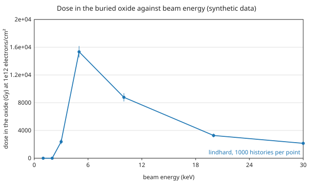

# Dose in a buried oxide

Electrons at normal incidence on a stack of two metal and dielectric pairs over
a 10 nm oxide on Si, with the beam energy swept from 1 to 30 keV. The input is
[`examples/electron/e_dose_buried_oxide.toml`](https://github.com/2AMLogic/lindhard/blob/main/examples/electron/e_dose_buried_oxide.toml):

```toml
{{#include ../../../examples/electron/e_dose_buried_oxide.toml}}
```

The `[electron.tally.dose]` table adds the dose in each layer per unit incident
fluence, a depth-dose profile with refined bins next to each interface, and the
electrons crossing each interface (see `docs/cli.md`, "Electron runs"). Run and
check one energy with

```sh
lindhard check examples/electron/e_dose_buried_oxide.toml
lindhard run examples/electron/e_dose_buried_oxide.toml --out out/e_dose_buried_oxide
```

## Synthetic data: read this first

**The electron data of this example are not those of any metal, dielectric,
oxide or Si.** Every material uses the same synthetic Drude-Lorentz plasmon as
its optical energy-loss function
([`examples/electron/synthetic_plasmon_elf.toml`](https://github.com/2AMLogic/lindhard/blob/main/examples/electron/synthetic_plasmon_elf.toml)),
the band parameters are round numbers, and the elastic potential is the
Thomas-Fermi stand-in
([`docs/data-provenance.md`](https://github.com/2AMLogic/lindhard/blob/main/docs/data-provenance.md)).
The result below shows what the dose tallies report for a stack. It is not
compared with any measurement and says nothing about a real stack.

## Result

One run per beam energy, 1000 histories each, seed 1 (see
`validation/gallery.py`). The dose is that in the oxide layer for a fluence of
10¹² electrons/cm², with the standard error of the mean. At 1 and 2 keV no
electron reaches the oxide through the 200 nm of layers in front of it in this
model, so the tally is exactly zero.



{{#include generated/dose_buried_oxide.md}}

## What is validated, and what is an illustration

- **Validated:** the bookkeeping, in the tests (`lindhard/tests/electron_dose.rs`):
  the per-layer energies, the depth-profile sums and the Cartesian grid agree to
  summation error for one seed, the dose is the layer energy over its areal
  mass, and the results are bit-identical across thread counts.
- **Illustration only:** every number in the figure and table. The comparison
  of depth-dose curves and of the interface enhancement with published
  measurements needs sourced optical data and is tracked in #557.
