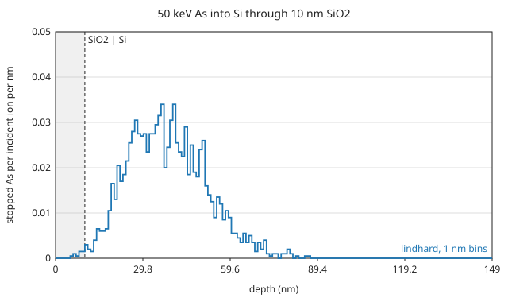
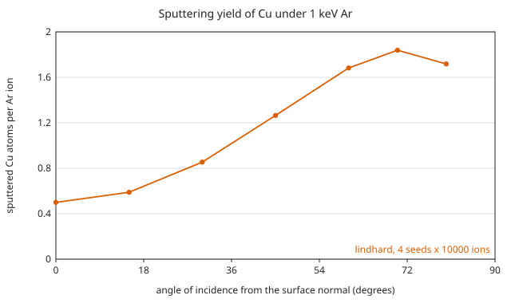
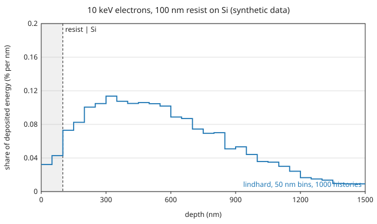
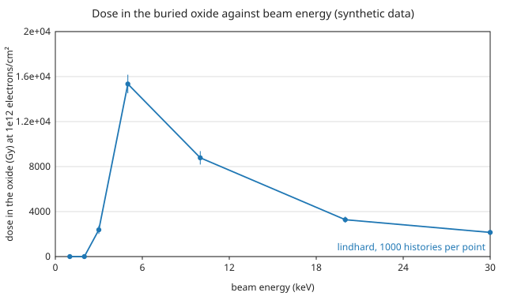

# Examples gallery

Four scenarios, each with a runnable input under
[`examples/`](https://github.com/2AMLogic/lindhard/tree/main/examples), the
command that runs it, and a figure and table of the result:

1. [Implant through a screen oxide](screen-oxide.md): 50 keV As into Si
   through 10 nm of SiO₂.
2. [Sputtering yield against incidence angle](sputtering-angle.md): 1 keV Ar
   on Cu, swept over the tilt.
3. [Electron deposition in a resist on Si](resist-on-si.md): 10 keV electrons
   into a 100 nm layer on Si, with **synthetic** electron data.
4. [Dose in a buried oxide](dose-buried-oxide.md): electrons of 1 to 30 keV
   on a metal and dielectric stack over a thin oxide, with **synthetic**
   electron data.

<div class="gallery-thumbs">
<a href="screen-oxide.html"><span>Implant through a screen oxide</span></a>
<a href="sputtering-angle.html"><span>Sputtering yield against incidence angle</span></a>
<a href="resist-on-si.html"><span>Electron deposition in a resist on Si</span></a>
<a href="dose-buried-oxide.html"><span>Dose in a buried oxide</span></a>
</div>

Every figure and table is generated from a run of the `lindhard` binary by one
committed script, [`validation/gallery.py`](https://github.com/2AMLogic/lindhard/blob/main/validation/gallery.py);
nothing is drawn by hand. From the root of the repository:

```sh
cargo build --release -p lindhard-cli
python3 validation/gallery.py --lindhard target/release/lindhard
```

The script takes about 20 seconds and rewrites the files under
`book/src/gallery/generated/`. Each page states its seeds and particle
counts. Results do not depend on the thread count; the trailing digits of a
table can differ between platforms.

Every page says what is validated and what is only an illustration. The
inputs are examples of how to use the engine. Their energies and the
`E_d` values are illustrative model parameters, not recommendations, and no
figure here is a validated prediction unless its page says which comparison
supports it (the comparisons are in
[`docs/validation.md`](https://github.com/2AMLogic/lindhard/blob/main/docs/validation.md)).
