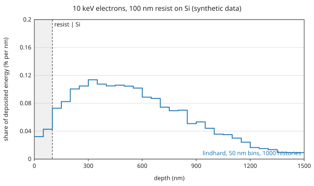

# Electron deposition in a resist on Si

10 keV electrons at normal incidence on a 100 nm resist layer over Si. The
input is
[`examples/electron/e_10keV_resist_on_si.toml`](https://github.com/2AMLogic/lindhard/blob/main/examples/electron/e_10keV_resist_on_si.toml):

```toml
{{#include ../../../examples/electron/e_10keV_resist_on_si.toml}}
```

It uses the `[electron]` table of an electron run
([TOML input reference](../guide/input.md)) with a layered `[target]`: a
`[[target.layers]]` entry in front of the `substrate`, and an
`[electron.materials.<name>]` table (optical ELF and band) for each of the two
materials. `Resist` is defined in `[materials]` by the composition and the
density of a PMMA-class polymer. Run and check it with

```sh
lindhard check examples/electron/e_10keV_resist_on_si.toml
lindhard run examples/electron/e_10keV_resist_on_si.toml --out out/e_10keV_resist_on_si
```

A run takes about ten seconds, mostly building the cross-section tables.

## Synthetic data: read this first

**The electron data of this example are not those of a resist or of Si.**
Both materials use the same synthetic Drude-Lorentz plasmon as their optical
energy-loss function
([`examples/electron/synthetic_plasmon_elf.toml`](https://github.com/2AMLogic/lindhard/blob/main/examples/electron/synthetic_plasmon_elf.toml)),
the band parameters are round numbers, and the elastic potential is the
Thomas-Fermi stand-in. No optical data of PMMA or any other resist is in the
repository: the source could not be opened
([`docs/data-provenance.md`](https://github.com/2AMLogic/lindhard/blob/main/docs/data-provenance.md),
the PMMA rows), and this example adds no dataset. The figure below shows what
an electron run reports for a layered target, not how a resist stack
behaves.

## Result

1000 histories, seed 1. The figure sums `electron_deposition_cylindrical.csv`
over the radial bins, in 50 nm depth bins, and divides by the total energy
deposited. The shaded band is the resist layer.



{{#include generated/resist_on_si.md}}

The library measures deposited energy from the band bottom of each layer, so
the total deposited includes the Fermi-sea energy of the conduction
electrons that secondaries liberate and exceeds the beam energy. This is why the
figure is a share of the total and the table lists the balance
`incident - escaped = deposited - Fermi-sea energy` (checked here:
`electron_summary.json`, `results.budget`; see
[Output files](../guide/output.md) and `docs/cli.md`). With the synthetic
12 eV conduction-band bottom of the Si the Fermi-sea term is large.

## What is validated, and what is an illustration

- **Validated:** only the energy bookkeeping of the run: the relative
  imbalance in the table is at the level of rounding. The transport
  comparisons in
  [`docs/validation.md`](https://github.com/2AMLogic/lindhard/blob/main/docs/validation.md)
  use their own cited data, not the synthetic data here, and say what they
  do and do not establish.
- **Illustration only:** every number in the figure and table. There is no
  validated resist point-spread function: the comparison with a measured one
  is a recorded gap (`docs/validation.md`, "Resist PSF vs a published
  measurement"). The grid is coarse (50 nm bins), the histories few, and the
  layer thickness, composition and density are illustrative.
