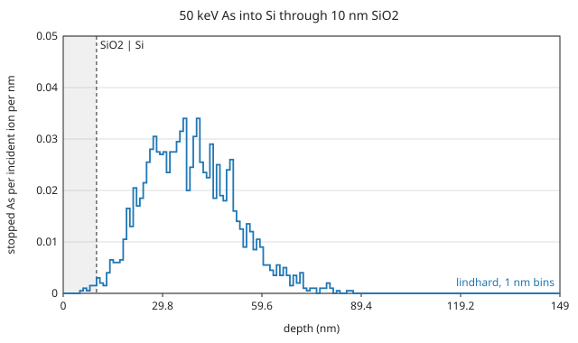

# Implant into Si through a screen oxide

50 keV arsenic into silicon at 7° off the surface normal, through a 10 nm
SiO₂ screen layer. The input is
[`examples/as_50keV_si_sio2.toml`](https://github.com/2AMLogic/lindhard/blob/main/examples/as_50keV_si_sio2.toml):

```toml
{{#include ../../../examples/as_50keV_si_sio2.toml}}
```

It shows a compound material with an explicit density, a finite layer over a
substrate, and per-element energy overrides (`[materials.SiO2]` and
`[physics.energies.Si]`). Run and check it with

```sh
lindhard check examples/as_50keV_si_sio2.toml
lindhard run examples/as_50keV_si_sio2.toml --out out/as_50keV_si_sio2
```

(or replace `lindhard` with `cargo run --release -p lindhard-cli --`). The run
takes a fraction of a second.

## Result

2000 histories, seed 1, 1 nm depth bins. The figure is `depth_profile.csv` of
that run: the stopped As per incident ion per nm, against depth from the
front face of the oxide. The shaded band is the screen layer.



{{#include generated/screen_oxide.md}}

Nearly all ions pass the oxide and stop in the Si, so the profile is the
bare-Si profile shifted by the oxide's own stopping, with the interface
visible as the edge of the shaded band. The statistical error of the moments
is the standard error in the table; 2000 histories is a coarse profile,
chosen to keep the page quick.

## What is validated, and what is an illustration

- **Validated:** the projected range of 50 keV As in **bare** amorphous Si
  against the Lindhard-Scharff-Schiøtt first-moment equation, on the ZBL
  potential and Lindhard-Scharff stopping used here
  ([`docs/validation.md`](https://github.com/2AMLogic/lindhard/blob/main/docs/validation.md),
  level 1, check `range.as50k_si.rp`). That is an internal consistency check
  against the theory the model implements, not a comparison with a
  measurement.
- **Illustration only:** the oxide layer, the `E_d` and `E_s` values
  (illustrative; the O energies have no defaults in the element table), the
  7° tilt and the sputtered-atom count. The amorphous target has no channeling
  tail; the crystalline variant
  ([`examples/as_50keV_sio2_on_si_crystal.toml`](https://github.com/2AMLogic/lindhard/blob/main/examples/as_50keV_sio2_on_si_crystal.toml))
  is likewise an input capability, not a validated channeling prediction.
  This page is not a validated prediction of a measured profile.
