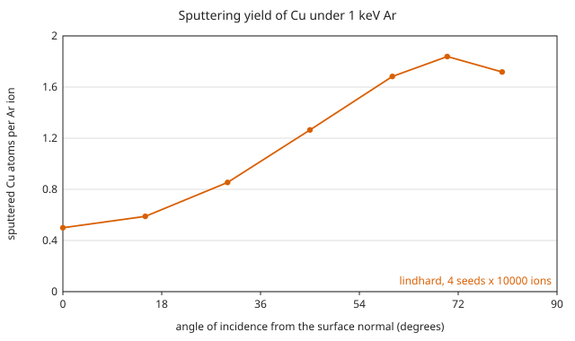

# Sputtering yield against incidence angle

The yield of Cu under 1 keV Ar as the beam is tilted away from the surface
normal. The base input is
[`examples/sputtering_ar_cu_angle.toml`](https://github.com/2AMLogic/lindhard/blob/main/examples/sputtering_ar_cu_angle.toml),
the physics of [`ar_1keV_cu.toml`](https://github.com/2AMLogic/lindhard/blob/main/examples/ar_1keV_cu.toml)
(KrC potential, Lindhard-Scharff stopping, `E_s` and `E_d` from the element
table) with a short depth grid and no escape or lateral tallies:

```toml
{{#include ../../../examples/sputtering_ar_cu_angle.toml}}
```

## The sweep

The CLI has no flag for the tilt, so the sweep needs one copy of the input
per angle that differs only in `beam.tilt_deg`. The generator writes them to a
scratch directory and runs each with `--seed`:

```sh
lindhard run examples/sputtering_ar_cu_angle.toml --out out/sputter_angle_0 --seed 1
```

is the run at 0°; `validation/gallery.py` does the same for 0°, 15°, 30°,
45°, 60°, 70° and 80°, and for seeds 1 to 4 at each (28 runs of 10 000 ions,
a fraction of a second each), then reads `results.sputtering.yield_per_ion`
from each `summary.json`. The mean over the four seeds is plotted; the error
bar is the standard error of that mean from the spread of the four seeds, so
it includes the correlation of atoms sputtered by one cascade.



{{#include generated/sputter_angle.md}}

Ions per run: 10 000; seeds: 1, 2, 3 and 4; every other setting as in the
input above.

## What is validated, and what is an illustration

- **Validated:** the normal-incidence (0°) yield of Ar on Cu is compared
  with the measured points of Matsunami et al. (1983) in
  [`docs/validation.md`](https://github.com/2AMLogic/lindhard/blob/main/docs/validation.md)
  ("Sputter yields: Ar → Si, Cu, Ag and Au"); read the deviations reported
  there before relying on the absolute scale.
- **Illustration only:** the angular dependence. No measured angle series is
  committed or compared here. The curve shows that the binary-collision
  model yields a rising, then falling, yield with a maximum at a grazing
  angle, which is the qualitative behaviour expected of sputtering; it does
  not establish the position or height of that maximum. The target is
  amorphous and its surface perfectly flat, with no roughness, which matters
  most at the grazing end of the sweep. This page is not a validated
  prediction.
