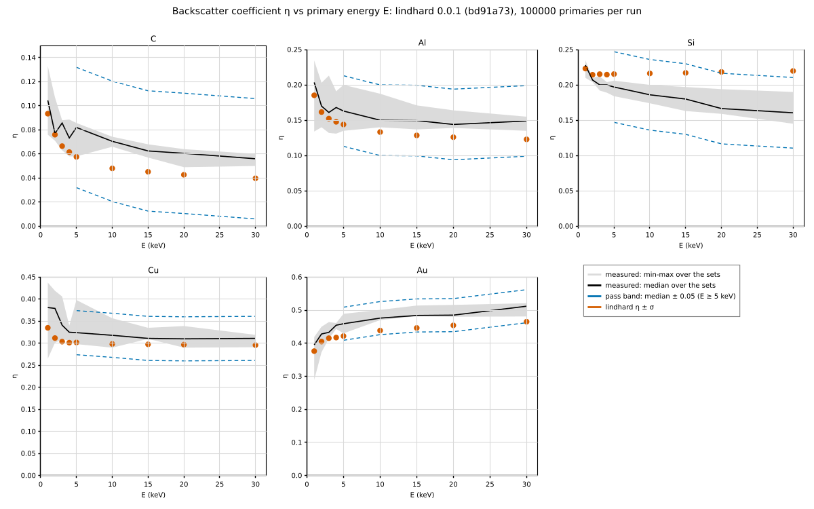

# Validation plan

A model counts as done only when it passes the checks below, at three levels.
Tolerances are the ones achieved and justified when each model was merged;
where a published reference turned out not to support a tolerance, the
deviation is reported (an `info` row, with the reason) rather than hidden by a
wider band.

Everything below is regenerated by one command:

```sh
validation/run.sh                 # level 1 (full statistics) + committed level-2/3 results
validation/run.sh --experiments   # also rerun the level-3 comparisons
validation/run.sh --oracles       # also rerun the configured level-2 oracles
```

The harness lives in [`../validation/`](../validation/README.md) and
[`../lindhard/tests/validation/`](../lindhard/tests/validation/main.rs).

## 1. Analytic and internal checks (CI, every PR)

`cargo test` runs the level-1 harness (`lindhard/tests/validation`, a
`harness = false` test target) with "quick" statistics. It prints one table
and fails the build if any check misses its tolerance. A check id (or part of
one) filters the reported rows:
`cargo test -p lindhard --test validation range.p50k`. A filter that matches
no id reports nothing and succeeds, as libtest does, since `cargo test <name>`
passes the filter to every test binary in the package.

What it covers:

- **Scattering (#3).** Nuclear stopping from the quadrature against the ZBL
  universal fit where the fit is accurate (`eps <= 0.3`, < 0.5 %), and
  against the exact impulse-approximation asymptote at high energy
  (`eps >= 1e3`, < 0.2 %); the magic formula against the quadrature; the
  Rutherford limit; the engine's angle-table interpolation error.
- **Stopping (#4).** Lindhard-Scharff reduced vs dimensional form, velocity
  proportionality, Oen-Robinson normalisation, Bragg additivity. These are
  identities; agreement of the stopping *magnitudes* with experiment is
  level 3.
- **Ranges (#5).** The engine's mean projected range, mean path length and
  their ratio against a deterministic solution of the LSS first-moment
  transport equation (Lindhard, Scharff and Schiott, Mat. Fys. Medd. 33 (14)
  (1963)) built from the *same* inputs (ZBL table, exact lab angles,
  `p <= p_max`, Lindhard-Scharff). Also the nuclear-stopping regime of the
  reduced range `rho(eps)` (Si into Si with no electronic loss). A negative
  control shows the comparison fails by a wide margin for a deflection bug.
  The `_weak3` rows repeat P 50 keV and the `rho(eps)` case with three weak
  collisions per step (#64), the equation then integrating `p` out to
  `p_max sqrt(4)`. This tests the transport, not whether the inputs match
  experiment.
- **Engine invariants (#5, #6).** Energy conservation per history over every
  code path (weak collisions included); the full `IonReport` byte-identical
  on 1, 2 and 8 threads, with and without weak collisions.
- **Damage (#6).** NRT steps and its 0.8 ratio to Kinchin-Pease, the
  Lindhard partition's self-ion forms and its high-energy limit; the
  full-cascade vacancy count against Kinchin-Pease in the nuclear-only limit
  (reported).
- **Cascade electronic share (#64).** The fraction of the energy kept in the
  target that a self-ion cascade (Cu and Si, 1 and 10 keV) gives to
  electrons, against a deterministic solution of the partition integral
  equation of Lindhard, Nielsen, Scharff and Thomsen, Mat. Fys. Medd. 33 (10)
  (1963), eq. (2.7), built from the engine's own inputs (ZBL table,
  Lindhard-Scharff, the 1 eV cutoffs). The solver is first checked against
  that paper's closed result for power-law scattering (p. 23). The engine
  runs with three weak collisions per step and surfaces that reflect
  everything, which for an amorphous medium is the infinite medium of the
  equation, except that a weak partner beyond the face is skipped (TRIDYN's
  surface test) where the mirror image would have one. The tolerance adds,
  to 3 SE and the solver error, three model terms computed or measured on
  the run: the weak rings' truncation and missing recoils (the equation
  solved with the engine's rings); the BCA's step conventions (each flight's
  electronic loss evaluated at the energy the step starts with, bracketed by
  the energy it ends with; loss charged below the cutoff; the primary's
  first flight); and a bound on what the surface test drops near the face
  (the weak transfers made within the outer ring radius of it). It is wide,
  but a negative control shows the engine without weak collisions misses it
  in every case.
- **Elastic cross sections vs published partial waves (#93, not yet
  active).** `sigma_el` and `sigma_tr1` for C, Si, Cu and Au at 1 and 10 keV
  against Jablonski, Salvat & Powell, J. Phys. Chem. Ref. Data 33, 409
  (2004), computed with the same DHFS potential and the exchange setting the
  reference states; tolerance 5 % at 1 keV and 2 % at 10 keV, and a failure
  records the measured gap rather than widening the band
  (`lindhard/tests/electron_elastic_reference.rs`). **No reference value is
  committed**: the paper's NIST reprint opens and was read in full, but it
  tabulates no `sigma_el` or `sigma_tr1` for these elements at these
  energies (its Tables 3 to 5 cover He and Hg at 50 and 100 eV and IMFPs; the
  cross sections appear only in figures, and those use H, Al, Ni, Ag, Au and
  Cm plus some gases, so C, Si and Cu are not even plotted and only Au
  overlaps), and the C, Si and Au DHFS
  coefficients are not in the tree (#130), so all eight cases are skipped and
  reported as skipped (`lindhard/tests/data/elastic_reference.toml`,
  provenance row). The harness reports `checked N of 16` and `INCOMPLETE`
  while values are absent (zero comparisons is never reported as a pass), an
  `--ignored` test fails until all 16 values are checked, and the fixture
  parser rejects malformed input (blank citation, non-positive or non-finite
  value, missing observable, duplicate or missing case, unknown setting such
  as an unsupported `correlation_polarization`, loosened tolerance). Nothing
  here has been validated yet: 0 of 16 values are checked.
- **Inelastic mean free paths vs TPP 2011 (#99).** Full Penn IMFPs of Al and
  Cu, built from the committed Hagemann optical ELFs (#98), and of Si, built
  from the Yang et al. (2019) ELF digitized in #125, with the Fermi
  energies of the reference, against Tanuma, Powell & Penn, Surf. Interface
  Anal. 43, 689 (2011), Table 4, at the rows nearest 100 eV, 1 keV and
  10 keV; tolerance 20 % near 100 eV and 10 % near 1 and 10 keV, pinned in
  `lindhard/tests/electron_imfp_tpp.rs` (fixture
  `lindhard/tests/data/imfp_tpp2011.toml`, provenance row). All nine cases
  pass; the table is under "Inelastic mean free paths vs TPP 2011" below.
- **Electrons (M1, not yet).** Elastic total cross sections from our
  partial-wave Mott solution against published Mott values at spot energies;
  the dielectric model's f-sum and perfect-screening sum rules.

### Results

The tolerance of a Monte Carlo row is three standard errors plus the
solver's discretisation uncertainty plus a stated systematic allowance, so it
tightens with the history count (`quick` in CI, `full` here). Values are
deterministic for a given platform; the last digits of Monte Carlo rows can
differ between platforms because `libm` differs.

<!-- validation:level1:begin -->

<!-- validation:level1:end -->

### Known deviations (reported, not asserted)

- **ZBL universal stopping fit, `0.3 < eps < 1e3`: up to +5.5 % (at
  `eps ~ 30`).** The fit's `eps > 30` branch is the high-energy asymptote
  with the screening constant `C` dropped, so it runs low by `C / ln eps`, and
  its `eps <= 30` branch joins it. The quadrature matches the exact
  asymptote to 0.1 % and is converged in between; two independent
  integrations confirmed the mid-range values (PR #40 review; the acceptance
  criterion of #3 was amended accordingly).
- **Rp of light ions in a semi-infinite target vs the infinite-medium
  equation.** B at 10 keV into Si: the engine's Rp is about 4 % above the
  equation because the few percent of ions that backscatter leave the target
  and drop out of the mean, while the equation keeps them at negative depth
  (PR #46 review). This is a difference of definitions, not of transport.
  Range comparisons with theory use heavier ions (P, As) where backscatter is
  below 1 %.
- **Range offsets against measurement are in the inputs.** Because the
  transport reproduces the LSS equation for the same inputs, any offset of a
  computed range from a measured one comes from the Lindhard-Scharff
  electronic and ZBL nuclear stopping, not from the engine (PR #46 review).
  For B in amorphous Si the defaults give Rp 24 to 36 % too long; level 3
  attributes this to both inputs, nuclear stopping dominating below about
  5 keV (see "Stopping-input attribution" in section 3; #51).
- **Sputter yield vs `E_d`.** Ar 1 keV on Si gives about 0.3 with
  `E_d` = 15 eV and about 0.5 with `E_d = E_s`: with the Biersack-Haggmark
  displacement criterion a transfer between `E_s` and `E_d` near the surface
  never moves, so it cannot sputter (PR #46 review). Set `E_d <= E_s` when
  low-energy yields matter (Eckstein 1991).
- **Cascade electronic share without weak collisions: about twice the
  partition.** With the default single collision per flight, the nuclear loss
  of impact parameters beyond `p_max` is dropped while the electronic loss of
  the flight is charged in full; at cascade-tail energies the disc keeps only
  about half of the nuclear stopping (45 % for Cu on Cu at 5 eV). A Cu
  self-ion cascade at 1 keV then gives about 0.79 of its energy to electrons,
  where the partition equation for the same inputs gives 0.38 (#64, #61).
  `physics.weak_collisions` (`ion::bca`, "Weak collisions") restores that
  loss and the share (0.35 with three), but it lowers sputter yields
  strongly (level 2), so the default is unchanged.
- **The partition for ZBL and Lindhard-Scharff is not Robinson's.** For the
  same cases, Robinson's fit (the `ion::damage` NRT partition, Thomas-Fermi
  cross section) gives an electronic share of 0.18 to 0.31, the integral
  equation with ZBL and LS 0.35 to 0.45. With ZBL, `S_e/S_n` rises again
  below about 100 eV, where the Thomas-Fermi cross section keeps it falling
  (LNST 1963, pp. 21 and 26), and a cascade's tail spends much of its
  electronic loss there. The level-1 check therefore compares with the
  equation for the engine's inputs and reports Robinson's values as context.
- **Cascade vacancies vs Kinchin-Pease** depend on the replacement rule and
  the cutoffs: about 0.86 of `E/(2 E_d)` with both cutoffs at `E_d` (the KP
  assumption), about 1.26 with a 1 eV recoil cutoff, where a displacer left
  below `E_d` moves on instead of filling the site it emptied. NRT's 0.8
  came from BCA calculations of this kind (Robinson and Torrens, Phys. Rev. B
  9 (1974) 5008).

### Inelastic mean free paths vs TPP 2011 (#99)

Ours: `FullPenn` (full Penn algorithm at every energy, integration tolerance
1e-3) on `validation/data/optical/{al,cu}_elf_hagemann1975.toml` and
`si_elf_yang2019.toml`, Fermi energy 11.2 eV (Al), 8.7 eV (Cu) and 12.5 eV
(Si) from TPP 2011 Table 1. TPP: Tanuma,
Powell & Penn, Surf. Interface Anal. 43, 689 (2011), doi:10.1002/sia.3522,
Table 4, read in the authors' original manuscript (NIMS MDR,
doi:10.48505/nims.3238; the published version was not reachable, so a value
changed in review would not show here). Table 4 is on a 10 % logarithmic
grid, so the rows used are 99.5, 992.3 and 9897.1 eV, and the model is
evaluated at exactly those energies. Relative difference is ours / TPP - 1.
Measured 2026-10-07 (Al, Cu) and 2026-10-09 (Si) by
`cargo test -p lindhard --test electron_imfp_tpp -- --nocapture`.

| Material | E (eV) | Ours (Å) | TPP (Å) | Relative difference | Tolerance | Result |
|---|---|---|---|---|---|---|
| Al | 99.5 | 4.28 | 4.56 | -6.2 % | 20 % | pass |
| Al | 992.3 | 19.76 | 21.2 | -6.8 % | 10 % | pass |
| Al | 9897.1 | 132.8 | 143.6 | -7.5 % | 10 % | pass |
| Cu | 99.5 | 5.16 | 5.00 | +3.1 % | 20 % | pass |
| Cu | 992.3 | 16.50 | 16.6 | -0.6 % | 10 % | pass |
| Cu | 9897.1 | 103.4 | 104.8 | -1.3 % | 10 % | pass |
| Si | 99.5 | 5.19 | 5.25 | -1.2 % | 20 % | pass |
| Si | 992.3 | 24.75 | 24.3 | +1.8 % | 10 % | pass |
| Si | 9897.1 | 170.1 | 164.2 | +3.6 % | 10 % | pass |

Reading the table (reported, not tuned):

- **Al runs about 7 % short at every energy.** This matches what is known
  about the input rather than the model: served with the linear
  interpolation of `OpticalElf::elf()`, the Al table overshoots the f-sum by
  13.8 % (N_eff 14.79 for Z = 13) and the perfect-screening sum by 9.4 %
  (`lindhard/tests/optical_sumrule.rs`), and a larger ELF gives a shorter
  IMFP. TPP 2011 report an f-sum error of +0.9 % for their Al ELF (Table 3).
  The gap is inside the tolerance at all three energies but uses three
  quarters of it at 10 keV; a denser or power-law-served Al table is the
  expected fix, not a change to the model.
- **Cu agrees to 1 % at 1 and 10 keV and 3 % at 100 eV.** Its served ELF
  overshoots the f-sum by 7.3 %, but the whole excess of the linear over the
  power-law reading lies above 100 eV, across the L and K edges
  (`optical_sumrule.rs`), and its perfect-screening sum is 1.002. TPP 2011
  used the same Hagemann measurement for 1-95 eV and Henke et al. above
  102 eV (their Table 2), f-sum error -1.5 % (their Table 3). Why the
  inner-shell excess moves the IMFP so little was not isolated.
- **Algorithm.** TPP 2011 used the full Penn algorithm up to 300 eV and the
  single-pole approximation from 330 eV, and report the two differ by
  < 0.2 % at 300 eV (graphite); ours is full Penn throughout, and our own
  full / single-pole IMFP ratio on a synthetic Drude ELF is 1.002 at 1 keV
  (`full_penn` module docs). Our full Penn procedure is our reading of
  Shinotsuka et al. (2017), not Penn's formulae, and is least constrained
  below 200 eV, where TPP 2011 also expect larger uncertainties; the 100 eV
  rows here do not show a larger gap than the others.
- **Si agrees to 1 % at 100 eV and is 2 to 4 % long at 1 and 10 keV.** Our
  input is the ELF of Yang et al. (2019), digitized (#125): it comes from
  REELS inverted through the full Penn algorithm, not from optical
  measurements, and it ends at 199 eV, so the L-shell tail and the K shell
  contribute no losses here; a missing loss channel can only lengthen the
  IMFP, which is the sign seen at 1 and 10 keV. Its perfect-screening sum is
  within 0.1 % of the nonconductor target and its N_eff is 7.66 of 14 (the
  truncation; `optical_sumrule.rs`). TPP 2011 took Si from Palik's handbook
  to 2 keV and Henke et al. above (their Table 2). How much of the gap is the
  missing tail and how much the different source was not separated.

### Cu: the Mermin IMFP and the default oscillator fit (#300)

The `mermin-melf` IMFP of Cu is 15 to 41 % longer than TPP 2011 and 18 to
34 % longer than the single-pole model on the same table, while full Penn and single pole
agree with TPP (table above). The cause is the **default oscillator fit**
(`MerminFitOptions::default()`: 3 oscillators, relative weighting with
floor `1e-2 max ELF`), not the Mermin dielectric function or the momentum
integral. Model Fermi energy 0 throughout, as in the δ(E) runs; ELF
`validation/data/optical/cu_elf_hagemann1975.toml`; TPP 2011 Table 4
(continued), column Cu, manuscript p. 41 (copy and citation as above).
Outputs of this code, measured 2026-10-09 in a release build; the five
energies are pinned (to 0.5 %) in `lindhard/tests/mermin_inelastic.rs`
(`cu_*` tests, run with `--nocapture` for the table). Nothing was tuned.

| E (eV) | TPP (Å) | Mermin, default fit (Å) | single pole, table (Å) | single pole, fitted ELF (Å) | single pole fitted / table | Mermin / single pole, both on the fitted ELF |
|---|---|---|---|---|---|---|
| 54.6 | 4.94 | 6.967 (+41.0 %) | 5.186 (+5.0 %) | 9.286 | 1.791 | 0.750 |
| 99.5 | 5.00 | 6.282 (+25.6 %) | 5.065 (+1.3 %) | 7.533 | 1.487 | 0.834 |
| 200.3 | 6.29 | 7.430 (+18.1 %) | 6.285 (-0.1 %) | 8.504 | 1.353 | 0.874 |
| 492.7 | 10.3 | 11.807 (+14.6 %) | 10.021 (-2.7 %) | 12.869 | 1.284 | 0.917 |
| 992.3 | 16.6 | 19.213 (+15.7 %) | 16.164 (-2.6 %) | 20.606 | 1.275 | 0.932 |

"Fitted ELF" is the Drude-Lorentz sum of the fitted oscillators (the `q = 0`
loss function of the Mermin model) sampled at 4000 log-spaced points over
the table's range. The Mermin / table single-pole ratio factors exactly into
the last two columns, so:

- **The fit loses loss strength.** The single-pole model on the fitted ELF
  is 28 to 79 % longer than on the table. The fit report: f-sum
  `(π/2) Σ A_j` = 3243 eV² against the table's 5721 eV² (0.567);
  `P_eff = Σ A_j/(ħω_j)²` = 0.670 against 1.0017 (the table of a metal
  satisfies perfect screening); weighted rms 0.403; 99 iterations,
  converged. Of the missing 0.33 of `P_eff`, 0.29 is below 20 eV (`P_eff`
  below 20 eV: table 0.535, fit 0.243): three Drude-Lorentz terms
  (8.8, 28.6 and 86.6 eV) cannot follow the 4 to 20 eV structure, where
  the fitted ELF is a quarter to a half of the table (at 15 eV 0.20 against
  0.62). That the short-fall matters most at 54.6 eV is consistent with
  the `1/ω` weight of the low losses (not measured separately).
- **The Mermin extension shortens, not lengthens.** On the same fitted ELF
  the Mermin IMFP is 7 to 25 % *shorter* than the single-pole one, the
  sign of the synthetic Drude comparison in the `mermin` module docs
  (Mermin / single-pole `1/λ` 1.02 at 1 keV). So neither the momentum
  integral (limits `q- = k - s = 2ω/(k + s)`, `q+ = k + s`) nor the Mermin function
  produces the excess; both are tested against their limits and the f-sum
  rule in `mermin.rs`.
- **The Fermi energy** (0 against TPP's 8.7 eV) moves the Mermin column by
  at most 2 % (#242 note below).

The published method is checked against the sum rules: de Vera et al.,
Int. J. Mol. Sci. 23, 6121 (2022), doi:10.3390/ijms23116121 (PMC9181504,
opened 2026-10-09), section 2.1.1, after eq. (5): "The consistency of the
fitting procedure is checked by fulfilling the Kramers–Kronig and f-sum
rules". The default fit of Cu does not pass that check. The same section
fits Mermin oscillators to the *outer-shell* ELF only (eqs. (1), (3)) and
describes the inner shells by atomic GOS (eq. (2)); lindhard fits the whole
table, inner-shell edges included, with Mermin oscillators. So the excess is
a property of our default fit, not the published behaviour of the MELF-GOS
method.

**Oscillator count** (same weighting and default start; a sensitivity probe,
not a choice; the count is not picked by matching TPP):

| Oscillators | f-sum fit / table | `P_eff` fit | Mermin IMFP at 54.6 / 99.5 / 200.3 / 492.7 / 992.3 eV (Å) | Mermin / TPP - 1 |
|---|---|---|---|---|
| 3 (default) | 0.567 | 0.670 | 6.967 / 6.282 / 7.430 / 11.807 / 19.213 | +41 / +26 / +18 / +15 / +16 % |
| 6 | 0.807 | 0.752 | 6.002 / 5.731 / 6.974 / 11.274 / 18.466 | +22 / +15 / +11 / +9 / +11 % |
| 10 | 187.9 (unconverged; #311) | 0.754 | 5.973 / 5.700 / 6.926 / 11.172 / 18.200 | +21 / +14 / +10 / +8 / +10 % |
| 16 | 105.8 (unconverged; #311) | 0.792 | 6.022 / 5.719 / 6.861 / 10.893 / 17.663 | +22 / +14 / +9 / +6 / +6 % |

From 3 to 6 oscillators the fit gains loss strength and the gap halves at
every energy; the 10- and 16-oscillator IMFPs are within 5 % of the
6-oscillator ones. The 10 and 16 rows are with the width floor of #307:
each width is at least the local knot spacing of the table (our choice,
documented on `fit_mermin_oscillators`), enforced on the fitted parameters.
Without it those two fits placed an oscillator of width 1e-4 eV and
amplitude 2e7 to 6e7 eV² between two knots near 1.1 keV, where the
residuals at the knots cannot see it, with f-sum 6771 and 16467 times the
table's, `P_eff` 22.7 and 46.4, and IMFPs of 3.70 to 0.41 Å. The floor
removes that oscillator. **The f-sum of these two fits is still not
bounded:** each carries a very wide oscillator (A = 6.8e5 and 3.8e5 eV², E =
9.7 and 7.8 keV, width 8.3e5 and 4.4e5 eV) whose weight lies mostly above
the table. Under the default relative weighting `1/(ELF + 0.01 max ELF)`
it changes the weighted residual by only about 1e-3, and it makes the
f-sum 188 and 106 times the table's. Both fits stop unconverged after 500
iterations. The IMFPs above barely depend on that tail, but they are not
results of a fit that passes the sum-rule check; the weighting options
below were measured for it (#311). Of the default 3-oscillator fits of the
committed ELFs, only C is touched by the floor: its start width (0.05 eV
at 0.2 eV) is raised to the 0.1 eV knot spacing, and the fit ends within
about 1e-7 of the fit without the floor. Al, Au, Cu and Si, and Cu with
6 oscillators, are bitwise unchanged.

Not changed here: `MerminFitOptions::default()`, and so every `mermin`
table and δ(E) row. Whether to change the default, expose the fit options
in the input, or reject a fit that misses the sum rules is #306.

**Weighting options and the wide oscillator (#311).** Since #306 the fit
options are set per material in the input
(`[electron.materials.<name>.mermin_fit]`, [`cli.md`](cli.md)); the default
stays 3 oscillators, `relative` with `relative_floor = 0.01`. The same Cu
ELF, default start, 500-iteration cap, width floor of #307, with
`relative_floor` in the set {1e-3, 1e-2, 1e-1, 1} (fixed before measuring;
1e-2 is the default) and with `uniform`. "Widest" is the widest oscillator
with a nonzero amplitude (zero-amplitude oscillators carry nothing); f-sum
table 5721 eV², `P_eff` table 1.0017. Model Fermi energy 0, as above.
Outputs of this code, measured 2026-10-10 in a release build (aarch64
macOS), one fit at a time; each fit takes under 4 s. Nothing was tuned
and no option was chosen by matching TPP.

| n | weighting | converged (iterations) | widest: A (eV²), E (eV), γ (eV) | f-sum fit / table | `P_eff` fit | Mermin IMFP at 54.6 / 99.5 / 200.3 / 492.7 / 992.3 eV (Å) |
|---|---|---|---|---|---|---|
| 3 | relative 1e-3 | no (500) | 1.85e3, 94.6, 109 | 0.564 | 0.480 | 11.094 / 9.137 / 9.907 / 14.592 / 23.189 |
| 3 | relative 1e-2 (default) | yes (99) | 1.79e3, 86.6, 115 | 0.567 | 0.670 | 6.967 / 6.282 / 7.430 / 11.807 / 19.213 |
| 3 | relative 1e-1 | yes (198) | 2.23e3, 89.4, 161 | 0.716 | 0.967 | 4.182 / 4.363 / 5.590 / 9.325 / 15.340 |
| 3 | relative 1 | yes (31) | 1.92e3, 101.6, 147 | 0.688 | 1.032 | 3.777 / 4.119 / 5.397 / 9.056 / 14.940 |
| 3 | uniform | no (500) | 2.20e3, 100.5, 165 | 0.748 | 1.046 | 3.780 / 4.090 / 5.333 / 8.927 / 14.686 |
| 10 | relative 1e-3 | no (500) | 682, 1190, 414 | 0.713 | 0.529 | 9.821 / 8.639 / 9.489 / 14.151 / 22.612 |
| 10 | relative 1e-2 (default) | no (500) | 6.83e5, 9696, 8.26e5 | 187.9 | 0.754 | 5.973 / 5.700 / 6.926 / 11.172 / 18.200 |
| 10 | relative 1e-1 | yes (57) | 426, 1107, 245 | 0.794 | 0.981 | 4.292 / 4.412 / 5.622 / 9.371 / 15.430 |
| 10 | relative 1 | yes (45) | 312, 1123, 187 | 0.869 | 1.029 | 3.912 / 4.065 / 5.254 / 8.872 / 14.632 |
| 10 | uniform | yes (252) | 1.47e8, 1.95e4, 8.93e6 | 4.03e4 | 1.088 | 3.232 / 3.173 / 3.819 / 5.767 / 8.608 |
| 16 | relative 1e-3 | no (500) | 1.12e5, 6346, 2.91e5 | 31.3 | 0.639 | 7.913 / 7.033 / 8.052 / 12.357 / 19.890 |
| 16 | relative 1e-2 (default) | no (500) | 3.83e5, 7756, 4.41e5 | 105.8 | 0.792 | 6.022 / 5.719 / 6.861 / 10.893 / 17.663 |
| 16 | relative 1e-1 | no (500) | 6.34e5, 9724, 5.63e5 | 174.8 | 0.988 | 4.553 / 4.677 / 5.933 / 9.625 / 15.634 |
| 16 | relative 1 | yes (494) | 9.76e36, 4.83e13, 8.81e8 | 2.7e33 | 4.2e9 | 4.231 / 4.406 / 5.666 / 9.381 / 15.379 |
| 16 | uniform | yes (93) | 1.43e6, 1.70e4, 1.95e6 | 392 | 1.032 | 4.181 / 4.349 / 5.566 / 9.200 / 15.065 |

The default rows (n = 3, 10 and 16 at 1e-2) equal the values above,
digit for digit. What the table shows:

- **At n = 10, `relative_floor` 1e-1 and 1 avoid the wide oscillator**:
  both converge, the widest oscillator with weight is a few hundred eV wide
  near the 1.1 keV edge, and the f-sum is 0.79 and 0.87 of the table's with
  `P_eff` 0.98 and 1.03. 1e-3 also avoids it but does not converge and
  keeps only 0.53 of `P_eff`. `uniform` is far worse than the default
  (4e4 times the table's f-sum).
- **At n = 16, no option measured avoids it**: every row carries an
  oscillator of width 3e5 to 9e8 eV, far above the table's top knot
  (5.0e4 eV), with 31 to 2.7e33 times the table's f-sum. `relative_floor = 1`
  puts one at E = 4.8e13 eV and reports `converged = true`.
- **`converged` does not mean the sum rules hold**: two of the converged
  rows (n = 10 uniform, n = 16 at 1) are the worst. Only the f-sum and
  `P_eff` of the report against the table's tell a sound fit from these.
- **The IMFP is no check of the fit**: the n = 16, `relative_floor = 1`
  row, whose wide oscillator sits at 4.8e13 eV, has IMFPs within 3 % of
  the n = 16 `uniform` row. The IMFP columns move mostly with the
  weighting (by up to a factor 3 at 54.6 eV across one n), not with whether
  a wide oscillator is present. At n = 3 a larger floor brings the f-sum to
  0.69 to 0.72 and `P_eff` to 0.97 to 1.03, without a wide oscillator.
- **Every wide oscillator found has γ above the table's top knot**, and no
  oscillator with weight in any other row does (the widest is 414 eV). An
  upper bound on γ from the knots would exclude all of them; the fit then
  moves the excess elsewhere and the f-sum stays unbounded (#337, below).

The table is not pinned in a test: ten of the fifteen fits stop at the
iteration cap or converge to parameters far outside the table, where the
Levenberg-Marquardt path depends on the last bits of `exp`/`ln`, which may
differ between the platforms CI runs (x86-64 and aarch64 Linux, macOS).
The default 3-oscillator fit is pinned (`cu_*` tests above). To reproduce a
row, fit the committed table with `fit_mermin_oscillators` and
`MerminFitOptions { n_oscillators, weighting, ..Default::default() }`
(e.g. `FitWeighting::Relative { floor: 0.1 }`), print the `MerminFit`
fields above and the `MerminPenn::new(elf, fit)` IMFPs, or run `lindhard`
with `model = "mermin-melf"` and a `mermin_fit` table such as
`{ oscillators = 10, weighting = "relative", relative_floor = 0.1 }`.

**An upper bound on the width (#337): measured, not adopted.** The
candidate, fixed before measuring, was a bound that is a pure function of
the knots: `ħγ_j <= E_max`, the table's top knot (Cu: 4.9994e4 eV),
enforced like the #307 floor (stored `ln γ_j` lowered to `ln E_max` at the
start and after every accepted step, and the width capped in every
residual evaluation; where cap and floor cross, the floor wins). The
decision rule, also fixed before measuring, was to adopt it only if (1)
each of the seven pathological fits of the #311 table becomes sane, with
f-sum fit / table in 0.56 to 0.87 and `P_eff` in 0.48 to 1.05 (the ranges of
its eight sound rows) and no oscillator with weight wider than the bound,
and (2) the default 3-oscillator fit of every committed ELF in
`validation/data/optical/` is bitwise unchanged. The fifteen fits again,
with the cap and otherwise as above (measured 2026-10-10, release build,
aarch64 macOS, one fit at a time, each under 3 s; the cap was a temporary
code change, not committed):

| n | weighting | converged (iterations) | widest: A (eV²), E (eV), γ (eV) | f-sum fit / table | `P_eff` fit | Mermin IMFP at 54.6 / 99.5 / 200.3 / 492.7 / 992.3 eV (Å) |
|---|---|---|---|---|---|---|
| 3 | relative 1e-3 | no (500) | 1.85e3, 94.6, 109 | 0.564 | 0.480 | 11.094 / 9.137 / 9.907 / 14.592 / 23.189 |
| 3 | relative 1e-2 (default) | yes (99) | 1.79e3, 86.6, 115 | 0.567 | 0.670 | 6.967 / 6.282 / 7.430 / 11.807 / 19.213 |
| 3 | relative 1e-1 | yes (198) | 2.23e3, 89.4, 161 | 0.716 | 0.967 | 4.182 / 4.363 / 5.590 / 9.325 / 15.340 |
| 3 | relative 1 | yes (31) | 1.92e3, 101.6, 147 | 0.688 | 1.032 | 3.777 / 4.119 / 5.397 / 9.056 / 14.940 |
| 3 | uniform | no (500) | 2.20e3, 100.5, 165 | 0.747 | 1.046 | 3.780 / 4.090 / 5.333 / 8.927 / 14.686 |
| 10 | relative 1e-3 | no (500) | 695, 1192, 422 | 0.738 | 0.617 | 8.204 / 7.239 / 8.246 / 12.572 / 20.201 |
| 10 | relative 1e-2 (default) | no (500) | 820, 199.9, 434 | 0.759 | 0.756 | 5.990 / 5.723 / 6.969 / 11.219 / 18.245 |
| 10 | relative 1e-1 | no (500) | 2.13e3, 86.7, 148 | 0.778 | 0.981 | 4.292 / 4.412 / 5.622 / 9.371 / 15.430 |
| 10 | relative 1 | yes (45) | 312, 1123, 187 | 0.869 | 1.029 | 3.912 / 4.065 / 5.254 / 8.872 / 14.632 |
| 10 | uniform | yes (46) | 1.64e15, 1.83e7, 2.00e4 | 4.5e11 | 5.96 | 3.798 / 3.973 / 5.181 / 8.829 / 14.624 |
| 16 | relative 1e-3 | no (500) | 452, 1132, 248 | 0.741 | 0.638 | 8.020 / 7.203 / 8.297 / 12.693 / 20.148 |
| 16 | relative 1e-2 (default) | no (500) | 2.50e4, 1987, 2.90e4 | 7.40 | 0.792 | 6.026 / 5.725 / 6.878 / 10.941 / 17.768 |
| 16 | relative 1e-1 | no (500) | 1.81e4, 1637, 1.64e4 | 5.53 | 0.988 | 4.554 / 4.681 / 5.947 / 9.678 / 15.759 |
| 16 | relative 1 | no (500) | 1.08e4, 1187, 1.08e4 | 3.56 | 1.026 | 4.218 / 4.381 / 5.609 / 9.284 / 15.216 |
| 16 | uniform | yes (84) | 3.18e26, 8.10e9, 2.00e4 | 8.7e22 | 4.9e6 | 4.188 / 4.362 / 5.598 / 9.249 / 14.882 |

- **Condition (2) holds**: the default 3-oscillator fits of Al, Au (both
  tables), C, Cu and Si are bitwise identical with and without the cap
  (amplitudes, energies, widths, weighted rms, iterations); their widest
  oscillator is 115 eV (Cu) against a top knot of 199 eV (Si) to 1.5e5 eV
  (Au). The five n = 3 rows above are the uncapped fits, bit for bit.
- **Condition (1) fails**: of the seven pathological rows only two become
  sane, n = 10 at 1e-2 (f-sum 0.759, `P_eff` 0.756) and n = 16 at 1e-3
  (0.741, 0.638). The other five still exceed the table's f-sum by 3.6 to
  8.7e22 times. At n = 16 with `relative` 1e-2, 1e-1 and 1 the excess sits
  in an oscillator of width 1e4 to 3e4 eV, below the cap, near 1.2 to
  2 keV. With `uniform` (n = 10 and 16) it moves into the energy: an
  oscillator at E = 1.8e7 and 8.1e9 eV, far above the table, with its width
  on the #307 floor of the top knot (2.0e4 eV), and `converged = true`.
- **The cap also changes sound fits**: n = 10 at 1e-1 no longer converges
  (500 iterations instead of 57; f-sum 0.778 instead of 0.794), and n = 10
  at 1e-3 moves (f-sum 0.738, `P_eff` 0.617, instead of 0.713 and 0.529).
  n = 10 at 1 matches its #311 row to the digits shown; its zero-amplitude
  oscillator, of width 1.1e5 eV without the cap, sits on the cap.

So a width cap alone does not bound the f-sum of these fits, and it was not
added; `fit_mermin_oscillators` and `MerminFitOptions::default()` are
unchanged. Other bounds (on the energy `ħω_j`, or a sum-rule term in the
cost) were not measured here. The f-sum and `P_eff` of the report against
the table's remain the check of a fit. (The n = 3 `uniform` f-sum ratio is
0.74746; the #311 table above shows it as 0.748.)

## 2. Code-to-code oracles (local harness, summaries committed)

Programs are run unmodified on matched problems, under the rules in
[`../CONTRIBUTING.md`](../CONTRIBUTING.md) §Oracles:

| Oracle | Compared on |
|---|---|
| RustBCA | Amorphous ranges, sputter yields, reflection coefficients, ions/s |
| OpenTRIM | Ranges, damage profiles, ions/s |
| iradina / IM3D | 3D geometry cases (M3) |
| SRIM (via Wine, local only) | Range moments only, as a familiarity check; never a fixture |
| Nebula | Electron PSFs, SE/BSE yields (M1) |
| Geant4 MicroElec | Electron energy deposition in Si/SiO₂ (M1) |
| PENELOPE / penEasy | Electron depth–dose above ~1 keV (M1) |

### Running the oracles

The matched problems are in
[`../validation/oracles/problems.json`](../validation/oracles/problems.json):
B 5 keV and As 50 keV into Si for ranges, and Ar 1 keV onto Cu for
sputtering, once with the problem's `E_d` (30 eV, the Cu default), once
with `E_d = E_s` (`ar_1keV_cu_ed_es`), which isolates the displacement
criterion, and once more with three weak collisions per step on both sides
(`ar_1keV_cu_ed_es_weak3`: lindhard's `weak_collisions`, RustBCA's documented
`weak_collision_order`; OpenTRIM has no matched option, recorded as a
mismatch). Install the oracles yourself, **outside this tree**, and point the
runner at them:

```sh
RUSTBCA_BIN=/path/to/RustBCA RUSTBCA_SRC=/path/to/rustbca-clone \
OPENTRIM_BIN=/path/to/opentrim OPENTRIM_SRC=/path/to/opentrim-clone \
  validation/oracles/run.py
validation/oracles/run.py --lindhard-only     # the lindhard side alone
```

`*_SRC` (optional) is the git clone each binary was built from; the runner
records its `git describe` and commit. `*_BUILD` (optional) describes the
build (compiler, profile) for the summary. OpenTRIM's HDF5 output is read
with `h5dump` from the HDF5 tools (`H5DUMP_BIN`, default on `PATH`), so the
harness stays standard-library Python. Each code is also timed at five times
the ion count (`--timing-factor`), which gives a throughput with fixed setup
costs removed.

An oracle that is not configured is skipped and the script still succeeds;
CI never needs one. Raw oracle output and the input files written for the
oracles go to the gitignored `validation/oracle-runs/`. Only our scalar
summary of each comparison is written to `validation/oracles/summaries/`
(format in its [README](../validation/oracles/summaries/README.md)), and
only those are committed.

How each adapter was written, under the licence tiers of
[`../CONTRIBUTING.md`](../CONTRIBUTING.md):

- **RustBCA** (GPL-3.0, Tier B). Built from its public repository with
  `cargo build --release` into a directory outside this tree. Its source,
  example inputs and fixtures were never opened. The input writer uses only
  the keys documented on the wiki page "Standalone Code: Input File", and the
  output parser the formats on "Standalone Code: Output Files"; each is cited
  at the adapter.
- **OpenTRIM** (MIT, Tier A). Built from its public repository (CLI only,
  GUI off). Its electronic stopping choices are `SRIM96`, `SRIM13` (SRIM
  tables, Tier C) and `DPASS` (Tier C), or `Off`. None is a published formula
  we can match and none of the tables may be used, so OpenTRIM runs with
  electronic stopping **off**. lindhard's CLI cannot switch electronic loss
  off, so OpenTRIM's range comparisons are **not like-for-like**. They are
  kept as a check of the setup, and for speed.

**Status:** both adapters are in place, and the first summaries were run
locally on 2026-10-05 against RustBCA v3.0.0-17-ga356280 (commit `a356280`)
and OpenTRIM 1.2.0 (commit `6b12392`).

### Reading the level-2 table

lindhard is not tuned to match any oracle. Differences beyond statistics are
explained here, or recorded as unexplained:

- **RustBCA, ranges (like-for-like).** ZBL, Lindhard-Scharff (nonlocal),
  constant free path `n^(-1/3)` and the same cutoffs and masses on both
  sides. Rp, ΔRp and backscatter agree within statistics: Rp +0.2 % (B) and
  +0.6 % (As, 1.7σ), ΔRp within 0.4 %, B backscatter 5.5 % vs 5.7 %
  (0.7σ). The residual mismatches (impact-parameter limit and first-flight
  convention, which RustBCA does not document, and per-collision quadrature
  vs our table) are listed in each summary.
- **RustBCA, Ar → Cu sputtering: not comparable as configured.** RustBCA's
  results are bit-identical with `E_d` = 30 eV and with `E_d = E_s`, so its
  `Ed` does not act as a displacement threshold. Its input page describes
  `Ed` as a filter of the displacement output. lindhard uses `E_d` as the
  displacement criterion, which suppresses low-energy sputtering (see
  "Sputter yield vs `E_d`" above). With `E_d = E_s`, lindhard's yield rises
  from 0.47 to 1.93, but RustBCA's is 4.17: a factor of 2.2 that remains
  **unexplained**. It is not a statistical effect. It is consistent with
  RustBCA setting atoms in motion below any threshold we can match, plus
  surface-barrier details its documentation does not give. Ar backscatter
  is 8.8 % (lindhard) vs 10.8 % (RustBCA), 6.6σ, also **unexplained**.
  Candidates are the impact-parameter limit and first-flight conventions at
  1 keV. Neither is tuned away.
- **RustBCA, Ar → Cu with weak collisions (#64).** The #61 investigation
  (summary below the table) suspected that much of the factor 2.2 comes from
  lindhard's electronic share of the
  cascade, which is about twice the partition for its own inputs because the
  nuclear loss beyond `p_max` is dropped (level 1, "Known deviations").
  Restoring that loss with TRIDYN's weak collisions does not close the gap,
  it widens it: with three per step, lindhard's electronic loss per ion falls
  from 624 to 340 eV but its yield falls from 1.93 to 0.88, because at a few
  eV the weak transfers, which stay in the lattice, take most of a slow
  atom's energy. That figure includes TRIDYN's surface test (a weak partner
  that would lie outside the target is skipped); without it the yield would
  be 0.66, since near the surface many weak partners lie in vacuum. Each
  weak collision uses the energy left after the previous one, a documented
  deviation from TRIDYN (`ion::bca`, "Weak collisions"); evaluating the weak
  collisions, or every collision, at the step's starting energy instead
  gives 0.875 or 0.976, each with a clamp the report does not give. RustBCA's yield with its
  `weak_collision_order = 3` rises instead, from 4.17 to 5.15. Its manual
  places the partners in the same annuli but does not say whether they
  recoil, which energy they use or whether partners outside the target are
  skipped; TRIDYN's report says only the hard collision makes a recoil. The
  two codes' weak collisions are therefore not the same model, and the yield
  gap (factor 5.8 with weak collisions, 2.2 without) remains
  **unexplained**. Backscatter: lindhard 8.8 % to 8.4 %, RustBCA 10.8 % to
  10.5 %.
- **OpenTRIM, ranges: stopping mismatch.** With no electronic loss,
  OpenTRIM's ranges are longer, as they must be: lindhard's Rp is 21 % (B)
  and 10 % (As) shorter. This says nothing about either code's transport.
  A like-for-like run needs an electronic-loss-off option in lindhard's CLI
  (#58).
- **OpenTRIM, Ar → Cu backscatter.** OpenTRIM reflects 6.1 % against
  lindhard's 8.8 %. This is not the stopping mismatch: in a one-off local
  check with electronic loss off in both oracles (RustBCA through its
  documented `electronic_stopping_correction_factor = 0`), RustBCA reflected
  12.0 % and OpenTRIM 6.1 %. OpenTRIM's low-energy reflection differs from
  both other codes for a reason we have not identified. OpenTRIM 1.2 stores
  `Es` but applies no surface barrier (its `TODO.md`: "Handle surface
  effects"), so its sputter yield is not compared.
- **Speed.** Every code runs on all logical CPUs. *End-to-end* includes
  setup: lindhard builds its scattering table (about 0.2 s) and RustBCA
  writes its particle lists. At 20 000 ions this dominates lindhard's time.
  *Marginal* (`(N2 - N1)/(t2 - t1)` between 20 000 and 100 000 ions) is the
  throughput #9 needs. Two caveats. On the cascade problems the codes do
  different amounts of work, since RustBCA follows far more recoils (see
  above). And the host's load average at the start of the run is recorded
  in each summary: these first numbers were taken while other builds shared
  the machine, so treat them as indicative.

<!-- validation:level2:begin -->
| Problem | Oracle (version, commit) | Rp | ΔRp | Backscatter (abs.) | Sputter yield | Speed ratio (end-to-end) | Speed ratio (marginal) | Date |
|---|---|---|---|---|---|---|---|---|
| `ar_1keV_cu` | OpenTRIM (1.2.0 (v1.1.6-84-g6b12392), 6b12392) | - | - | +0.0267 (10.2σ) | - | 0.64x | 2.12x | 2026-10-05 |
| `ar_1keV_cu_ed_es` | OpenTRIM (1.2.0 (v1.1.6-84-g6b12392), 6b12392) | - | - | +0.0278 (10.6σ) | - | 0.90x | 1.06x | 2026-10-05 |
| `ar_1keV_cu_ed_es_weak3` | OpenTRIM (1.2.0 (v1.1.6-84-g6b12392), 6b12392) | - | - | +0.0233 (9.0σ) | - | 0.95x | 0.62x | 2026-10-05 |
| `as_50keV_si` | OpenTRIM (1.2.0 (v1.1.6-84-g6b12392), 6b12392) | -10.0 % (29.6σ) | -16.3 % (27.5σ) | +0.0000 | - | 1.04x | 3.47x | 2026-10-05 |
| `b_5keV_si` | OpenTRIM (1.2.0 (v1.1.6-84-g6b12392), 6b12392) | -21.2 % (46.9σ) | -29.4 % (59.1σ) | -0.0070 (3.0σ) | - | 1.51x | 4.24x | 2026-10-05 |
| `ar_1keV_cu` | RustBCA (v3.0.0-17-ga356280, a356280) | - | - | -0.0197 (6.6σ) | -88.8 % (727.0σ) | 17.81x | 135.86x | 2026-10-05 |
| `ar_1keV_cu_ed_es` | RustBCA (v3.0.0-17-ga356280, a356280) | - | - | -0.0197 (6.6σ) | -53.6 % (187.9σ) | 14.40x | 33.96x | 2026-10-05 |
| `ar_1keV_cu_ed_es_weak3` | RustBCA (v3.0.0-17-ga356280, a356280) | - | - | -0.0216 (7.4σ) | -82.9 % (594.1σ) | 32.50x | 81.69x | 2026-10-05 |
| `as_50keV_si` | RustBCA (v3.0.0-17-ga356280, a356280) | +0.6 % (1.7σ) | -0.4 % (0.5σ) | +0.0000 | - | 0.76x | 3.38x | 2026-10-05 |
| `b_5keV_si` | RustBCA (v3.0.0-17-ga356280, a356280) | +0.2 % (0.4σ) | -0.4 % (0.5σ) | -0.0015 (0.7σ) | - | 0.79x | 5.68x | 2026-10-05 |

Differences are lindhard relative to the oracle, with the difference in units of its combined standard error in brackets (both runs' statistics; the sputter-yield error assumes Poisson counts). A speed ratio > 1 means lindhard is faster: end-to-end is process wall clock at the run's ion count, marginal removes fixed setup costs (see each summary's `timing`). Every row's settings, both sides' values and the full list of mismatches are in its file under `validation/oracles/summaries/`.
<!-- validation:level2:end -->

### Investigation of the low sputter yield (#61), as of 2026-10-07

**Status.** No coding defect was found in the paths checked below. The
factor of about 2.2 between lindhard and RustBCA on `ar_1keV_cu_ed_es`
(level 2), and lindhard's deficit of 0.43 to 0.66 against the measured median
for Ar on Si, Cu, Ag and Au (level 3, "Sputter yields"), both remain
**unexplained**. The yield depends strongly on how electronic loss is charged
to slow recoils. That is the leading hypothesis, not a demonstrated cause, and
a residual not attributable to electronic loss is not excluded. No default
was changed and nothing was tuned. Agreement with RustBCA is not the target,
because RustBCA itself lies above the measured median for most energies on
Si, Cu and Au (level 3).

**Evidence classes.** Every number in this summary is one of three kinds:

- *Committed*: in a file in this tree, with the lindhard revision recorded,
  namely the level-2 summaries under `validation/oracles/summaries/`, the
  level-3 `validation/experiments/results.json` (lindhard `2aff938`) and the
  level-1 table above.
- *Rerun*: run again for this summary (table below).
- *Exploratory, unverified*: reported in the #61 comments from scratch builds
  that were never committed. The source revision, patches, scripts and outputs
  of those builds were not recovered. They are quoted only as reported, are
  not regenerated here with a different revision, and must not be cited as
  results.

The investigation history, in order:
[investigation](https://github.com/2AMLogic/lindhard/issues/61#issuecomment-6006453873),
[weak collisions, first report](https://github.com/2AMLogic/lindhard/issues/61#issuecomment-6010527198)
(superseded by the
[correction](https://github.com/2AMLogic/lindhard/issues/61#issuecomment-6010987411)),
[Cu experiment](https://github.com/2AMLogic/lindhard/issues/61#issuecomment-6022849779),
[four-target experiment](https://github.com/2AMLogic/lindhard/issues/61#issuecomment-6025544781),
[electronic-loss variants](https://github.com/2AMLogic/lindhard/issues/61#issuecomment-6027541880).

**Rerun, 2026-10-07.** lindhard `8cca5e8`, `lindhard run` on the inputs that
`validation/lib/lindhard_cli.py` writes for each problem of
`validation/oracles/problems.json`, 20 000 ions, seed 1, 2 threads. The errors
are 1σ: Poisson `sqrt(sputtered)/ions` for the yield (this underestimates the
true error, because sputtered atoms come in correlated bursts) and binomial
for backscatter.

| Case | Sputter yield | Backscatter | Electronic loss, eV/ion (nonlocal + local) | Committed value (lindhard revision) |
|---|---|---|---|---|
| `ar_1keV_cu_ed_es` (control: E_d = E_s = 3.49 eV, K = 0) | 1.9341 ± 0.0098 | 0.0881 ± 0.0020 | 623.8 + 0 | 1.9341, 0.08805 (`7c76596`): identical |
| `ar_1keV_cu` (E_d = 30 eV) | 0.4666 ± 0.0048 | 0.0881 ± 0.0020 | 307.9 + 0 | 0.46655, 0.08805 (`7c76596`): identical |
| `ar_1keV_cu_ed_es_weak3` (K = 3) | 0.8824 ± 0.0066 | 0.0836 ± 0.0020 | 339.7 + 0 | 0.88235, 0.08355 (`782e3cc`): identical |
| Probe: the control with `stopping = "equipartition-ls-or"` | 2.7985 ± 0.0118 | 0.0915 ± 0.0020 | 402.0 + 32.7 | none (first recorded here) |

For context, the committed RustBCA v3.0.0-17-ga356280 values are 4.169 ±
0.014 (yield) and 0.1077 ± 0.0022 (backscatter) on the control, and 5.153
and 0.1052 with `weak_collision_order = 3`. RustBCA was not rerun. Each
energy budget closes to rounding (`max_relative_residual` 0). The committed
summaries are rounded to 6 significant figures and were run on 28 threads.
The rerun matches them exactly: the same sputtered and backscattered counts
on 2 threads, at a later revision, as the determinism invariant requires.

The probe is an existing, documented engine option (`ion::stopping`; the
level-3 range variant `zbl_eqLSOR` uses it too). It is used here only as a
sensitivity check. It moves part of the electronic loss into each collision
(Oen-Robinson), lowers the total by 30 %, and raises the yield by a factor of
1.45. It is not proposed as a sputtering model, and it was not compared with
the measured yields here.

**Hypotheses checked in the code** (`lindhard/src/ion/bca/mod.rs` and
`kinematics.rs` at `8cca5e8`):

1. *Recoil creation.* `Bca::collide` applies a single gate to the hard
   partner, `T > E_d && T > E_b`. The recoil starts with `T - E_b` at the
   collision site and is followed if that energy is at least the recoil
   cutoff. No generation limit, depth limit or replacement rule acts in
   transport; replacements are bookkeeping in `tally::ion`. A recoil with
   `T <= E_s` can never cross the planar barrier, nor can any of its own
   recoils. So once `E_d <= E_s`, lowering `E_d` further can change the yield
   only through the random sequence, never in expectation. The drop from 1.93
   to 0.47 at E_d = 30 eV (rerun) is the Biersack-Haggmark criterion
   ("Sputter yield vs `E_d`", level 1).
2. *Recoil termination.* `Bca::transport` ends a particle only when its
   energy falls below its cutoff or when it escapes. There is no step limit.
   Collisions beyond `p_max` are dropped (`MeanFreePath::Constant`,
   `N pi p_max^2 l = 1`). That truncation of the nuclear loss is a committed,
   tested finding: the negative control `damage.cascade_electronic_share.control`
   in the level-1 table above, and "Cascade electronic share without weak
   collisions" under "Known deviations". Restoring the dropped loss (K = 3)
   lowers the yield (rerun, 1.93 → 0.88), so the truncation alone does not
   account for the gap.
3. *Surface crossing and first flight.* `kinematics::refract_out_normal`
   implements the planar barrier `E cos^2 > E_s`, the refraction outside and
   specular reflection when the atom cannot escape. `Bca::draw_tau` draws the
   uniform `[0, l)` first flight for the primary only. A new recoil flies a
   full `l` (`tau = 1`), and `Bca::electronic_nonlocal` charges `n S_e(E) s`
   at the energy that flight starts with, before the next collision or the
   barrier test. This is the convention that the electronic-loss hypothesis
   concerns.
4. *Counting.* `tally.escaped` counts every non-primary front-face escape as
   sputtered, whatever its generation or depth of origin. The pending stack is
   drained in `Bca::history_in`, and the energy budget closes (rerun).

**Electronic-loss sensitivity: what is shown and what is not.**

- *Committed or rerun.* Without weak collisions the cascade's electronic
  share is about twice the LNST partition for the engine's own inputs (level
  1). The equipartition probe raises the yield by a factor of 1.45. K = 3
  brings the electronic share into line with the partition but halves the
  yield. Together these show that the yield is sensitive to the electronic
  loss of slow atoms. They do not show which treatment is correct.
- *Exploratory, unverified.* These were reported from scratch builds:
  - With electronic loss off in both codes, the lindhard/RustBCA ratio is
    0.89 to 1.00 for the metals.
  - Removing the nonlocal loss on each recoil's first flight raises the Cu
    1 keV yield from 1.95 to 3.06.
  - Charging the nonlocal loss over `lambda - tau`, with TRIM's hard-sphere
    time integral `tau = p tan(theta/2)` (variant "P4"), gives 0.78 / 0.98 /
    0.69 / 0.91 of the measured median for Si / Cu / Ag / Au. The same
    variant brings the electronic share within 0.03 of the partition.

  None of these variants exists in the engine. The time-integral path length
  is follow-up #79, and #58 would make the electronic-loss-off comparison
  reproducible with the supported CLI. Closeness to RustBCA or to the
  partition is not, by itself, evidence of a defect.

**Residual hypotheses (not electronic).** These are separate from the above
and open:

- *Backscatter* is lower than RustBCA's: 8.8 % against 10.8 %, 6.6σ
  (committed). It was reported to stay lower with electronic loss off (10.3 %
  against 13.1 %, unverified).
- *Si and Ag* stayed about 20 % low under every exploratory electronic-loss
  variant (unverified).
- *The surface-binding convention* (`E_s` = cohesive energy, planar barrier)
  is a convention. The yield was reported to scale roughly as `1/E_s`
  (unverified).
- *The target dependence* at level 3 is not one common factor (committed,
  "Key result" below).
- *The sputtered-atom energy spectrum* (rerun, 0.5 eV bins, the recipe's
  tally settings) has a broad maximum over 1.5 to 3.0 eV in the control.
  Its largest bin is 2.0 to 2.5 eV (1817 atoms; the neighbouring bins hold
  1764 and 1801, each ± about 42). With the equipartition probe the
  maximum moves to 1.5 to 2.5 eV. Thompson's spectrum peaks at
  `U_s/2` = 1.75 eV for Cu (Phil. Mag. 18, 377 (1968)). The shift is
  consistent with a few-eV loss on the way out, but it does not identify a
  mechanism. The mean sputtered energy is 12.2 eV in the control.

**Weak-collision numbers.** The current values are those of the correction
comment, and the rerun confirms them: the yield falls from 1.93 to 0.88, the
electronic loss from 624 to 340 eV/ion, and backscatter from 8.8 % to 8.4 %.
The first report's 0.66, 339 eV and 7.8 % were obtained without TRIDYN's
surface test for weak partners. They are superseded.

**Reproduction.** Use a worktree, and keep the build's target directory
inside it.

```sh
export CARGO_TARGET_DIR=$PWD/target
cargo build --release -p lindhard-cli -j 2
export LINDHARD_BIN=$PWD/target/release/lindhard
# Control (prints yield and backscatter; input and output under validation/oracle-runs/)
validation/oracles/run.py --lindhard-only --problem ar_1keV_cu_ed_es --timing-factor 0
validation/oracles/run.py --lindhard-only --problem ar_1keV_cu --timing-factor 0
validation/oracles/run.py --lindhard-only --problem ar_1keV_cu_ed_es_weak3 --timing-factor 0
# Electronic-loss probe: the control's own input with one physics choice changed
d=validation/oracle-runs/lindhard/ar_1keV_cu_ed_es
sed 's/^stopping = "lindhard-scharff"$/stopping = "equipartition-ls-or"/' "$d/input.toml" > probe.toml
$LINDHARD_BIN run probe.toml --out probe-out --threads 2
# Sputtered-atom spectrum in 0.5 eV bins: append to either input, whose last
# table is [tally] (tally only; the counts and yields are unchanged), rerun,
# then read escape_spectra.csv
printf 'escape_energy_max_ev = 20.0\nescape_energy_bins = 40\n' >> probe.toml
```

`summary.json` in each output directory records the revision
(`software.git_describe`), the full input as run, and the per-ion energy
budget. The thread count does not change any result, and neither do the
tally settings. Measured yields are only
in level 3, and oracle values only in the committed level-2 summaries; none
of the commands above runs an oracle.

**Follow-ups, none of them required by #61:**

- #58: an electronic-loss-off CLI choice.
- #79: an opt-in time-integral path length for nonlocal loss.
- #80: an opt-in, experiment-tuned mode. It is kept separate from the untuned
  comparison.
- #81: a clean-room warning that the cited IPP 9/64 PDF carries the TRIDYN
  listing as Appendix 1. Use only the report body.
- #78: the sensitivity of the level-3 ratios to doubtful datasets.

### Electron oracles: Nebula and Geant4 MicroElec (#150)

Matched problems
([`../validation/oracles/electron_problems.json`](../validation/oracles/electron_problems.json)):
electrons at normal incidence, entering at the beam axis, into bulk Si and
bulk Cu at 1, 5 and 20 keV. Four scalar outputs: the backscatter yield η and
the secondary yield δ (front-face escapes split at 50 eV of vacuum energy,
`SE_BSE_SPLIT_EV`), the mean depth at which stopped primaries came to rest
(`results.stopping_points.primaries` of `electron_summary.json`), and r50, the
radius of the cylinder about the beam axis that holds half of the energy
deposited in the target. Every code's histories are split into batches
(lindhard: separate runs with consecutive seeds; the oracles: primary index
modulo the batch count), and every standard error is the batch-means error.

Collision-cap truncation diagnostics (#369). The lindhard summaries
(`lindhard-electron-<problem>.json`, and `lindhard_event_cap_diagnostics` in
each comparison summary) carry `event_cap_diagnostics`:
`primary_event_capped` (`results.fates.event_capped`), `secondary_tracks` and
`affected_histories` (`results.event_caps`; counts, each history once) and
`event_cap_ev` (`results.budget.event_cap_ev`; an energy, kept apart from the
counts). The batches are pooled by summing counts and energy;
`affected_fraction` is pooled `affected_histories` over pooled histories, never
a mean of batch fractions, and is not inferred from primary caps. `status` is
`truncated` if any reported value is positive (the metrics are kept for
diagnosis, and `truncation_note` says so), `uncapped` only if all four are
reported zeros, and `unknown` otherwise. A field absent from a summary (an
older binary or artifact, including one batch of several) is `null` and never
zero; the oracles' own diagnostics are `null` (their outputs carry none). The six
`lindhard-electron-<problem>.json` summaries carry them since the #365 re-run
(all six `uncapped`); the committed comparison summaries (`nebula-*`,
`geant4_microelec-*`) predate the fields and so read as unknown, not
uncapped. The #364 rerun of the δ(E) file recorded them too (all 218 runs
`uncapped`). In
`validation/experiments/se_yield_results.json` each run has the same fields
under `event_caps` (with `affected_fraction` and `status`), and
`se_yield.py --markdown` lists truncated runs and the count of unknown ones. A
zero `relative_imbalance` does not show a run uncapped: cap energy is an
accounted sink.

The oracles are installed and run unmodified outside this tree:

- **Nebula** (BSD-3-Clause, Tier A), CPU build `nebula_cpu_edep`, with
  material files compiled by its cstool. lindhard reads the **same** optical
  ELF and band parameters at run time from the user's cstool clone, so the
  dielectric input and the inner potential are matched; neither is
  committed (see [`data-provenance.md`](data-provenance.md)). Nebula's
  geometry and electron files follow its documentation ("Nebula geometry
  format", "Nebula electron file format"); its deposit stream (energy lost
  per event, not documented) was read from `cpu_energydep.cpp` at commit
  `a50a8e8`. cstool calls ELSEPA (Tier C) for its Mott tables; ELSEPA was
  run unmodified on the local machine only as part of that toolchain.
- **Geant4 MicroElec** (oracle and papers only), through our own application
  [`../validation/oracles/geant4_microelec/`](../validation/oracles/geant4_microelec/),
  written from the Geant4 Book For Application Developers 11.4: a G4_Si slab
  as its own region with `G4EmParameters::AddMicroElec`, on
  `G4EmStandardPhysics_option4`. The Physics Reference Manual 11.4 ("The
  MicroElec extension for microelectronics applications", Table 36 and the
  paragraph above it) states that the models are valid for silicon only and
  that electrons below 16.7 eV are killed with their energy deposited
  locally. So there are no Cu rows, and δ counts only electrons that escape
  from above 16.7 eV.

```sh
CSTOOL_SRC=/path/to/cstool-clone \
NEBULA_BIN=/path/to/nebula/build/bin/nebula_cpu_edep NEBULA_SRC=/path/to/nebula-clone \
NEBULA_MATERIALS=/path/to/compiled-mat-files \
GEANT4_MICROELEC_BIN=/path/to/build/lindhard_microelec GEANT4_SRC=/path/to/geant4-clone \
  validation/oracles/run_electron.py
validation/oracles/run_electron.py --lindhard-only   # our side alone
```

lindhard runs the single-pole Penn inelastic model. Its full Penn model is
the closer match to Nebula, but until #256 (Al) and #298 (Si, the element
of this comparison) one full-Penn table build did not finish in a usable
time; see the cost tables below. The
batches of a harness run now share their tables through
`lindhard run --table-cache` (#168; `docs/cli.md`, "Cross-section table
cache"), so each (problem, material) builds its tables once; that removes the
per-batch factor (10 batches) but not the cost of the one build.

Cost of one build, measured for #168 (2026-10-09; release build of
`d000e16`; aarch64 macOS, 28 cores, load average 125 to 175 from concurrent
builds on the host, so wall times are inflated): Si (the committed
`si_elf_yang2019.toml`), beam 5 keV, `electron.tables` from 10 eV at 20
points per decade, Thomas-Fermi stand-in potential with exchange.

| Inelastic model | Threads | Result | Wall | CPU |
|---|---|---|---|---|
| `penn-single-pole` | 1 | elastic and inelastic tables built | 108 s | 36 s |
| `penn-full` | 4 | killed at the stated 60 min cap, not finished | > 60 min | > 59 min (at 40 min wall) |

The full-Penn rerun of the comparison was therefore not done. Neither
oracle (Nebula with its cstool, Geant4 MicroElec) was installed on that host
either, so even a finished build could not have been compared there.

**After #256** (2026-10-09; release build of the #256 change on `fb4f7b8`;
x86-64 Linux, Intel Xeon Platinum 8488C, a shared 16-vCPU host with a load
average of about 5 from other jobs; `cargo run --release -p lindhard
--example penn_full_build_time`). One full-Penn inelastic table, alone (no
elastic table, no transport), on the backscatter grid of #169 (Al, the
committed `al_elf_hagemann1975.toml`, 148 knots; 51 eV to 30 keV at 20
points per decade, 57 energies):

| Code | Threads | Result | Wall |
|---|---|---|---|
| `fb4f7b8` (before) | 1 | one row (51 eV) not finished: over 6250 DIIMFP evaluations at about 0.14 s each | > 900 s per row, stopped |
| per-call speed-ups only (see below) | 1 | one row (51 eV) not finished: over 21000 DIIMFP evaluations at about 0.03 s each | > 600 s per row, stopped |
| #256 | 2 | 57 rows, 1521 probability points | 203 s (254 s in a second run at a load average of 14 to 16) |

The same build for Si on the grid of #168 (the committed
`si_elf_yang2019.toml`, 297 knots 1 eV apart, ending at 199 eV with a
non-zero value; 10 eV to 5 keV at 20 points per decade, 55 energies) did
**not** finish within a 40 min cap on two threads: at isolated `(q, ω)`
points one evaluation of the expanded loss function cost seconds instead of
about 0.06 ms, a cause older than #256 (diagnosis and fix: "After #298"
below).

Where the time went (one thread, counted in the build): the table needs
the DIIMFP at the nodes of an adaptive density in `ln W`, about 8400 per
row already for the single-pole model on this ELF, and one full-Penn DIIMFP
cost 0.03 to 0.25 s: 240 to 425 evaluations of the expanded loss function
`Im[-1/ε(q, ω)]` (the `q` integral), each an `ω_p` integral over 80 to 120
knot intervals with 15 Lindhard evaluations per interval (95 to 140 µs) plus
the plasmon term (140 to 250 µs, a root solve of the plasmon energy at
every step of two bisections; the larger part). On top of that, the direct DIIMFP carries
quadrature noise of up to 2e-4 at the model's 1e-4 tolerance, above the
table's 1e-5 density tolerance, so a row refines to the 20000-node cap.
The IMFP pass (an `ω_p`, `q`, `ω` triple integral per energy) cost 2.5 s
per energy, 140 s for the 57 energies on one thread.

What #256 changed: (1) the plasmon term bisects on the sign of `Re ε_L`
(one evaluation per step) and the `ω_p` integral checks the smooth Lindhard
factor on groups of knot intervals (every interval still gets its own rule);
one DIIMFP drops to about 15 ms and the IMFP pass to 27 s (one thread), with
the inverse IMFP and the stopping power unchanged to 3e-8 and 2e-7 at every
one of the 57 energies; (2) the table rows read the DIIMFP from a
`FullPenn::diimfp_grid`, built once per table (3100 loss nodes for this
grid, 194 s of the 203 s on two threads): the `q` integrand of each loss
node is tabulated once and integrated over each row's momentum window,
and nodes are added until the interpolation between them is within the
model tolerance of the DIIMFP, or of the row's mean density where the DIIMFP
is below it. Against the direct DIIMFP at a tolerance of 1e-7, at 7 losses
per row in all 57 rows (399 points the grid was not refined on), the error
on that scale is at most 3.6e-5; relative to the DIIMFP itself it exceeds
1e-4 at 17 points (at most 5.7e-4), all at losses of 1 to 2.6 eV or in the
far tail where the DIIMFP is below the row's mean. 66 cells of the grid
reached the narrowest width (1e-4 in `ln ω`) still failing the check and
were left as they are. The stopping power of every table row (`λ⁻¹ ⟨W⟩`)
agrees with the model's own to 4.6e-5. A `penn-full` harness run of this
comparison (Si) has not been redone (the Si table builds since #298, below).

**After #298** (2026-10-10; release builds on x86-64 Linux, Intel Xeon
Platinum 8488C, a shared 16-vCPU host with a load average of 2 to 5 from
other jobs; "before" is `09bc1dd`, main with #256, and "after" is the
library of `cc11bf9`, which later commits of #298 change only in comments;
`cargo run --release -p lindhard --example
penn_full_build_time`, whose `point` and `scan` modes time single
evaluations; model tolerance 1e-4 unless stated).

*Diagnosis.* Counters on the bisection of the `ω_p` integral at the two
points of the issue (Si, `(q, ω)` = (1.116561281 a.u., 79 eV) and
(1.480290203 a.u., 160 eV)) put all the time in one knot interval, the
first, from the lower end `x_a` of the continuum term to the next knot
(51.72 to 52 eV and 103.0 to 103.25 eV in `ω_p`): 1.2 and 5.8 million rule
applications (6.2 and 29 million Lindhard evaluations), of which 0.26 and
1.3 million cells stopped at the maximum depth (40) without meeting their
tolerance, all within 1e-7 Hartree of `x_a`. The near-singular-edge
hypothesis of the issue is half right. The gas at `x_a`, whose continuum
edge is at `ω`, has `Re ε_L` = 1.9e-6 and 1.0e-6 there (its plasmon is at
its cutoff), so `Re ε_L` crosses zero 1.6e-7 and 1.5e-7 Hartree above
`x_a`, where `Im ε_L` is 2e-7 to 3e-7. That is a resonance about 3e-8 Hartree
wide and over 1e6 high, integrable and not singular, and the bisection finds
it (depth 16 to 20). What fails is the stopping rule: the tolerance, halved
at every level, asks the cells on the peak for an accuracy of about 1e-11
relative to their own integrals, and the integrand there carries an
estimated relative noise of about 1e-9 (`Re ε_L` is a cancellation of terms of order 1 down to
1e-7, and `ω_p - x_a` is resolved only to the spacing of doubles). So the
cells fill the peak down to the maximum depth. Their summed error estimate
was 8e-14 and 2e-12, 1e-11 and 1e-10 of the values. The results were right;
only the work was unbounded.

*Fix.* (1) A cell of a knot interval's bisection is also accepted when its
halves agree with it to the tolerance relative to its own integral. The
estimated error of the total stays within three times the tolerance of the
integral of `|g Im[-1/ε_L]|` (`quadrature::integrate_weighted`: the
absolute tolerances of the segments sum to twice that, and the cells
accepted by the relative test add one more). (2) Each knot interval
has a budget of 4096 rule applications (some 50 times the most any interval
used in the scans below). Cells left without meeting their tolerance
(budget spent, maximum depth, or a midpoint that is not representable) are
counted with their error estimates and returned by
`FullPenn::loss_function_evaluation`, so an exhausted refinement is never
reported as converged. (3) The momentum profiles of `FullPenn::diimfp_grid`
(`quadrature::integrate_panels`) get the same two rules. With (1) and (2)
alone the Si grid still stalled, on profiles just above the end of the ELF.
At 208.07 eV one profile took over 10⁵ loss evaluations, against 1700 to
3200 at its neighbours. The cause is the same, in the plasmon term: it
jumps where the plasmon of the 199 eV gas reaches `ω` (the ELF ends at a
non-zero value), and it carries a relative noise of a few 1e-8 from its
finite-difference slope.

Single evaluations, one thread:

| ω (eV) | q (a.u.) | Tolerance | Before | After | Lindhard evaluations after | Value before | Value after |
|---|---|---|---|---|---|---|---|
| 79 | 1.116561281 | 1e-4 | 0.35 s | 0.1 ms | 1350 | 8.906588126e-3 | 8.906587992e-3 |
| 79 | 1.116561281 | 1e-5 | 10.5 s | 0.1 ms | 1400 | 8.906588511e-3 | 8.906588500e-3 |
| 160 | 1.480290203 | 1e-4 | 1.66 s | 0.1 ms | 995 | 2.424955525e-2 | 2.424955514e-2 |
| 160 | 1.480290203 | 1e-5 | 15.0 s | 0.1 ms | 1045 | 2.424955527e-2 | 2.424955521e-2 |

*Accuracy.* The reference is the same model at a tolerance of 1e-6, which
converges at both points (8.906588507e-3 and 2.424955528e-2). The values
after differ from it by 5.8e-8 and 6.0e-9 at the two points and by at most
2.3e-6 at their neighbours (`q` changed by ±1e-10 to ±1e-2 relative). At
5 ordinary points on the Al ELF and 4 on the Si ELF they differ by at most
8e-8, and they equal the values before to all 13 printed digits. Below a
tolerance of about 1e-7 the cells on the resonance cannot meet their
tolerance (the noise floor), the budget runs out and the evaluation says so.
At 1e-8 and 160 eV this costs 21285 evaluations (1.3 ms), with an error
estimate of 1.6e-2 that covers the actual difference of 5e-6 from the
reference. (That estimate is not tight: the error estimate of the cell
bisected last is charged to every cell skipped after the budget ran out,
so at 1e-8 it is about 66 % of the value, 2.4e-2. Read `unconverged_error`
as a safe bound, not as a measure of the error.) The IMFP pass (`imfp` mode, one thread) changed by at most
2.5e-10 in `λ⁻¹` and 2.3e-9 in `S` at the 57 Al energies (54 of them
identical to the printed digits), and by 9.2e-8 and 1.1e-7 at the 55 Si
energies. On scans of 2000 momenta from 0.005 to 40 a.u. at 11 losses each
(Si: 5 to 199 eV; Al: 1 eV to 1 keV) every evaluation converged. The most
any knot interval used there was 62 rule applications (78 at the two
points of the issue), and no evaluation used more than 1750 Lindhard
evaluations. These checks are in `tests/penn_full.rs` as work counts, not
wall times. Exhaustion is reported by `FullPenn::loss_function_evaluation`,
by `FullPenn::imfp_and_stopping_evaluation` and `FullPenn::imfp_unconverged`
(the outer `ω_p` integral of the IMFP and stopping power; its inner
integrals over `q` and `ω` are not bounded and report nothing), by
`DiimfpGrid::unconverged_profile_panels` and
`unconverged_profile_loss_evaluations` (the `q` cells of the profiles, and
the loss evaluations inside them), and by `FullPenn::diimfp_evaluation`
(the loss evaluations inside the `q` integral of the direct DIIMFP, the
table's fallback where the grid does not answer; #368). The values these
return are those of `imfp_and_stopping` and `diimfp_per_m_ev`, bit for bit.
The `grid` and `imfp` modes print the counts. At the model tolerance,
on the Si and Al ELFs at 10 eV to 5 keV (5 energies each), every outer
`ω_p` integral of the IMFP converged but one: Al at 10 eV has one cell
stopped at floating-point resolution (346 of 4096 rule applications used),
with an error estimate of 5e-18 of `λ⁻¹`. In the Si grid (`grid` mode, 10 eV
to 5 keV), no loss evaluation inside any profile was unconverged.

One full-Penn inelastic table, alone, two threads (`RAYON_NUM_THREADS=2`,
`timeout 2400`):

| ELF, grid | Code | Result | Wall |
|---|---|---|---|
| Si, #168 (55 energies) | before (`09bc1dd`) | not finished: stopped by the 40 min cap (exit 124; 2433 s CPU, 101 %, one core busy) | > 2400 s |
| Si, #168 (55 energies) | after (`cc11bf9`) | 55 rows, 1153 probability points | 224 s (287 s with the per-row model check; 368 s CPU) |
| Si, #168 (55 energies) | after, rebased onto main with #345 (`0ecc82d`) | 55 rows, 1153 probability points, no row refused (no `DensityNodeLimit`); `S` of every row within 4.5e-3 of the model (#361) | 139 s, `nice -n 19`, at a load average of 7 to 8 |
| Al, #169 (57 energies) | after (`cc11bf9`) | 57 rows, 1521 probability points; `S` of every row within 4.6e-5 of the model (as at #256) | 279 s, at a load average of 7 to 8 (#256: 203 s, and 254 s at 14 to 16) |

The Si grid alone (`grid` mode) took 113 s and has 2161 loss nodes. 22
cells (losses of 203 to 267 eV, just above the ELF end) are left to the
direct model. 602 profile panels are counted as unconverged: cells holding
a jump, stopped at the maximum depth, the largest error estimate 6.4e-13 of
its profile. Against the direct DIIMFP at 1e-7, at 7 losses in each of the
55 rows (385 points), the largest relative difference is 2.9e-4. 37 points
exceed 1e-4, most at losses of 0.6 to 2.5 eV, the pattern of the Al grid
above. The stopping power of the Si table rows (`λ⁻¹ ⟨W⟩`) exceeds the
model's by 4.45e-3 at 10 eV, 1.0e-3 at 22 eV and less than 2.5e-4 above
50 eV. That is not a quadrature error. The table's loss window opens at the
lowest ELF energy (0.5 eV for Si), but the full-Penn DIIMFP is not zero
below it (the Lindhard continuum). The share of `λ⁻¹` from losses below
0.5 eV (4.46e-3 at 10 eV) reproduces the difference row by row. This
predates #298 and was #361: since #361 a full-Penn row's window opens at
`1e-6 T` and the grid reaches down to it, so that figure describes the
tables of this section as built, not a current build.

**Inputs that differ** (each summary lists them in full under `mismatches`):

- *Inelastic:* Nebula's full Penn algorithm with inner-shell ionization from
  the ENDF/B photo-atomic data and cstool's Fermi correction; lindhard's
  single-pole Penn with no inner-shell channels.
- *Elastic:* Nebula's ELSEPA Mott cross sections (Dirac-Fock density,
  exchange, LDA correlation-polarization, muffin-tin) above 200 eV and
  acoustic-phonon scattering below 100 eV, interpolated between, with
  phonon and recoil energy losses; lindhard's Mott cross sections of the
  free-atom Thomas-Fermi Yukawa stand-in with exchange only, and no
  quasi-elastic losses. Geant4 MicroElec: its own Si elastic and inelastic
  models (Valentin et al. 2012).
- *Deposited energy:* Nebula's stream gives the energy each electron loses
  at each event, so a secondary's energy is counted where its parent lost
  it and again along its own track, and the energy of electrons that stop
  below the vacuum level is not in it. lindhard deposits only what no
  secondary carries away, plus the remaining energy where an electron
  stops. r50 is loss-weighted for Nebula and deposit-weighted for lindhard
  and Geant4.
- *Primary depth:* Nebula's tags pass to secondaries, so its output cannot
  tell a primary from a secondary and it has no value for this metric.
- *Surface:* Nebula and lindhard apply the same step barrier (quantum
  transmission and refraction); the Geant4 setup has none.

**Status:** the lindhard side was re-run alone on 2026-10-10
(`run_electron.py --lindhard-only`, lindhard `bd91a73`, two threads, the
same histories, batches and seeds; cstool commit `0c739eb`, the same
parameter and ELF files by SHA-256) (#365). That build has the band-bottom
inelastic tables of #241 (on the band's Fermi energy, as cstool's "Fermi
correction" is, so one of the inelastic differences above is gone), the
rate refinement of #339 and the loss window of #342; all six runs report
no collision cap reached. The oracles were not re-run: their rows are
from the run of 2026-10-07 (lindhard `6ffd486`, before #241) against Nebula
v1.0.2-1-ga50a8e8 (commit `a50a8e8`, cstool commit `0c739eb`) and Geant4
v11.4.3 (commit `2ee379e`, G4EMLOW 8.8; the models it reports for the
region are `G4MicroElecElasticModel` and `G4MicroElecInelasticModel`), and
`update_docs.py` recomputes Δ and the verdicts against the new lindhard
rows by the harness's own rule (marked † in the table). Their summary
files keep the comparison against `6ffd486` as it was run.

What the re-run changed on the lindhard side (same seeds, so the two runs
are not independent and no σ is given): Si δ roughly doubled at every
energy (2.17 to 4.13 at 1 keV, 0.589 to 1.224 at 5 keV, 0.162 to 0.316 at
20 keV), the change #364 found in the δ(E) tables. At 1 keV in Si the mean
primary depth rose by 6 % (13.48 to 14.31 nm) and r50 by 26 % (9.22 to
11.58 nm). Cu δ moved by -3.8 % to +0.4 %, and every other value (η at
every energy, primary depth and r50 at 5 and 20 keV, all Cu lengths) by
less than 2 %.
The speed side of these problems (electrons/s, thread scaling, determinism at
every thread count, the Nebula CPU timing) is in
[`benchmarks.md`](benchmarks.md), "Electron engine (#152)".

**Tolerances (vs Nebula, 5 and 20 keV): all eight checks pass**, as
before the re-run. |Δη| is at most 0.023 and |Δr50| at most 12.9 %
(before: 0.025 and 13.0 %). Notes on every difference that is beyond its
tolerance, or beyond statistics where no tolerance applies:

- **r50, 5 and 20 keV (within the 15 % tolerance, but 6σ to 13σ).**
  lindhard's radius is 8 % to 13 % smaller than Nebula's for both
  elements. Attributed to two of the differing inputs above, not separated
  here: the two codes weight different energies (Nebula's per-event loss
  counts a secondary's energy twice and leaves out electrons that stop below
  the vacuum level; lindhard deposits net energy, including the Fermi-sea
  energy of every secondary where it stops, see #123), and the elastic
  cross sections that set the lateral spread differ (free-atom
  Thomas-Fermi Yukawa stand-in against ELSEPA's muffin-tin Dirac-Fock
  potential).
- **r50, 1 keV (reported only): +54 % (Si) and +28 % (Cu)** (before the
  re-run: +23 % and +29 %; the Si gap grew with lindhard's r50, above). The
  sign is the opposite of 5 and 20 keV, so this is not one scale factor. At
  1 keV lindhard's r50 is 3 to 12 nm, where the secondaries' own spread and the sub-200-eV elastic
  model (acoustic phonons in Nebula, Mott in lindhard) weigh most.
  Unexplained beyond that.
- **η, 20 keV (within tolerance): -0.022 (Si, 3.4σ) and -0.023 (Cu,
  1.8σ).** Agreement at 1 and 5 keV is within statistics (at most 1.6σ).
  The elastic model is the leading candidate: large-angle scattering at
  10 to 20 keV comes from the inner part of the atomic potential, where the
  Thomas-Fermi stand-in and the Dirac-Fock density differ most.
- **δ (reported only): lindhard's is 12 to 14 times Nebula's for Si and
  2.7 to 3.3 times for Cu, at every energy (lindhard 4.13 vs 0.35 for Si at
  1 keV).** Before the re-run it was 6.3 to 7.1 times for Si and 2.7 to 3.4
  times for Cu: the band-bottom tables of #241 and the changes after them
  roughly doubled Si δ (as in the δ(E) tables, #364) and left Cu δ within
  4 %, so the Si gap widened. Not explained. The escape barrier, the secondary model and the band
  parameters are the same on both sides, so the difference lies in how slow
  electrons are transported: Nebula's quasi-elastic channel below 100 eV
  (acoustic-phonon scattering with energy loss) against lindhard's Mott
  cross sections down to 10 eV with no quasi-elastic loss, and full against
  single-pole Penn at low energy. Neither is tested in isolation here. The
  comparison with measured yields is #149.
- **Geant4 MicroElec (reported only).** MicroElec gives η = 0.47 to 0.59 in
  Si, 1.7 to 3.4 times both other codes, with correspondingly shallower
  primaries and a smaller r50; δ is smaller because electrons below 16.7 eV
  are killed. The application itself is not the cause: in a one-off local
  check with `AddMicroElec` left out (plain `G4EmStandardPhysics_option4`,
  5 keV Si, 2000 events), the same geometry and tallies gave η = 0.20. The
  difference therefore lies in the MicroElec models (Valentin et al. 2012)
  as Geant4 11.4.3 runs them; it is not investigated further here.

<!-- validation:electron-oracles:begin -->
| Problem | Code (version, commit) | Histories | η | δ | Primary depth (nm) | r50 (nm) | Tolerance (vs Nebula) |
|---|---|---|---|---|---|---|---|
| `e_1keV_si` | lindhard (0.0.1 (bd91a73)) | 20000 | 0.280 ± 0.003 | 4.131 ± 0.019 | 14.31 ± 0.08 | 11.58 ± 0.04 | - |
| `e_1keV_si` | Nebula (v1.0.2-1-ga50a8e8, a50a8e8)† | 20000 | 0.276 ± 0.003<br>Δ +0.004 ± 0.004 (0.9σ) | 0.347 ± 0.005<br>Δ +3.784 ± 0.020 (187.5σ) | n/a | 7.50 ± 0.04<br>Δ +54.3 % ± 1.0 % (56.9σ) | reported only |
| `e_1keV_si` | Geant4 MicroElec (v11.4.3, 2ee379e)† | 20000 | 0.469 ± 0.005<br>Δ -0.189 ± 0.005 (34.7σ) | 0.119 ± 0.002<br>Δ +4.012 ± 0.020 (204.6σ) | 9.23 ± 0.04<br>Δ +55.0 % ± 1.2 % (47.0σ) | 5.71 ± 0.04<br>Δ +102.6 % ± 1.5 % (68.4σ) | reported only |
| `e_5keV_si` | lindhard (0.0.1 (bd91a73)) | 10000 | 0.217 ± 0.004 | 1.224 ± 0.017 | 150.1 ± 0.7 | 88.08 ± 0.67 | - |
| `e_5keV_si` | Nebula (v1.0.2-1-ga50a8e8, a50a8e8)† | 10000 | 0.224 ± 0.005<br>Δ -0.006 ± 0.006 (1.1σ) | 0.090 ± 0.004<br>Δ +1.134 ± 0.017 (65.2σ) | n/a | 99.26 ± 0.57<br>Δ -11.3 % ± 0.8 % (13.3σ) | η pass, r50 pass |
| `e_5keV_si` | Geant4 MicroElec (v11.4.3, 2ee379e)† | 10000 | 0.533 ± 0.004<br>Δ -0.316 ± 0.006 (56.7σ) | 0.026 ± 0.002<br>Δ +1.198 ± 0.017 (69.7σ) | 90.79 ± 0.62<br>Δ +65.3 % ± 1.4 % (47.4σ) | 65.09 ± 0.46<br>Δ +35.3 % ± 1.4 % (25.2σ) | reported only |
| `e_20keV_si` | lindhard (0.0.1 (bd91a73)) | 4000 | 0.175 ± 0.005 | 0.316 ± 0.017 | 1589.8 ± 15.2 | 977.7 ± 7.4 | - |
| `e_20keV_si` | Nebula (v1.0.2-1-ga50a8e8, a50a8e8)† | 4000 | 0.197 ± 0.004<br>Δ -0.022 ± 0.006 (3.4σ) | 0.023 ± 0.002<br>Δ +0.293 ± 0.017 (17.5σ) | n/a | 1063.9 ± 12.1<br>Δ -8.1 % ± 1.3 % (6.5σ) | η pass, r50 pass |
| `e_20keV_si` | Geant4 MicroElec (v11.4.3, 2ee379e)† | 4000 | 0.593 ± 0.006<br>Δ -0.419 ± 0.008 (55.3σ) | 0.008 ± 0.001<br>Δ +0.307 ± 0.017 (18.4σ) | 802.9 ± 14.4<br>Δ +98.0 % ± 4.0 % (24.4σ) | 588.8 ± 8.1<br>Δ +66.0 % ± 2.6 % (25.2σ) | reported only |
| `e_1keV_cu` | lindhard (0.0.1 (bd91a73)) | 20000 | 0.500 ± 0.006 | 2.450 ± 0.020 | 5.07 ± 0.02 | 3.40 ± 0.01 | - |
| `e_1keV_cu` | Nebula (v1.0.2-1-ga50a8e8, a50a8e8)† | 20000 | 0.488 ± 0.004<br>Δ +0.012 ± 0.007 (1.6σ) | 0.903 ± 0.011<br>Δ +1.547 ± 0.023 (68.6σ) | n/a | 2.67 ± 0.01<br>Δ +27.6 % ± 0.8 % (32.5σ) | reported only |
| `e_1keV_cu` | Geant4 MicroElec | - | not applicable (MicroElec: silicon only) | | | | - |
| `e_5keV_cu` | lindhard (0.0.1 (bd91a73)) | 10000 | 0.396 ± 0.007 | 0.824 ± 0.019 | 43.31 ± 0.29 | 27.87 ± 0.25 | - |
| `e_5keV_cu` | Nebula (v1.0.2-1-ga50a8e8, a50a8e8)† | 10000 | 0.399 ± 0.004<br>Δ -0.003 ± 0.008 (0.3σ) | 0.273 ± 0.004<br>Δ +0.552 ± 0.020 (28.1σ) | n/a | 31.56 ± 0.24<br>Δ -11.7 % ± 1.0 % (11.3σ) | η pass, r50 pass |
| `e_5keV_cu` | Geant4 MicroElec | - | not applicable (MicroElec: silicon only) | | | | - |
| `e_20keV_cu` | lindhard (0.0.1 (bd91a73)) | 4000 | 0.329 ± 0.008 | 0.250 ± 0.019 | 397.7 ± 3.9 | 273.7 ± 3.4 | - |
| `e_20keV_cu` | Nebula (v1.0.2-1-ga50a8e8, a50a8e8)† | 4000 | 0.351 ± 0.010<br>Δ -0.023 ± 0.013 (1.8σ) | 0.076 ± 0.004<br>Δ +0.173 ± 0.019 (9.0σ) | n/a | 314.2 ± 2.9<br>Δ -12.9 % ± 1.3 % (9.6σ) | η pass, r50 pass |
| `e_20keV_cu` | Geant4 MicroElec | - | not applicable (MicroElec: silicon only) | | | | - |

Values are pooled over all histories, ± the batch-means standard error (10 batches). Δ is lindhard minus the oracle: absolute for η and δ, relative for the lengths, ± the combined standard error, with the difference in units of it in brackets. η and δ split the front-face escapes at 50 eV (vacuum energy). r50 is the radius of the cylinder about the beam axis that holds half the energy deposited. Tolerances (vs Nebula at 5 and 20 keV only): |Δη| ≤ 0.03 and |Δr50| ≤ 15 %. Every summary's settings and its list of differing inputs are in its file under `validation/oracles/summaries/`. † The oracle was run beside an earlier lindhard build (`6ffd486`): its values are from that run's committed summary, and Δ and the tolerance verdict are recomputed against the lindhard row of the problem by the rule of `run_electron.py`.
<!-- validation:electron-oracles:end -->

## 3. Experiment (the real bar)

- **Ion ranges:** published SIMS and RBS depth profiles of B, BF₂, P, As and
  Sb in amorphous (pre-amorphized) Si, and in Ge and SiC. Cite each dataset in
  [`data-provenance.md`](data-provenance.md).
- **Channeling (M2):** published SIMS profiles in crystalline Si as a function
  of tilt and twist, dose and screen oxide. No dataset is in the tree yet.
  The search for #225 found measured off-axis B and As profiles in
  Cai et al., Phys. Rev. B 54, 17147 (1996) (arXiv:physics/9901056). They
  were not digitized, for two reasons. The paper does not give the in-plane
  reference of its "rotation" angle, the beam divergence, or the oxide and
  dose of the 5 keV data. And each measured line overlaps Tier C simulated
  curves in the same figure. Several other leads could not be opened. The
  list, and why the 7°/22° check is now a recorded-value regression rather
  than a random-direction bound, are in the module docs of
  `ion::bca::crystal` ("Comparison with the literature" and "The 7°/22°
  criterion"). What is needed: a profile with the tilt, twist and its
  reference direction, divergence, oxide and dose all stated, ideally at two
  wafer temperatures. A single room-temperature profile cannot tell the
  static and vibrating lattice apart.
- **Electronic stopping:** IAEA stopping database experimental points, with
  per-system residual statistics reported (terms of reuse still unread; see
  the open questions in [`data-provenance.md`](data-provenance.md)).
- **Sputtering:** published yields vs. energy and angle. Ar → Si, Cu, Ag
  and Au at normal incidence, 0.2 to 10 keV, are in (#69, #70, below); the
  angular dependence is not yet.
- **Electrons (M1):** published backscatter coefficients η(E, Z) (C, Al, Si,
  Cu and Au at normal incidence, 1 to 30 keV, are in (#148, below); compared
  for C, Al, Cu and Au, with a reduced model; Si waits for its optical data),
  SE yields δ(E), and resist-exposure PSF measurements (PMMA on Si: a
  recorded gap, #151, below).

Datasets live in `validation/data/` with the schema and rules in
[`../validation/data/README.md`](../validation/data/README.md);
`validation/experiments/run.py` compares `lindhard` with each one. It first
checks every dataset's provenance fields and its row in
[`data-provenance.md`](data-provenance.md), and refuses to run if one is
missing (`validation/experiments/run.py --check` runs the check alone;
`validation/run.sh` always runs it).

**Status (#51):** six measured ranges of 11B in amorphous Si, 1 to 20 keV
(Wach and Wittmaack, Nucl. Instrum. Methods 194, 113 (1982)), digitized from
the compilation of Wittmaack and Mutzke, J. Appl. Phys. 121, 105104 (2017),
Fig. 8, with 3.5 % uncertainty. No ΔRp was reported in that figure. **P and
As in amorphous Si are open gaps:** no source with values that may be stored
could be reached; the searches and the one source found but not usable (its
terms forbid publishing derived information) are listed in
[`data-provenance.md`](data-provenance.md).

**Status (#69):** 15 measured Ar → Cu sputter-yield sets (47 points, 0.2 to
10 keV, normal incidence), digitized from the compilation of Matsunami et al.
(IPPJ-AM-32, 1983) and cross-checked against Yamamura and Tawara
(NIFS-DATA-23, 1995).

**Status (#70):** the same for Ar → Si (4 sets, 19 points), Ar → Ag (9 sets,
34 points) and Ar → Au (12 sets, 44 points), each point located a second
time by hand and, where NIFS-DATA-23 separates its symbol, read again
there. Results and interpretation for all four targets are under "Sputter
yields" below.

### Stopping-input attribution

The level-1 harness shows that the transport reproduces the LSS first-moment
equation for its inputs, so an offset from a measured range lies in the
nuclear stopping (interatomic potential and screening length) or the
electronic stopping (Lindhard-Scharff, LS). `validation/experiments/run.py`
reruns each dataset with one of the two varied, using lindhard's existing
models only: the CLI's potentials and screening lengths, and LS times a
constant k supplied as a user stopping table. The probes k = 1.46 and 2 are
the values in the literature and the PR #46 review, not fits, and no default
changes. Results are in the second table below. For B in amorphous Si,
1 to 20 keV:

- **The defaults are 24 to 36 % long** (7 to 10 σ), the largest excess at
  1 keV.
- **Electronic stopping alone does not explain it.** With ZBL, the LS factor
  needed to match is above the largest probed k = 2 at 1 to 10 keV, so
  those values are extrapolated (starred in the table; they assume a power
  law Rp ~ k^s between the probes and are unverified). The extrapolation is
  sensitive to the assumed slope: at 1 keV, the k = 1.46 to 2 pair gives 6.8
  but the k = 1 to 1.46 pair gives 15.0. Only the 20 keV value (1.75) lies
  between probes. The directly simulated runs carry the conclusion: a
  missing constant factor in velocity-proportional stopping would need the
  same k at every energy, but with ZBL 2 LS leaves +23 % at 1 keV (where
  nuclear stopping dominates) and overshoots by 5.6 % at 20 keV. The PR #46
  estimate of about 2 LS is consistent with the 10 keV run (+0.4 % at k = 2).
- **Nuclear stopping carries the low-energy part.** Changing only the
  potential to Kr-C with the Lindhard screening length (the combination
  Wittmaack and Mutzke found best, below) removes 86 % of the excess at
  1 keV, 69 % at 10 keV and 56 % at 20 keV. What remains grows with energy,
  as the electronic share of the stopping does. Kr-C and Moliere with their
  default (Firsov) length, and the LS/Oen-Robinson split of the same LS
  magnitude, help less or not at all.
- **Together, one constant k fits.** With Kr-C and the Lindhard length, the
  k needed is 1.33 to 1.44 from 2 to 20 keV (interpolated between the probes;
  the upper bounds are extrapolated) and 1.65 at 1 keV (extrapolated, where Rp
  hardly depends on k), and the run with k = 1.46 is within -2.7 to +1.2 % of all
  six measurements (at most 0.8 σ).

So the offset is attributed to both inputs: mainly the nuclear stopping
(the ZBL universal potential is too soft for B on Si) below about 5 keV, and
about equally nuclear and electronic (LS a factor of about 1.3 to 1.5 too
small) at 10 to 20 keV.
This agrees with Wittmaack and Mutzke (2017), who reached the same pair
(Kr-C with the Lindhard screening length, S_e = 1.46 S_e,LS up to 300 keV) by
fitting their own Monte Carlo code to 93 measured B-in-Si ranges from 1 keV to
8 MeV. The runs here use only lindhard's models and none of their computed
values. That paper also cites a measured electronic stopping for 44 keV 11B
in Si foils (Hoffmann, Jager and Muller-Jahreis, Radiat. Eff. 31, 57 (1976),
8 % uncertainty) that agrees within 2 % with its 1.46 LS. That measurement
was not seen here, and the IAEA stopping database is still unread (terms,
#34), so the direct check of the electronic magnitude against stopping data
remains open.

Limits: within the 3.5 % uncertainty the potential and k are partly
degenerate, so these data identify which input is short, not unique
corrections. Only B has been compared; P and As (heavier, more nuclear
stopping) await data. Bethe-Bloch was not probed: at 0.1 to 2 keV/u it is far
below its range of validity. Choosing a new default is a model change and
belongs in its own issue.

Weak collisions (#64) do not change this. With `physics.weak_collisions = 3`
lindhard's own B Rp changes by -0.6 to +1.0 % relative to the default
`K = 0` at 1 to 20 keV, so it stays +24 to +35 % above the measurement
(20 000 ions, seed 1, one-off runs; the table below keeps the defaults): B
keeps most of its energy where the annuli beyond `p_max` carry little nuclear
stopping.

<!-- validation:level3:begin -->
lindhard 0.0.1 (2aff938), 20000 ions per case, physics zbl + lindhard-scharff (the defaults).

| Case | Rp measured (nm) | Rp lindhard (nm) | Diff. | Diff. / σ | ΔRp measured (nm) | ΔRp lindhard (nm) | Diff. | Source |
|---|---|---|---|---|---|---|---|---|
| B 1 keV -> Si (SIMS) | 4.84 ± 0.17 | 6.58 | +35.9 % | +10.1 | - | 3.85 | - | Wach and Wittmaack (1982), via Wittmaack and Mutzke (2017) Fig. 8 |
| B 2 keV -> Si (SIMS) | 8.58 ± 0.30 | 11.21 | +30.6 % | +8.7 | - | 6.37 | - | Wach and Wittmaack (1982), via Wittmaack and Mutzke (2017) Fig. 8 |
| B 3 keV -> Si (SIMS) | 12.18 ± 0.43 | 15.64 | +28.4 % | +8.0 | - | 8.61 | - | Wach and Wittmaack (1982), via Wittmaack and Mutzke (2017) Fig. 8 |
| B 5 keV -> Si (SIMS) | 19.40 ± 0.68 | 24.37 | +25.6 % | +7.2 | - | 12.78 | - | Wach and Wittmaack (1982), via Wittmaack and Mutzke (2017) Fig. 8 |
| B 10 keV -> Si (SIMS) | 37.36 ± 1.31 | 46.13 | +23.5 % | +6.6 | - | 22.20 | - | Wach and Wittmaack (1982), via Wittmaack and Mutzke (2017) Fig. 8 |
| B 20 keV -> Si (SIMS) | 72.93 ± 2.55 | 90.26 | +23.8 % | +6.8 | - | 37.94 | - | Wach and Wittmaack (1982), via Wittmaack and Mutzke (2017) Fig. 8 |

σ combines the measurement uncertainty with the Monte Carlo standard error of lindhard's Rp. Datasets, their extraction and uncertainty: `validation/data/ranges/`; provenance: [`data-provenance.md`](data-provenance.md).

**Stopping-input attribution.** lindhard's Rp relative to the measurement, with the nuclear or the electronic stopping varied separately (existing models only; LS = Lindhard-Scharff, k LS = LS times k, through a generated user table; a = screening length). "k needed" is the LS factor at which the potential's Rp would meet the measurement (range from the measurement uncertainty). A value without a star lies between the probed k (1, 1.46 and 2 for ZBL; 1 and 1.46 for Kr-C) and is a log-log interpolation. **A starred value (*) lies outside the probed k: it extrapolates the nearest pair of runs, assuming Rp follows a power law in k there, and no run verifies it.** It is a sensitivity estimate, not a result, and the measurement-uncertainty range does not include the extrapolation uncertainty.

| Case | Rp measured (nm) | ZBL, LS | ZBL, 1.46 LS | ZBL, 2 LS | ZBL, LS/Oen-Robinson | Kr-C (Firsov a), LS | Moliere (Firsov a), LS | Kr-C (Lindhard a), LS | Kr-C (Lindhard a), 1.46 LS | k needed, ZBL | k needed, Kr-C (Lindhard a) |
|---|---|---|---|---|---|---|---|---|---|---|---|
| B 1 keV -> Si (SIMS) | 4.84 ± 0.17 | +35.9 % | +30.2 % | +23.4 % | +38.3 % | +18.7 % | +12.0 % | +5.0 % | +1.2 % | 6.80* (5.56*-8.37*) | 1.65* (1.15-2.39*) |
| B 2 keV -> Si (SIMS) | 8.58 ± 0.30 | +30.6 % | +23.2 % | +16.1 % | +33.1 % | +16.6 % | +14.9 % | +4.6 % | -0.2 % | 4.40* (3.67*-5.31*) | 1.44 (1.09-1.93*) |
| B 3 keV -> Si (SIMS) | 12.18 ± 0.43 | +28.4 % | +20.2 % | +12.3 % | +30.8 % | +16.0 % | +16.3 % | +4.9 % | -0.6 % | 3.42* (2.92*-4.04*) | 1.40 (1.10-1.79*) |
| B 5 keV -> Si (SIMS) | 19.40 ± 0.68 | +25.6 % | +16.6 % | +7.0 % | +28.3 % | +15.6 % | +17.6 % | +5.4 % | -1.6 % | 2.56* (2.26*-2.92*) | 1.33 (1.11-1.62*) |
| B 10 keV -> Si (SIMS) | 37.36 ± 1.31 | +23.5 % | +11.4 % | +0.4 % | +26.9 % | +15.5 % | +19.0 % | +7.2 % | -2.2 % | 2.02* (1.82-2.25*) | 1.33 (1.16-1.54*) |
| B 20 keV -> Si (SIMS) | 72.93 ± 2.55 | +23.8 % | +8.0 % | -5.6 % | +27.6 % | +17.2 % | +21.5 % | +10.5 % | -2.7 % | 1.75 (1.61-1.90) | 1.34 (1.21-1.50*) |

Control: a k = 1 table reproduces the built-in Lindhard-Scharff Rp to 6.7e-16 (relative), so the k tables change only the magnitude. Per-run values: `validation/experiments/results.json`.
<!-- validation:level3:end -->

### Sputter yields: Ar → Si, Cu, Ag and Au (#69, #70)

**Data.** The measured points of the Ar → Cu, Ar → Si, Ar → Ag and Ar → Au
figures of N. Matsunami et al., IPPJ-AM-32 (1983) (At. Data Nucl. Data
Tables 31, 1 (1984)), PDF pp. 118, 47, 191 and 262, one dataset per original
measurement, stored as facts attributed to those measurements with the
compilation as the source read (operator decision, #69; provenance rows in
[`data-provenance.md`](data-provenance.md)). The compilation's fitted curve
is not stored and is used nowhere. The compilation holds normal-incidence,
room-temperature yields, says it excludes single-crystal targets (mostly
polycrystalline foils or evaporated films) and gives no measurement errors.
Digitizing (`validation/data/digitize/matsunami1983_ipp_am32.py`, one table
per figure): a 2-D affine axis calibration from the tick marks of all four
frame sides, symbols identified by eye and centred by template matching;
the symbols between 196 eV and 10.2 keV are stored with their digitizing
uncertainty. Symbols that overlap beyond identification are listed in each
figure's `dropped` table with the reason and are not stored (11 for Cu,
none for Si, 3 for Ag, 2 for Au); identities that rest on an argument are
marked in the point's `note` (2 for Cu, 2 for Ag, 1 for Au). Original
references, DOIs and author names were checked against Crossref.

Four things about the sets matter for the comparison:

- **Si.** The compilation does not record, per set, whether the surface was
  crystalline or amorphized, and the datasets say so. Si targets in such
  measurements are normally cut from single crystals, whose surface a keV Ar
  beam amorphizes at the doses a yield measurement needs; lindhard models an
  amorphous target throughout.
- **Au, Robinson and Southern (1967).** Crossref gives the title as
  "Sputtering Experiments with 1- to 5-keV Ar+ Ions. II. Monocrystalline
  Targets of Al, Cu, and Au". The compilation shows the set although it
  says it excludes single crystals; the dataset's `target_state` records
  this and the set is kept, since it is in the figure that was read.
- **Ag, Wehner and Rosenberg (1961).** The compilation cites J. Appl. Phys.
  32, 887 (1961), whose Crossref title is "Mercury Ion Beam Sputtering of
  Metals at Energies 4-15 kev". That does not match Ar points at 0.2 to
  0.6 keV, so the publication that holds them is uncertain. The points are
  stored as the compilation shows them, without a DOI, and the dataset says
  so.
- **Titles that name another system.** The Crossref titles of a few cited
  papers name other ions or targets than the point they are cited for
  (Szymonski et al. 1978: Xe+ on an AgAu alloy, cited for the highest Au
  point; Holloway 1977: chromium in gold; Poate et al. 1976: PtSi and NiSi;
  Okajima 1981: O2+). The originals were not seen, so whether each reports
  the Ar yield plotted is not checked; the points are stored as the
  compilation attributes them, and the Szymonski dataset says so.

**Double-check.** Every stored point was located at least twice.

1. *NIFS-DATA-23.* An independent second read of Yamamura and Tawara,
   NIFS-DATA-23 (1995), Figs. 120 (Cu), 41 (Si), 209 (Ag) and 310 (Au)
   (`validation/data/digitize/yamamura1995_nifs23.py`: its own log-comb
   axis calibration and template-free centring, no shared code or
   constants). That report is scanned at 200 ppi, so only symbols that
   stand apart from their neighbours can be compared; every other point's
   `crosscheck` says so. Points marked ACAT (calculated) there are never
   read. The search for each symbol was guided by where IPPJ-AM-32 puts the
   same reference's point; each position was then read and measured in the
   NIFS raster alone.
2. *Manual second read (Si, Ag, Au).* Every stored point was located again
   without templates: a box around the glyph read by eye from zoomed
   rasters, and the centre of the bounding box of the ink inside it
   (`matsunami1983_ipp_am32.py --record`), compared with the template
   centre under the same axis calibration.
3. *Cu (#69).* The NIFS read above, and the reviewer's own re-digitization
   of 16 points (PR #71), all within 1.1 % in yield.

<!-- validation:level3-sputter-crosscheck:begin -->
**Ar → Si**, NIFS-DATA-23: 2 of 19 stored points compared (NIFS calibration rms 0.0044 decade).

| Set (NIFS letter) | E (eV) | Y, IPPJ-AM-32 | Y, NIFS-DATA-23 | Y ratio | E ratio | Combined unc. | Symbols | Verdict |
|---|---|---|---|---|---|---|---|---|
| Coburn 1977 (F) | 1487 | 0.709 | 0.734 | 1.034 | 0.998 | 3.2 % | isolated | within 2σ, unexplained |
| Kang 1979 (G) | 9804 | 1.296 | 1.279 | 0.987 | 0.988 | 2.9 % | isolated | within 1σ |

Mean Y ratio 1.010 (rms 2.4 %), mean E ratio 0.993 (rms 0.5 %); 1 within 1σ, 1 within 2σ (0 explained by coincident symbols under the rule that the NIFS read lies within the IPPJ-AM-32 reads drawn on that spot, 1 not), 0 beyond 2σ; σ is the combined digitizing uncertainty of the two yield reads, used for both ratios. Record: `validation/data/digitize/crosscheck_ar_si_nifs23.json`.

Manual second read (glyph boxes against template centres, `validation/data/digitize/secondread_ar_si_am32.json`): 19 of 19 points within the stored digitizing uncertainty; rms of ln(manual/template) 0.0030 in Y and 0.0028 in E, largest 0.0066.

**Ar → Cu**, NIFS-DATA-23: 10 of 47 stored points compared (NIFS calibration rms 0.0045 decade).

| Set (NIFS letter) | E (eV) | Y, IPPJ-AM-32 | Y, NIFS-DATA-23 | Y ratio | E ratio | Combined unc. | Symbols | Verdict |
|---|---|---|---|---|---|---|---|---|
| Akaishi 1977 (O) | 201.3 | 1.099 | 1.123 | 1.022 | 1.007 | 2.9 % | coincident | within 1σ |
| Akaishi 1977 (O) | 253.7 | 1.200 | 1.220 | 1.017 | 1.000 | 2.9 % | isolated | within 1σ |
| Akaishi 1977 (O) | 302.3 | 0.980 | 0.992 | 1.013 | 1.003 | 2.9 % | isolated | within 1σ |
| Akaishi 1977 (O) | 1001 | 2.105 | 2.107 | 1.001 | 0.990 | 2.9 % | coincident | within 1σ |
| Guseva 1960 (B) | 4956 | 4.117 | 4.093 | 0.994 | 1.003 | 2.9 % | isolated | within 1σ |
| Keywell 1955 (A) | 455.4 | 1.198 | 1.202 | 1.003 | 1.004 | 2.9 % | isolated | within 1σ |
| Koshkin 1969 (N) | 1003 | 2.204 | 2.107 | 0.956 | 0.988 | 2.9 % | coincident | within 2σ, explained (coincident) |
| Koshkin 1969 (N) | 7978 | 7.493 | 7.474 | 0.998 | 0.949 | 2.9 % | coincident | E within 2σ, explained (coincident) |
| Laegreid 1961 (G) | 201.7 | 1.089 | 1.123 | 1.031 | 1.005 | 2.9 % | coincident | within 2σ, unexplained |
| Yonts 1960 (D) | 7440 | 7.365 | 7.474 | 1.015 | 1.018 | 2.9 % | coincident | within 1σ |

Mean Y ratio 1.005 (rms 2.0 %), mean E ratio 0.997 (rms 1.8 %); 7 within 1σ, 3 within 2σ (2 explained by coincident symbols under the rule that the NIFS read lies within the IPPJ-AM-32 reads drawn on that spot, 1 not), 0 beyond 2σ; σ is the combined digitizing uncertainty of the two yield reads, used for both ratios. Record: `validation/data/digitize/crosscheck_ar_cu_nifs23.json`.

**Ar → Ag**, NIFS-DATA-23: 4 of 34 stored points compared (NIFS calibration rms 0.0052 decade).

| Set (NIFS letter) | E (eV) | Y, IPPJ-AM-32 | Y, NIFS-DATA-23 | Y ratio | E ratio | Combined unc. | Symbols | Verdict |
|---|---|---|---|---|---|---|---|---|
| Benninghoven 1969 (O) | 1005 | 6.257 | 6.435 | 1.028 | 1.033 | 2.9 % | isolated | E within 2σ, unexplained |
| Guseva 1960 (B) | 3016 | 7.103 | 7.284 | 1.025 | 1.014 | 2.9 % | isolated | within 1σ |
| Keywell 1955 (A) | 655 | 4.504 | 4.577 | 1.016 | 1.020 | 2.9 % | isolated | within 1σ |
| Keywell 1955 (A) | 1422 | 5.964 | 6.014 | 1.008 | 1.008 | 3.0 % | isolated | within 1σ |

Mean Y ratio 1.020 (rms 0.8 %), mean E ratio 1.019 (rms 0.9 %); 3 within 1σ, 1 within 2σ (0 explained by coincident symbols under the rule that the NIFS read lies within the IPPJ-AM-32 reads drawn on that spot, 1 not), 0 beyond 2σ; σ is the combined digitizing uncertainty of the two yield reads, used for both ratios. Record: `validation/data/digitize/crosscheck_ar_ag_nifs23.json`.

Manual second read (glyph boxes against template centres, `validation/data/digitize/secondread_ar_ag_am32.json`): 34 of 34 points within the stored digitizing uncertainty; rms of ln(manual/template) 0.0033 in Y and 0.0029 in E, largest 0.0093.

**Ar → Au**, NIFS-DATA-23: 9 of 44 stored points compared (NIFS calibration rms 0.0052 decade).

| Set (NIFS letter) | E (eV) | Y, IPPJ-AM-32 | Y, NIFS-DATA-23 | Y ratio | E ratio | Combined unc. | Symbols | Verdict |
|---|---|---|---|---|---|---|---|---|
| Benninghoven 1969 (Y) | 1001 | 5.098 | 5.279 | 1.035 | 1.005 | 3.0 % | isolated | within 2σ, unexplained |
| Holloway 1977 (V) | 1999 | 7.901 | 8.038 | 1.017 | 0.995 | 2.9 % | isolated | within 1σ |
| Patterson 1962 (D) | 999.3 | 1.151 | 1.140 | 0.990 | 0.998 | 2.9 % | isolated | within 1σ |
| Patterson 1962 (D) | 2006 | 1.769 | 1.773 | 1.002 | 0.990 | 2.9 % | isolated | within 1σ |
| Sletten 1972 (L) | 9943 | 4.535 | 4.496 | 0.991 | 0.951 | 3.1 % | isolated | E within 2σ, unexplained |
| Szymonski 1978 (Z) | 6022 | 13.920 | 14.228 | 1.022 | 0.983 | 2.9 % | isolated | within 1σ |
| Yamashita 1980 (T) | 250.7 | 0.764 | 0.779 | 1.019 | 1.006 | 3.2 % | isolated | within 1σ |
| Yamashita 1980 (T) | 351.5 | 0.681 | 0.688 | 1.010 | 1.011 | 3.1 % | isolated | within 1σ |
| Yamashita 1980 (T) | 500.4 | 1.303 | 1.321 | 1.014 | 1.018 | 3.2 % | isolated | within 1σ |

Mean Y ratio 1.011 (rms 1.4 %), mean E ratio 0.995 (rms 1.9 %); 7 within 1σ, 2 within 2σ (0 explained by coincident symbols under the rule that the NIFS read lies within the IPPJ-AM-32 reads drawn on that spot, 2 not), 0 beyond 2σ; σ is the combined digitizing uncertainty of the two yield reads, used for both ratios. Record: `validation/data/digitize/crosscheck_ar_au_nifs23.json`.

Manual second read (glyph boxes against template centres, `validation/data/digitize/secondread_ar_au_am32.json`): 44 of 44 points within the stored digitizing uncertainty; rms of ln(manual/template) 0.0038 in Y and 0.0027 in E, largest 0.0149.
<!-- validation:level3-sputter-crosscheck:end -->

A read beyond the combined uncertainty is called "explained (coincident)"
only by the rule coded in `yamamura1995_nifs23.py` (`coinc()`) and replayed
by `validation/update_docs.py` on the committed record: NIFS-DATA-23 draws
two references on one spot, and its single blob reads within the range of
IPPJ-AM-32's separate reads of those references. A read outside that range
is reported as unexplained, whatever its size; none is beyond twice the
combined uncertainty, so no point is flagged or excluded.

One calibration finding is disclosed: the calibration of Fig. 310 (Au)
uses no right-side ticks, because none usable for the comb fit was found on
that side of the scan when it was digitized. With log Y taken from the left
side alone, all nine compared Au points read 4 to 9 % high, which is how the
panel's rotation (about 0.6°, the same on its top and bottom edges) was
noticed. The calibration now moves the left-side fit along that measured
tilt; it uses only the frame geometry, and the table above is the result.
The review of PR #77 (#78) reports three faint remnants of right-side
decade ticks in the raster, 1 to 2 px thick, lying nearer the rows of the
tilt-corrected calibration than those of the left-side fit alone. That is a
qualitative cross-check of the correction, attributed to the review: it was
not reproduced when this text was written, and the calibration does not use
those remnants.

*Plausibility of the axes.* Where a Crossref title states an energy range,
the stored points respect it: Koedam, "(40-240 eV)", has its Ag points at
197 to 237 eV; Laegreid and Wehner, "50 to 600 ev", end at 592 eV (Si),
597 eV (Ag) and 498 eV (Au); Robinson and Southern, "1- to 5-keV", span
1.50 to 5.03 keV; Okajima, "10 keV", is read at 10.02 keV. For the yield
axis there is no tabulated value in either compilation to compare with.

**Matched settings.** Those of the level-2 problem `ar_1keV_cu_ed_es` for
every target: ZBL, Lindhard-Scharff all nonlocal, constant free path,
primary and recoil cutoffs 2 and 1 eV, recoils followed, `E_b` = 0, and
`E_d = E_s`, where `E_s` is lindhard's tabulated cohesive energy of the
target (read back from a lindhard probe run, not typed in; the values are
in the first line of the generated block below). `E_d <= E_s` is Eckstein's
convention when yields matter, and #61 showed that `E_d` is inert once below
`E_s`, while a damage-accounting `E_d` of tens of eV costs about a factor of
4 for reasons unrelated to what is tested here. Both `weak_collisions` = 0
(the default) and 3 (TRIDYN's maximum, #64) are run at each distinct
measured energy (energies within 2 % merged), seed 1, with at least 20 000
ions and more where the Poisson error would exceed 3 %. Nothing was varied
beyond these two settings, and nothing was fitted. RustBCA, through the
unmodified level-2 adapter (binary only) and the same settings, is shown
for context only.

<!-- validation:level3-sputter:begin -->
lindhard, at least 20000 ions per run, seed 1; matched settings of `ar_1keV_cu_ed_es` (ZBL, Lindhard-Scharff nonlocal, constant free path, cutoffs 2 / 1 eV, recoils followed, E_b = 0, E_d = E_s, with E_s lindhard's tabulated cohesive energy read back from a probe run: 2.95 eV (Ag), 3.81 eV (Au), 3.49 eV (Cu), 4.63 eV (Si)). Measured energies within 2 % share one run.

| Ar → Si, E (eV) | Points (sets) | Measured min..max (median) | lindhard K = 0 (/median) | lindhard K = 3 (/median) | RustBCA K = 0 / K = 3 |
|---|---|---|---|---|---|
| 199.1 | 2 (1) | 0.18..0.23 (0.20) | 0.07 (0.36) | 0.06 (0.27) | 0.17 / 0.24 |
| 246.8 | 1 (1) | 0.23..0.23 (0.23) | 0.10 (0.45) | 0.08 (0.35) | 0.23 / 0.29 |
| 296 | 2 (2) | 0.28..0.31 (0.29) | 0.15 (0.50) | 0.10 (0.36) | 0.28 / 0.34 |
| 347.6 | 1 (1) | 0.38..0.38 (0.38) | 0.17 (0.46) | 0.14 (0.37) | 0.34 / 0.38 |
| 396.9 | 1 (1) | 0.32..0.32 (0.32) | 0.22 (0.68) | 0.16 (0.51) | 0.39 / 0.42 |
| 495.2 | 2 (2) | 0.45..0.47 (0.46) | 0.27 (0.60) | 0.21 (0.45) | 0.46 / 0.48 |
| 592.3 | 1 (1) | 0.53..0.53 (0.53) | 0.33 (0.62) | 0.26 (0.49) | 0.54 / 0.55 |
| 744.3 | 1 (1) | 0.50..0.50 (0.50) | 0.40 (0.79) | 0.32 (0.63) | 0.62 / 0.62 |
| 888.5 | 1 (1) | 0.52..0.52 (0.52) | 0.46 (0.89) | 0.36 (0.70) | 0.69 / 0.68 |
| 985.2 | 1 (1) | 0.68..0.68 (0.68) | 0.50 (0.74) | 0.39 (0.58) | 0.72 / 0.71 |
| 1487 | 1 (1) | 0.71..0.71 (0.71) | 0.64 (0.91) | 0.53 (0.74) | 0.90 / 0.86 |
| 1949 | 1 (1) | 0.89..0.89 (0.89) | 0.74 (0.84) | 0.61 (0.69) | 1.00 / 0.94 |
| 2920 | 2 (2) | 0.96..1.20 (1.08) | 0.87 (0.81) | 0.73 (0.68) | 1.14 / 1.06 |
| 4928 | 1 (1) | 1.30..1.30 (1.30) | 1.04 (0.80) | 0.87 (0.67) | 1.30 / 1.21 |
| 9804 | 1 (1) | 1.30..1.30 (1.30) | 1.20 (0.92) | 1.03 (0.80) | 1.48 / 1.36 |

Ar → Si: K = 0 lies in the measured band at 0 of 15 energies (ratio 0.36 to 0.92), K = 3 at 0 (ratio 0.27 to 0.80). RustBCA v3.0.0-17-ga356280 (20000 ions, same settings through the level-2 adapter; summary `validation/oracles/summaries/rustbca-sputter_ar_si.json`, context only).

| Ar → Cu, E (eV) | Points (sets) | Measured min..max (median) | lindhard K = 0 (/median) | lindhard K = 3 (/median) | RustBCA K = 0 / K = 3 |
|---|---|---|---|---|---|
| 201.5 | 2 (2) | 1.09..1.10 (1.09) | 0.48 (0.44) | 0.26 (0.23) | 1.17 / 2.08 |
| 253.1 | 2 (2) | 1.20..1.35 (1.27) | 0.64 (0.50) | 0.33 (0.26) | 1.50 / 2.50 |
| 302.3 | 1 (1) | 0.98..0.98 (0.98) | 0.78 (0.80) | 0.38 (0.38) | 1.78 / 2.83 |
| 330.2 | 1 (1) | 1.70..1.70 (1.70) | 0.85 (0.50) | 0.41 (0.24) | 1.95 / 2.99 |
| 353.4 | 3 (3) | 1.20..1.75 (1.44) | 0.90 (0.63) | 0.43 (0.30) | 2.04 / 3.12 |
| 405.2 | 2 (2) | 1.71..1.99 (1.85) | 1.04 (0.56) | 0.48 (0.26) | 2.31 / 3.38 |
| 455.3 | 2 (2) | 1.20..1.70 (1.45) | 1.13 (0.78) | 0.53 (0.37) | 2.54 / 3.63 |
| 503.5 | 2 (2) | 1.93..2.18 (2.05) | 1.24 (0.60) | 0.57 (0.28) | 2.73 / 3.84 |
| 554.5 | 1 (1) | 2.19..2.19 (2.19) | 1.33 (0.60) | 0.61 (0.28) | 2.93 / 3.99 |
| 603.7 | 1 (1) | 2.71..2.71 (2.71) | 1.41 (0.52) | 0.65 (0.24) | 3.11 / 4.18 |
| 652.5 | 1 (1) | 2.61..2.61 (2.61) | 1.50 (0.57) | 0.69 (0.26) | 3.28 / 4.33 |
| 705.6 | 1 (1) | 2.52..2.52 (2.52) | 1.56 (0.62) | 0.72 (0.29) | 3.44 / 4.47 |
| 833.6 | 1 (1) | 2.61..2.61 (2.61) | 1.75 (0.67) | 0.80 (0.31) | 3.77 / 4.80 |
| 852.7 | 1 (1) | 3.23..3.23 (3.23) | 1.77 (0.55) | 0.81 (0.25) | 3.85 / 4.81 |
| 956.3 | 1 (1) | 2.82..2.82 (2.82) | 1.88 (0.67) | 0.85 (0.30) | 4.08 / 5.05 |
| 1002 | 2 (2) | 2.10..2.20 (2.15) | 1.94 (0.90) | 0.89 (0.41) | 4.15 / 5.16 |
| 1054 | 2 (2) | 2.58..3.68 (3.13) | 1.99 (0.64) | 0.91 (0.29) | 4.29 / 5.25 |
| 1149 | 1 (1) | 3.22..3.22 (3.22) | 2.09 (0.65) | 0.94 (0.29) | 4.44 / 5.34 |
| 1503 | 2 (2) | 3.40..3.91 (3.65) | 2.36 (0.65) | 1.09 (0.30) | 4.99 / 5.80 |
| 1594 | 1 (1) | 4.13..4.13 (4.13) | 2.41 (0.58) | 1.13 (0.27) | 5.09 / 5.89 |
| 1992 | 4 (4) | 3.03..4.23 (3.92) | 2.64 (0.67) | 1.23 (0.31) | 5.46 / 6.25 |
| 2392 | 1 (1) | 4.55..4.55 (4.55) | 2.81 (0.62) | 1.33 (0.29) | 5.77 / 6.50 |
| 2502 | 1 (1) | 4.54..4.54 (4.54) | 2.84 (0.62) | 1.34 (0.29) | 5.87 / 6.52 |
| 2587 | 1 (1) | 5.33..5.33 (5.33) | 2.87 (0.54) | 1.35 (0.25) | 5.87 / 6.58 |
| 4039 | 1 (1) | 6.26..6.26 (6.26) | 3.22 (0.51) | 1.53 (0.24) | 6.44 / 6.99 |
| 4956 | 1 (1) | 4.12..4.12 (4.12) | 3.33 (0.81) | 1.63 (0.40) | 6.60 / 7.10 |
| 6003 | 2 (2) | 6.48..7.05 (6.76) | 3.42 (0.51) | 1.68 (0.25) | 6.78 / 7.23 |
| 7440 | 1 (1) | 7.37..7.37 (7.37) | 3.55 (0.48) | 1.73 (0.23) | 6.89 / 7.29 |
| 7978 | 1 (1) | 7.49..7.49 (7.49) | 3.56 (0.48) | 1.76 (0.23) | 6.95 / 7.25 |
| 8437 | 1 (1) | 4.55..4.55 (4.55) | 3.58 (0.79) | 1.77 (0.39) | 6.94 / 7.28 |
| 9936 | 3 (3) | 4.33..6.39 (4.79) | 3.64 (0.76) | 1.80 (0.38) | 6.99 / 7.25 |

Ar → Cu: K = 0 lies in the measured band at 0 of 31 energies (ratio 0.44 to 0.90), K = 3 at 0 (ratio 0.23 to 0.41). RustBCA v3.0.0-17-ga356280 (20000 ions, same settings through the level-2 adapter; summary `validation/oracles/summaries/rustbca-sputter_ar_cu.json`, context only).

| Ar → Ag, E (eV) | Points (sets) | Measured min..max (median) | lindhard K = 0 (/median) | lindhard K = 3 (/median) | RustBCA K = 0 / K = 3 |
|---|---|---|---|---|---|
| 197 | 3 (3) | 1.18..1.60 (1.60) | 0.63 (0.40) | 0.41 (0.26) | 1.32 / 1.65 |
| 219 | 2 (2) | 1.40..1.98 (1.69) | 0.71 (0.42) | 0.44 (0.26) | 1.48 / 1.81 |
| 236.8 | 2 (1) | 1.52..1.62 (1.57) | 0.77 (0.49) | 0.46 (0.30) | 1.62 / 1.92 |
| 245.1 | 1 (1) | 2.42..2.42 (2.42) | 0.79 (0.33) | 0.48 (0.20) | 1.65 / 1.98 |
| 270.4 | 1 (1) | 2.12..2.12 (2.12) | 0.85 (0.40) | 0.51 (0.24) | 1.81 / 2.12 |
| 295.4 | 2 (2) | 2.20..2.31 (2.25) | 0.94 (0.42) | 0.55 (0.24) | 1.96 / 2.26 |
| 346.7 | 1 (1) | 2.36..2.36 (2.36) | 1.07 (0.46) | 0.60 (0.26) | 2.23 / 2.51 |
| 371.6 | 1 (1) | 2.50..2.50 (2.50) | 1.13 (0.45) | 0.64 (0.26) | 2.37 / 2.64 |
| 398.4 | 2 (2) | 2.71..2.71 (2.71) | 1.19 (0.44) | 0.67 (0.25) | 2.51 / 2.74 |
| 497.7 | 2 (2) | 2.70..3.38 (3.04) | 1.41 (0.46) | 0.77 (0.25) | 2.94 / 3.13 |
| 598.4 | 2 (2) | 3.39..3.48 (3.44) | 1.59 (0.46) | 0.84 (0.25) | 3.33 / 3.45 |
| 655 | 1 (1) | 4.50..4.50 (4.50) | 1.68 (0.37) | 0.89 (0.20) | 3.52 / 3.61 |
| 1007 | 2 (2) | 3.57..6.26 (4.91) | 2.15 (0.44) | 1.12 (0.23) | 4.50 / 4.36 |
| 1057 | 1 (1) | 4.67..4.67 (4.67) | 2.20 (0.47) | 1.15 (0.25) | 4.62 / 4.46 |
| 1422 | 1 (1) | 5.96..5.96 (5.96) | 2.52 (0.42) | 1.31 (0.22) | 5.29 / 4.95 |
| 1529 | 1 (1) | 5.05..5.05 (5.05) | 2.59 (0.51) | 1.35 (0.27) | 5.42 / 5.08 |
| 2433 | 1 (1) | 6.40..6.40 (6.40) | 3.08 (0.48) | 1.61 (0.25) | 6.40 / 5.73 |
| 3016 | 1 (1) | 7.10..7.10 (7.10) | 3.28 (0.46) | 1.73 (0.24) | 6.78 / 6.01 |
| 3531 | 1 (1) | 7.93..7.93 (7.93) | 3.43 (0.43) | 1.82 (0.23) | 7.06 / 6.20 |
| 4544 | 1 (1) | 7.81..7.81 (7.81) | 3.65 (0.47) | 1.96 (0.25) | 7.42 / 6.50 |
| 5051 | 1 (1) | 8.53..8.53 (8.53) | 3.72 (0.44) | 1.98 (0.23) | 7.57 / 6.57 |
| 5667 | 1 (1) | 9.32..9.32 (9.32) | 3.82 (0.41) | 2.05 (0.22) | 7.70 / 6.70 |
| 6178 | 1 (1) | 9.26..9.26 (9.26) | 3.85 (0.42) | 2.08 (0.23) | 7.81 / 6.78 |
| 7028 | 1 (1) | 8.63..8.63 (8.63) | 3.93 (0.46) | 2.14 (0.25) | 7.89 / 6.85 |
| 10020 | 1 (1) | 12.32..12.32 (12.32) | 4.12 (0.33) | 2.23 (0.18) | 8.20 / 7.04 |

Ar → Ag: K = 0 lies in the measured band at 0 of 25 energies (ratio 0.33 to 0.51), K = 3 at 0 (ratio 0.18 to 0.30). RustBCA v3.0.0-17-ga356280 (20000 ions, same settings through the level-2 adapter; summary `validation/oracles/summaries/rustbca-sputter_ar_ag.json`, context only).

| Ar → Au, E (eV) | Points (sets) | Measured min..max (median) | lindhard K = 0 (/median) | lindhard K = 3 (/median) | RustBCA K = 0 / K = 3 |
|---|---|---|---|---|---|
| 199.5 | 1 (1) | 1.07..1.07 (1.07) | 0.46 (0.43) | 0.35 (0.33) | 0.88 / 1.10 |
| 224.6 | 1 (1) | 1.30..1.30 (1.30) | 0.52 (0.40) | 0.38 (0.29) | 1.01 / 1.25 |
| 250.7 | 1 (1) | 0.76..0.76 (0.76) | 0.57 (0.75) | 0.41 (0.54) | 1.14 / 1.39 |
| 301 | 2 (2) | 1.65..1.75 (1.70) | 0.67 (0.40) | 0.46 (0.27) | 1.38 / 1.66 |
| 351.5 | 1 (1) | 0.68..0.68 (0.68) | 0.77 (1.13) | 0.51 (0.74) | 1.59 / 1.90 |
| 399.9 | 1 (1) | 2.01..2.01 (2.01) | 0.87 (0.43) | 0.54 (0.27) | 1.80 / 2.09 |
| 499.3 | 2 (2) | 1.30..2.44 (1.87) | 1.03 (0.55) | 0.62 (0.33) | 2.18 / 2.47 |
| 595.5 | 1 (1) | 2.70..2.70 (2.70) | 1.16 (0.43) | 0.68 (0.25) | 2.50 / 2.79 |
| 752.9 | 2 (2) | 1.61..1.72 (1.66) | 1.35 (0.81) | 0.77 (0.46) | 2.98 / 3.23 |
| 802.1 | 1 (1) | 2.88..2.88 (2.88) | 1.41 (0.49) | 0.79 (0.27) | 3.12 / 3.33 |
| 999.2 | 6 (5) | 1.15..5.10 (2.63) | 1.60 (0.61) in | 0.89 (0.34) | 3.59 / 3.77 |
| 1047 | 1 (1) | 4.07..4.07 (4.07) | 1.66 (0.41) | 0.90 (0.22) | 3.72 / 3.88 |
| 1245 | 1 (1) | 2.21..2.21 (2.21) | 1.83 (0.83) | 0.98 (0.45) | 4.11 / 4.21 |
| 1503 | 3 (3) | 2.41..4.73 (2.42) | 2.02 (0.84) | 1.07 (0.44) | 4.56 / 4.58 |
| 1762 | 1 (1) | 2.51..2.51 (2.51) | 2.17 (0.86) | 1.15 (0.46) | 4.93 / 4.88 |
| 2001 | 5 (5) | 1.77..7.90 (3.02) | 2.29 (0.76) in | 1.22 (0.40) | 5.24 / 5.14 |
| 2520 | 1 (1) | 6.32..6.32 (6.32) | 2.56 (0.41) | 1.35 (0.21) | 5.77 / 5.59 |
| 3018 | 2 (2) | 3.80..6.79 (5.30) | 2.72 (0.51) | 1.41 (0.27) | 6.18 / 5.89 |
| 3507 | 1 (1) | 7.13..7.13 (7.13) | 2.86 (0.40) | 1.50 (0.21) | 6.46 / 6.12 |
| 4012 | 2 (2) | 5.57..7.29 (6.43) | 2.99 (0.47) | 1.56 (0.24) | 6.80 / 6.32 |
| 4508 | 1 (1) | 7.58..7.58 (7.58) | 3.06 (0.40) | 1.61 (0.21) | 7.01 / 6.51 |
| 5029 | 2 (2) | 6.47..7.92 (7.19) | 3.20 (0.44) | 1.68 (0.23) | 7.23 / 6.67 |
| 6021 | 2 (2) | 8.22..13.92 (11.07) | 3.35 (0.30) | 1.75 (0.16) | 7.57 / 6.91 |
| 9416 | 1 (1) | 8.23..8.23 (8.23) | 3.64 (0.44) | 1.93 (0.23) | 8.21 / 7.41 |
| 9911 | 2 (2) | 4.54..8.53 (6.53) | 3.70 (0.57) | 1.94 (0.30) | 8.25 / 7.43 |

Ar → Au: K = 0 lies in the measured band at 2 of 25 energies (ratio 0.30 to 1.13), K = 3 at 0 (ratio 0.16 to 0.74). RustBCA v3.0.0-17-ga356280 (20000 ions, same settings through the level-2 adapter; summary `validation/oracles/summaries/rustbca-sputter_ar_au.json`, context only).

(/median): lindhard over the measured median; "in": inside the measured min..max. Statistical errors (Poisson) are at most 2.99 % of the yield. Measured points: `validation/data/sputtering/`; provenance: [`data-provenance.md`](data-provenance.md).

Control: the 1 keV Ar → Cu run gives 1.9341, the level-2 `ar_1keV_cu_ed_es` value 1.9341 (+0.0 σ).
<!-- validation:level3-sputter:end -->

**Key result: is the deficit target-independent?** Measured scatter between
laboratories is large (sets at one energy differ by tens of percent), so
lindhard is compared with the band and the median, not with a curve. The
table and every statement under it are generated by
`validation/update_docs.py` from `validation/experiments/results.json` and
the RustBCA summaries; the comparative words are the outcome of rules
written next to them in that script.

<!-- validation:level3-sputter-summary:begin -->
| Target | M2/M1 | E_s = E_d (eV) | Energies (sets, points) | lindhard K = 0 / median | lindhard K = 3 / median | RustBCA K = 0 / median | RustBCA K = 3 / median | lindhard K = 0 by band: 0.2-0.6 keV / 0.6-2 keV / 2-10 keV |
|---|---|---|---|---|---|---|---|---|
| Si | 0.70 | 4.63 | 15 (4, 19) | 0.66 (0.36-0.92) | 0.53 (0.27-0.80) | 1.07 (0.82-1.33) | 1.12 (0.93-1.33) | 0.51 (7) / 0.83 (5) / 0.84 (3) |
| Cu | 1.59 | 3.49 | 31 (15, 47) | 0.61 (0.44-0.90) | 0.29 (0.23-0.41) | 1.30 (0.93-1.93) | 1.64 (0.97-2.88) | 0.59 (9) / 0.63 (12) / 0.60 (10) |
| Ag | 2.70 | 2.95 | 25 (9, 34) | 0.43 (0.33-0.51) | 0.24 (0.18-0.30) | 0.89 (0.67-1.07) | 0.90 (0.57-1.22) | 0.43 (11) / 0.44 (5) / 0.43 (9) |
| Au | 4.93 | 3.81 | 25 (12, 44) | 0.53 (0.30-1.13) | 0.30 (0.16-0.74) | 1.16 (0.68-2.34) | 1.21 (0.62-2.79) | 0.53 (8) / 0.67 (7) / 0.46 (10) |

Geometric mean over the merged energies of each target's ratio to the measured median, with its range in brackets; band columns give the geometric mean and, in brackets, the number of energies in the band.

**Interpretation (generated from the table; no tuning, no default changed).**

- **Measured scatter.** At energies where more than one set has a point, the sets differ by up to a factor 1.26 (Si, 3 of 15 energies), 1.47 (Cu, 12 of 31 energies), 1.75 (Ag, 7 of 25 energies), 4.47 (Au, 11 of 25 energies); elsewhere the median is a single set.
- **Across targets the K = 0 ratio is not one common value.** Its geometric means are 0.66 (Si), 0.61 (Cu), 0.43 (Ag), 0.53 (Au), a factor 1.54 between Ag and Si. Within each target the energy-to-energy scatter of ln(ratio) is 0.30 (Si), 0.18 (Cu), 0.11 (Ag), 0.33 (Au); the 95 % intervals of the means that this scatter implies are 0.56-0.78 (Si), 0.57-0.65 (Cu), 0.41-0.45 (Ag), 0.46-0.61 (Au), and they do not all overlap. These intervals treat energies as independent, which the shared laboratories and the one-set-per-energy medians are not, so they understate the uncertainty.
- **No trend can be claimed from 4 targets.** In order of M2/M1 (Si 0.70, Cu 1.59, Ag 2.70, Au 4.93) the means run 0.66, 0.61, 0.43, 0.53, not monotonically; in order of E_s (Ag 2.95, Cu 3.49, Au 3.81, Si 4.63) the means run 0.43, 0.61, 0.53, 0.66, not monotonically. With 4 targets a monotonic order in a chosen variable arises by chance with probability 0.08 even when there is no trend, so the data support no trend in either; no physical cause is identified, and the target dependence is **unexplained**.
- **Energy dependence.** The ratio of the largest to the smallest band mean is Si 1.65, Cu 1.07, Ag 1.03, Au 1.46; it is flat over energy (band means within a factor 1.15) for Cu, Ag, and not for Si, Au. Where it is not flat, a single factor does not describe the deficit.
- **Against the measured band**, lindhard K = 0 is below it at 15 of 15 energies (Si), 31 of 31 energies (Cu), 25 of 25 energies (Ag), 22 of 25 energies (Au), inside it at 0 (Si), 0 (Cu), 0 (Ag), 2 (Au) and above it at 0 (Si), 0 (Cu), 0 (Ag), 1 (Au).
- **Weak collisions (K = 3)** give a lower lindhard yield than K = 0 at 96 of 96 energies; their geometric mean ratio to the median is 0.53 (Si), 0.29 (Cu), 0.24 (Ag), 0.30 (Au), further from the measured median than K = 0 for Si, Cu, Ag, Au. No default is changed here (#61).
- **RustBCA (context, K = 0)**: Si: lindhard 0.66, RustBCA 1.07, the median 87 % of the log distance from lindhard toward RustBCA; Cu: lindhard 0.61, RustBCA 1.30, the median 65 % of the log distance from lindhard toward RustBCA; Ag: lindhard 0.43, RustBCA 0.89, the median not between them; Au: lindhard 0.53, RustBCA 1.16, the median 81 % of the log distance from lindhard toward RustBCA. RustBCA lies above the measured median at 11 of 15 energies (Si), 29 of 31 energies (Cu), 3 of 25 energies (Ag), 14 of 25 energies (Au). The measured median lies between the two codes' geometric means for Si, Cu, Au, and not for Ag; RustBCA's geometric mean is the nearer to the median for Si, Cu, Ag, Au. lindhard is 0.62 (Si), 0.47 (Cu), 0.48 (Ag), 0.46 (Au) of RustBCA (geometric mean over energies): the gap of #61 is present for every target; it stays **unexplained**.

**Sensitivity to doubtful sets (scenarios, not a new baseline).** The table above keeps every stored set. Below, the sets named in each row are left out *before* the measured points are regrouped by the same rule (energies within 2 %, flagged points left out, median), so the median and the representative energy of a group can change and a group whose only set is left out disappears. lindhard's and RustBCA's yields are the committed runs: exact at a run energy, otherwise interpolated linearly in log E - log Y between the two bracketing run energies (an approximation to the committed code curve, not a new run and not an uncertainty); nothing is extrapolated, and an energy outside the runs is counted as unsupported. The reasons are the caveats stored in each dataset's `target_state` or `original_reference`, or listed under "Titles that name another system" above; none of the originals was read, so none is settled here.

| Target | Left out | Caveat (where stored) | Energies (sets, points) | Interpolated | Unsupported | lindhard K = 0 / median | RustBCA K = 0 / median |
|---|---|---|---|---|---|---|---|
| Si | none (baseline) | - | 15 (4, 19) | 0 | none | 0.66 (0.36-0.92) | 1.07 (0.82-1.33) |
| Si | `ar_si_sputter_poate1976` | cited paper's Crossref title names PtSi and NiSi (docs/validation.md) | 14 (3, 18) | 0 | none | 0.65 (0.36-0.92) | 1.05 (0.82-1.26) |
| Ag | none (baseline) | - | 25 (9, 34) | 0 | none | 0.43 (0.33-0.51) | 0.89 (0.67-1.07) |
| Ag | `ar_ag_sputter_wehner1961` | cited paper's Crossref title is Hg+ at 4-15 keV (original_reference) | 25 (8, 29) | 4 | lindhard at 196.8 eV (outside the committed run energies); rustbca at 196.8 eV (outside the committed run energies) | 0.44 (0.33-0.52), partial: 24 of 25 energies | 0.90 (0.67-1.09), partial: 24 of 25 energies |
| Ag | `ar_ag_sputter_okajima1981` | cited paper's Crossref title names O2+ (docs/validation.md) | 24 (8, 33) | 0 | none | 0.44 (0.33-0.51) | 0.90 (0.68-1.07) |
| Au | none (baseline) | - | 25 (12, 44) | 0 | none | 0.53 (0.30-1.13) | 1.16 (0.68-2.34) |
| Au | `ar_au_sputter_robinson1967` | monocrystalline target per the original's title; a target-state doubt, not an attribution one (target_state) | 22 (11, 36) | 5 | none | 0.57 (0.30-1.13) | 1.23 (0.68-2.34) |
| Au | `ar_au_sputter_szymonski1978` | cited paper's Crossref title is 6 keV Xe+ on an AgAu alloy (original_reference) | 25 (11, 43) | 0 | none | 0.54 (0.40-1.13) | 1.17 (0.78-2.34) |
| Au | `ar_au_sputter_holloway1977` | cited paper's Crossref title names Cr in Au (docs/validation.md) | 25 (11, 43) | 1 | none | 0.53 (0.30-1.13) | 1.16 (0.68-2.34) |
| Au | `ar_au_sputter_robinson1967`, `ar_au_sputter_szymonski1978`, `ar_au_sputter_holloway1977` | the three Au rows above together (target_state, original_reference, docs/validation.md) | 22 (9, 34) | 5 | none | 0.58 (0.40-1.13) | 1.25 (0.78-2.34) |

Geometric mean (range) over the regrouped energies, as in the table above; "Interpolated" counts the energies whose code yield is interpolated rather than a committed run. The baseline rows are recomputed by this regrouping and reproduce the table above to its printed precision (update_docs.py stops otherwise). Scenarios: `SENSITIVITY_SCENARIOS` in `validation/update_docs.py`; semantics: `validation/data/README.md`.
<!-- validation:level3-sputter-summary:end -->

**Limits.** These are 1955 to 1982 measurements, read from figures, on
surfaces of mostly unstated condition; the compilation does not rank them,
and several energies are represented by a single set, whose own systematic
error then stands in for the median. `E_s` = cohesive energy is a
convention, not a measured surface barrier, and the yield depends on it
directly, so a per-target difference in how well that convention holds
would appear as a per-target ratio. The statements above say what the
numbers show; they do not identify a cause (electronic share, #61, see
"Investigation of the low sputter yield" in section 2; surface
binding; the impact-parameter limit; target structure), and no parameter
was adjusted to these data. The angular dependence is not covered.

### Backscatter coefficient η(E, Z) (#148)

**Data.** 57 measured sets for C, Al, Si (one of them amorphous), Cu and Au,
one file per original measurement, transcribed from the tables of D. C. Joy,
"A Database of Electron-Solid Interactions", revision 01-01 (2001), read in
the copy the Internet Archive kept of the author's site, and cited to the
measurements Joy's reference list names. Every point was read a second time
from the independent Akbari (2022) database on Zenodo: 362 of 380 points are
identical, and the rest are listed per set. Joy states no uncertainty,
incidence angle or energy threshold per set; the files say so, the stored
uncertainty is the rounding of the printed value, and the sets are taken as
normal incidence on bulk targets with the usual 50 eV threshold. Provenance,
the Crossref checks and the sets that could not be attributed (Akbari-only,
not stored) are in [`data-provenance.md`](data-provenance.md); the schema is
in [`../validation/data/README.md`](../validation/data/README.md).

**Runs.** `validation/experiments/backscatter.py` runs the committed CLI
inputs `validation/experiments/backscatter/eta_{c,al,si,cu,au}.toml` (an
`[electron]` input; as committed, the 10 keV run) at each comparison
energy. η is the number of electrons leaving the front face with at least
50 eV, per primary; its σ is binomial. The model, and how it differs from
the issue's "full model":

- **Elastic:** Mott cross sections from our partial-wave solver on the
  **DHFS potential** of Salvat et al. (1987) (#130), with the
  Furness-McCarthy exchange and the correlation-polarization corrections
  (polarizabilities from Schwerdtfeger and Nagle 2019), both solved on the
  DHFS Poisson density. Before #169 the CLI built DHFS tables without the
  two corrections even when the input asked for them; it now applies them,
  and this is the first comparison run on DHFS.
- **Inelastic:** the **full** Penn algorithm (`electron.inelastic.model =
  "penn-full"` in the five inputs since #148 part 2; before, the single-pole
  algorithm, because the full-Penn tables did not build in a usable time,
  #168, #256, #298). The five inputs share one table grid (51 eV to 31 keV,
  20 points per decade, `electron.tables.max_energy_ev`), so the tables of a
  material are built once and read from `lindhard run --table-cache` by
  every run of the sweep. Building the elastic and the inelastic table of
  one material together took, on two threads, 295 s (C), 440 s (Al), 414 s
  (Si), 908 s (Au) and 1081 s (Cu) (wall times of single `lindhard run`s of
  the 10 keV inputs; the 51 eV to 31 keV grid is wider than the 30 keV one of
  the #256 cost table). The input grid
  differs from the single-pole one of the earlier sweep only in its upper end
  (the single-pole runs used the beam energy).
  The ELFs: the measured optical ELF of Hagemann,
  Gudat and Kunz (1975) for Al, Cu, Au (their Table 5, the version fitted to
  transmission) and **glassy carbon**, whose constants the authors give on a
  1.5 g/cm³ basis, so the C target is glassy carbon at 1.5 g/cm³ (not
  graphite at 2.27); for Si the REELS-derived ELF of Yang et al. (2019)
  (#125), which **ends at 199 eV**: the Si K shell (about 1.84 keV) and the
  L-shell tail above 199 eV are absent. There is no separate inner-shell
  channel (the transport loop has none yet, #273), so the shells enter only
  through the ELF, and for Si the missing ones do not enter at all.
- **No secondaries, transparent surface in the graded table:** with the 50 eV
  cutoff no electron that could still count towards η is dropped, but fast
  secondaries (above 50 eV, which a measured η includes) are not generated.
  The "Fast secondaries" sensitivity table below reruns Al, Cu, Au and Si
  with Kieft-Bosch secondaries and a step barrier, using the band inputs of
  the δ(E) runs (see their provenance rows: caller-supplied for the metals;
  for Si the cited insulator band of #115 and #149). C has no band data, so it
  cannot be rerun with secondaries; that is a stated gap, not a result.
  With secondaries on (on the full-Penn baseline), η rises at every point, by
  0.034 to 0.072 for Al, 0.049 to 0.173 for Cu, 0.064 to 0.231 for Au and
  0.028 to 0.059 for Si, most at 1 keV, and lies above the measured median
  everywhere (Si: by 0.054 to 0.087, up from -0.005 to +0.059 without
  secondaries, so the Si excess is not a missing-secondaries effect; Si's secondaries use the insulator band with
  its cited affinity barrier and carry the same `B = 0` caveat below). Read it as the size of the effect under the
  present model, not as a corrected η: in a metal the library's Kieft-Bosch
  model takes the binding energy `B = 0` for every inelastic event until a
  shell channel supplies it (`lindhard::electron::secondary`, module docs;
  #273), so a loss `W` that the optical ELF owes to a core level gives a
  secondary of `E_F + W`, not `W` less that level's binding, and more of
  them clear 50 eV. These runs also switch on the step barrier together with
  the secondaries, so the two are not separated, and the run summary does
  not tell an escaping primary from an escaping secondary. In the front-face
  spectra of the runs (`electron_escape_spectra.csv`, not committed) the
  added electrons (the bin-by-bin difference of the two spectra) at 1 keV
  are mostly below 100 eV (Au: 24300 of 32700 per 100000 primaries; Cu: 12800
  of 22000), while at 10 keV a large part of them are above 500 eV (Al: 3000
  of 4350; Au: 4500 of 12700).

The committed sweep is 75 runs (9 energies for each of 5 targets, plus 3
sensitivity variants at 2 energies each), 100000 primaries each, two threads
per run (the `penn-full` regeneration of #148 part 2; release build of
`bd91a73`, main at the start of this change; x86-64 Linux, Intel Xeon
Platinum 8488C, a shared 16-vCPU host at a load average of 3 to 6). The first
run of each material built its tables (the times above; 3137 s for the five),
the later ones read them from the cache, and `backscatter.py
--skip-secondaries` took 27 min wall in all, including the elastic tables of
the three correction variants (they differ in their elastic table; the
inelastic table is shared). In `backscatter_results.json` the `table_build_s`
of a run is therefore the time of building or of reading the cached table,
not the cost of one build.

The fast-secondary sensitivity (`backscatter.py --secondaries-only`, one
target per invocation) is 16 runs with secondaries (100000 primaries, two
threads) after the baseline run at each of their four energies is redone as a
reproduction check (the committed η and δ bit for bit, which stopped the
script when it failed; for Al, Si and Cu the check reused the baseline runs of
the sweep, for Au it was rerun on a rebuilt binary, `9ef9ba1`: the library is
that of `bd91a73` (the change touches only the validation script, the five
inputs and the docs), and the
version recorded for each run is the one of the binary that made it). The
table built by the first run with secondaries of a target took 255 s (Al),
208 s (Si), 103 s (Cu) and 115 s (Au); the other three runs read it from the
cache. These are shorter than the builds of the baseline tables above because
a material with a band has the band-bottom axis, and are only what was
measured (not explained here).

The pass/fail rule is the issue's initial tolerance: at E ≥ 5 keV,
|η − measured median| ≤ 0.05 absolute; below 5 keV values are reported only.
It is pinned in `backscatter.py` and was neither loosened nor tightened.



The figure shows the table below: per target, the measured min-max band
(grey) and median (black), the pass band (dashed, E ≥ 5 keV only) and
lindhard's η (orange; the ±σ bars are shorter than the markers at 100000
primaries). It is rendered from `backscatter_results.json` alone by
`cargo run -p lindhard-plots`; CI re-renders it with `--check` and fails if
the committed SVG differs by a byte.

<!-- validation:level3-backscatter:begin -->
lindhard 0.0.1 (bd91a73), 100000 primaries per run, seed 1; the model and its gaps are listed above. Measured: per energy, each stored set's point within 2 % of it (at most one per set), median and min-max over the sets.

| Target | E (keV) | Sets | Measured median | Measured min-max | lindhard eta ± σ | lindhard - median | Pass (E ≥ 5 keV: abs. diff. ≤ 0.05) |
|---|---|---|---|---|---|---|---|
| C | 1 | 2 | 0.105 | 0.076-0.133 | 0.0935 ± 0.0009 | -0.011 | (reported only) |
| C | 2 | 3 | 0.077 | 0.071-0.107 | 0.0760 ± 0.0008 | -0.001 | (reported only) |
| C | 3 | 3 | 0.086 | 0.063-0.088 | 0.0665 ± 0.0008 | -0.019 | (reported only) |
| C | 4 | 2 | 0.073 | 0.058-0.089 | 0.0616 ± 0.0008 | -0.012 | (reported only) |
| C | 5 | 5 | 0.082 | 0.058-0.086 | 0.0576 ± 0.0007 | -0.024 | pass |
| C | 10 | 4 | 0.071 | 0.066-0.074 | 0.0480 ± 0.0007 | -0.023 | pass |
| C | 15 | 2 | 0.062 | 0.057-0.068 | 0.0452 ± 0.0007 | -0.017 | pass |
| C | 20 | 4 | 0.060 | 0.049-0.064 | 0.0427 ± 0.0006 | -0.018 | pass |
| C | 30 | 4 | 0.056 | 0.050-0.060 | 0.0398 ± 0.0006 | -0.016 | pass |
| Al | 1 | 6 | 0.204 | 0.134-0.235 | 0.1853 ± 0.0012 | -0.018 | (reported only) |
| Al | 2 | 5 | 0.170 | 0.140-0.203 | 0.1616 ± 0.0012 | -0.008 | (reported only) |
| Al | 3 | 7 | 0.161 | 0.132-0.213 | 0.1523 ± 0.0011 | -0.009 | (reported only) |
| Al | 4 | 4 | 0.168 | 0.131-0.191 | 0.1477 ± 0.0011 | -0.020 | (reported only) |
| Al | 5 | 8 | 0.163 | 0.135-0.200 | 0.1439 ± 0.0011 | -0.019 | pass |
| Al | 10 | 5 | 0.150 | 0.140-0.188 | 0.1333 ± 0.0011 | -0.017 | pass |
| Al | 15 | 4 | 0.149 | 0.137-0.171 | 0.1285 ± 0.0011 | -0.021 | pass |
| Al | 20 | 4 | 0.144 | 0.139-0.164 | 0.1260 ± 0.0010 | -0.018 | pass |
| Al | 30 | 5 | 0.149 | 0.135-0.155 | 0.1229 ± 0.0010 | -0.026 | pass |
| Si | 1 | 3 | 0.228 | 0.210-0.235 | 0.2232 ± 0.0013 | -0.005 | (reported only) |
| Si | 2 | 2 | 0.207 | 0.204-0.210 | 0.2144 ± 0.0013 | +0.007 | (reported only) |
| Si | 3 | 3 | 0.200 | 0.192-0.212 | 0.2152 ± 0.0013 | +0.015 | (reported only) |
| Si | 4 | 3 | 0.200 | 0.189-0.204 | 0.2146 ± 0.0013 | +0.015 | (reported only) |
| Si | 5 | 5 | 0.197 | 0.184-0.206 | 0.2154 ± 0.0013 | +0.018 | pass |
| Si | 10 | 5 | 0.186 | 0.174-0.200 | 0.2163 ± 0.0013 | +0.030 | pass |
| Si | 15 | 2 | 0.180 | 0.163-0.197 | 0.2170 ± 0.0013 | +0.037 | pass |
| Si | 20 | 4 | 0.167 | 0.159-0.194 | 0.2184 ± 0.0013 | +0.052 | **FAIL** |
| Si | 30 | 4 | 0.161 | 0.145-0.190 | 0.2197 ± 0.0013 | +0.059 | **FAIL** |
| Cu | 1 | 5 | 0.381 | 0.265-0.438 | 0.3350 ± 0.0015 | -0.046 | (reported only) |
| Cu | 2 | 5 | 0.379 | 0.301-0.419 | 0.3117 ± 0.0015 | -0.067 | (reported only) |
| Cu | 3 | 6 | 0.341 | 0.309-0.406 | 0.3036 ± 0.0015 | -0.037 | (reported only) |
| Cu | 4 | 4 | 0.325 | 0.306-0.340 | 0.3013 ± 0.0015 | -0.024 | (reported only) |
| Cu | 5 | 8 | 0.324 | 0.298-0.398 | 0.3018 ± 0.0015 | -0.022 | pass |
| Cu | 10 | 7 | 0.318 | 0.290-0.357 | 0.2984 ± 0.0014 | -0.020 | pass |
| Cu | 15 | 3 | 0.311 | 0.310-0.335 | 0.2976 ± 0.0014 | -0.013 | pass |
| Cu | 20 | 6 | 0.310 | 0.290-0.339 | 0.2969 ± 0.0014 | -0.013 | pass |
| Cu | 30 | 5 | 0.311 | 0.291-0.319 | 0.2958 ± 0.0014 | -0.015 | pass |
| Au | 1 | 3 | 0.395 | 0.289-0.419 | 0.3762 ± 0.0015 | -0.019 | (reported only) |
| Au | 2 | 3 | 0.428 | 0.373-0.450 | 0.4050 ± 0.0016 | -0.023 | (reported only) |
| Au | 3 | 4 | 0.433 | 0.414-0.464 | 0.4153 ± 0.0016 | -0.018 | (reported only) |
| Au | 4 | 4 | 0.455 | 0.443-0.461 | 0.4172 ± 0.0016 | -0.037 | (reported only) |
| Au | 5 | 7 | 0.459 | 0.430-0.489 | 0.4217 ± 0.0016 | -0.037 | pass |
| Au | 10 | 5 | 0.476 | 0.470-0.501 | 0.4384 ± 0.0016 | -0.038 | pass |
| Au | 15 | 3 | 0.484 | 0.482-0.514 | 0.4462 ± 0.0016 | -0.038 | pass |
| Au | 20 | 5 | 0.485 | 0.480-0.516 | 0.4540 ± 0.0016 | -0.031 | pass |
| Au | 30 | 5 | 0.512 | 0.481-0.521 | 0.4651 ± 0.0016 | -0.047 | pass |

**Verdict at E ≥ 5 keV (tolerance 0.05 absolute, generated):**

- C: 5 of 5 energies pass; largest abs. diff. -0.024 at 5 keV. Over all 9 compared energies (1 to 30 keV) lindhard is below the measured median at 9 and above it at 0.
- Al: 5 of 5 energies pass; largest abs. diff. -0.026 at 30 keV. Over all 9 compared energies (1 to 30 keV) lindhard is below the measured median at 9 and above it at 0.
- Si: 3 of 5 energies pass, **the tolerance is not met**; largest abs. diff. +0.059 at 30 keV. Over all 9 compared energies (1 to 30 keV) lindhard is below the measured median at 1 and above it at 8.
- Cu: 5 of 5 energies pass; largest abs. diff. -0.022 at 5 keV. Over all 9 compared energies (1 to 30 keV) lindhard is below the measured median at 9 and above it at 0.
- Au: 5 of 5 energies pass; largest abs. diff. -0.047 at 30 keV. Over all 9 compared energies (1 to 30 keV) lindhard is below the measured median at 9 and above it at 0.

**Elastic corrections (sensitivity).** The same input with the Furness-McCarthy exchange and the correlation-polarization corrections switched off one at a time and together (same seed and primaries; σ of each eta as above). The σ of each difference is hypot(σ_a, σ_b), the value for independent runs. The variants share the seed, so their noise is correlated and the true σ of a difference is likely smaller: the σ multiples below are lower bounds on significance, not a conservative test of it.

| Target | E (keV) | exchange + polarization (baseline) | exchange only | polarization only | no corrections | baseline - no corrections |
|---|---|---|---|---|---|---|
| C | 1 | 0.0935 ± 0.0009 | 0.0945 ± 0.0009 | 0.0904 ± 0.0009 | 0.0909 ± 0.0009 | +0.0025 (+1.9 σ) |
| C | 10 | 0.0480 ± 0.0007 | 0.0482 ± 0.0007 | 0.0476 ± 0.0007 | 0.0475 ± 0.0007 | +0.0005 (+0.6 σ) |
| Al | 1 | 0.1853 ± 0.0012 | 0.1854 ± 0.0012 | 0.1808 ± 0.0012 | 0.1812 ± 0.0012 | +0.0041 (+2.4 σ) |
| Al | 10 | 0.1333 ± 0.0011 | 0.1343 ± 0.0011 | 0.1321 ± 0.0011 | 0.1331 ± 0.0011 | +0.0001 (+0.1 σ) |
| Si | 1 | 0.2232 ± 0.0013 | 0.2236 ± 0.0013 | 0.2165 ± 0.0013 | 0.2176 ± 0.0013 | +0.0056 (+3.0 σ) |
| Si | 10 | 0.2163 ± 0.0013 | 0.2162 ± 0.0013 | 0.2155 ± 0.0013 | 0.2144 ± 0.0013 | +0.0019 (+1.0 σ) |
| Cu | 1 | 0.3350 ± 0.0015 | 0.3340 ± 0.0015 | 0.3298 ± 0.0015 | 0.3282 ± 0.0015 | +0.0068 (+3.2 σ) |
| Cu | 10 | 0.2984 ± 0.0014 | 0.2989 ± 0.0014 | 0.2965 ± 0.0014 | 0.2969 ± 0.0014 | +0.0015 (+0.7 σ) |
| Au | 1 | 0.3762 ± 0.0015 | 0.3763 ± 0.0015 | 0.3747 ± 0.0015 | 0.3747 ± 0.0015 | +0.0015 (+0.7 σ) |
| Au | 10 | 0.4384 ± 0.0016 | 0.4389 ± 0.0016 | 0.4358 ± 0.0016 | 0.4362 ± 0.0016 | +0.0023 (+1.0 σ) |

Largest effect of the two corrections together: 0.0068 (3.2 σ, Cu at 1 keV); at least one difference exceeds 2 σ.

**Fast secondaries (sensitivity, not graded).** The baseline input rerun with `secondaries = "kieft-bosch"` and a `step-barrier` (metals: at the mid work function; Si: its electron affinity), with the band inputs of the δ(E) runs, `BAND` and `BAND_PROVENANCE` in `validation/experiments/se_yield.py` (Al, Cu, Au: free-electron metal; Si: insulator band, gap and affinity from `BAND_DEFAULTS` (#115), valence-band width from Chelikowsky and Cohen 1974 (#149)); elastic model, optical ELF, tables, 50 eV band-bottom cutoff, seed and primaries as in the baseline (lindhard 9ef9ba1 and bd91a73; the baseline runs at these points were redone with it and reproduce the committed η bit for bit). η counts every electron leaving the front face with at least 50 eV in vacuum, secondaries included. With secondaries on a primary can yield several such electrons, and the run summary does not record how many per primary, so the quoted ± is the Poisson estimate √n/N: larger than the binomial error if no primary yields more than one, an underestimate only to the extent that some yield several. The baseline column is the main table's; the measured median is as above; the graded verdict above is for the baseline and is not re-judged here.

| Target | E (keV) | Baseline η ± σ | With secondaries η ± σ | Change | Measured median | With secondaries - median |
|---|---|---|---|---|---|---|
| Al | 1 | 0.1853 ± 0.0012 | 0.2573 ± 0.0016 | +0.0720 | 0.204 | +0.054 |
| Al | 5 | 0.1439 ± 0.0011 | 0.1967 ± 0.0014 | +0.0527 | 0.163 | +0.034 |
| Al | 10 | 0.1333 ± 0.0011 | 0.1758 ± 0.0013 | +0.0426 | 0.150 | +0.026 |
| Al | 30 | 0.1229 ± 0.0010 | 0.1571 ± 0.0013 | +0.0342 | 0.149 | +0.008 |
| Si | 1 | 0.2232 ± 0.0013 | 0.2820 ± 0.0017 | +0.0588 | 0.228 | +0.054 |
| Si | 5 | 0.2154 ± 0.0013 | 0.2559 ± 0.0016 | +0.0405 | 0.197 | +0.059 |
| Si | 10 | 0.2163 ± 0.0013 | 0.2504 ± 0.0016 | +0.0341 | 0.186 | +0.064 |
| Si | 30 | 0.2197 ± 0.0013 | 0.2478 ± 0.0016 | +0.0281 | 0.161 | +0.087 |
| Cu | 1 | 0.3350 ± 0.0015 | 0.5077 ± 0.0023 | +0.1727 | 0.381 | +0.127 |
| Cu | 5 | 0.3018 ± 0.0015 | 0.4039 ± 0.0020 | +0.1021 | 0.324 | +0.080 |
| Cu | 10 | 0.2984 ± 0.0014 | 0.3730 ± 0.0019 | +0.0746 | 0.318 | +0.055 |
| Cu | 30 | 0.2958 ± 0.0014 | 0.3447 ± 0.0019 | +0.0489 | 0.311 | +0.034 |
| Au | 1 | 0.3762 ± 0.0015 | 0.6072 ± 0.0025 | +0.2310 | 0.395 | +0.212 |
| Au | 5 | 0.4217 ± 0.0016 | 0.5708 ± 0.0024 | +0.1491 | 0.459 | +0.112 |
| Au | 10 | 0.4384 ± 0.0016 | 0.5437 ± 0.0023 | +0.1053 | 0.476 | +0.068 |
| Au | 30 | 0.4651 ± 0.0016 | 0.5294 ± 0.0023 | +0.0643 | 0.512 | +0.017 |

Not run, for lack of band inputs: C: no band data committed.

Per-run values: `validation/experiments/backscatter_results.json`; datasets: `validation/data/backscatter/`; provenance: [`data-provenance.md`](data-provenance.md).
<!-- validation:level3-backscatter:end -->

**Limits.** The tolerance is **not met** at two of the 25 graded points: Si
at 20 and 30 keV (+0.052 and +0.059 above the median). It was met at every
graded point for C, Al, Cu and Au (Au at 30 keV, -0.047, is now inside it;
with the single-pole model it was -0.052). The tolerance stays at the
issue's 0.05 absolute: it was not loosened to cover the Si points, and no
model parameter was adjusted to these data. Closing #148 with these two
points missed needs operator sign-off on the issue.

The full-Penn rerun changed η by -0.0005 to +0.0089 (the largest is Cu at 1 keV;
Si at 10 keV is the only decrease) at the 1, 5, 10 and 30 keV points, against
the single-pole results it replaces; it did not change the picture,
and the Si excess is in particular not the single-pole approximation.

The signs differ by element. For C, Al, Cu and Au lindhard is below the
measured median at every compared energy. At 5 keV and above the offset is
0.016 to 0.024 for C (28 to 32 % of the median), 0.017 to 0.026 for Al (11
to 18 %), 0.013 to 0.022 for Cu (4 to 7 %) and 0.031 to 0.047 for Au (6 to
9 %). lindhard is below the lowest measured set at the five C energies from
5 keV, at four Al energies (10 to 30 keV), at three Cu energies (3, 4 and
15 keV) and at six Au energies (4 to 30 keV), so the offset is not
inside the measured spread. Si is the other way round: lindhard is above
the median at 8 of the 9 energies and above the highest measured set at
every energy from 2 keV up. The excess grows with energy, from +0.018 at
5 keV to +0.059 at 30 keV, because the simulated η stays flat (0.215 to
0.220) while the measured median falls from 0.197 to 0.161.

The offsets are not attributed here. Known parts of the reduced model act on
them. The inelastic model is full Penn on the committed ELFs,
with no inner-shell channels (#273). Fast
secondaries above 50 eV, which a measured η counts, are not generated. For
Si the ELF ends at 199 eV, so the K shell and the L-shell tail are missing
from the stopping power. A Si excess that grows with energy is consistent
with that, but this run does not show it is the cause. For C the target is
glassy carbon at the 1.5 g/cm³ basis of its optical data, while the measured
C sets do not state the form of carbon (Joy gives no sample description).
The measured sets are mostly 1947 to 1997 work on surfaces of unstated
condition.

**What DHFS changed** (against the stand-in run this replaces, same seed and
primaries). At 5 keV and above, η moved by at most 0.001 for C, by -0.003
to -0.006 for Al and Cu, and by -0.011 to -0.019 for Au. That moved Au at
30 keV from -0.041 to -0.052, across the tolerance. Below 5 keV the large
change is Au at 1 keV: η rose from 0.265 to 0.371, so the deficit there,
-0.130 below every measured set with the stand-in, is now -0.024 and inside
the measured spread (0.289 to 0.419). Below 5 keV (reported only) the
largest deviation is now Cu at 2 keV, -0.074, inside its measured spread.

The elastic corrections (sensitivity table above) change η by at most
0.006 for any element and energy (Cu at 1 keV). That is small next to the
0.05 tolerance and the measured spread. The σ bound of the table is for
independent runs; the variants share a seed, so the 2 to 3 σ differences at
1 keV are lower bounds on their significance. With the stand-in the
corrections raised Au at 1 keV by 0.015; on DHFS the effect there is 0.003.

Still open: the Si K and L shells beyond the ELF's 199 eV end (an
inner-shell channel in the transport loop, #273; the Si excess above is not
shown to be that effect), the two missed Si points (operator sign-off to
close #148 with them), and fast secondaries for C (no band data; Al, Cu, Au
and Si are in the sensitivity table). The full-Penn rerun is done. This is
still a comparison of a model without inner shells, not of the issue's
full model.

### Resist PSF vs a published measurement (#151): gap, no comparison

**Status: not run.** The criterion is to reproduce a published measured
point-spread function (fitted α, β, η or a radial profile) for one stated
resist/substrate stack and beam energy, for example PMMA on Si, by
simulating that stack and fitting the deposited-energy profile with the
`tally::psf` tooling (#146). Three inputs are needed and none is in the tree:

| Input | Status | Where recorded |
|---|---|---|
| A published measured PSF for a stated stack and energy, cited to a table or figure | **Gap.** No source with a measured PMMA-on-Si PSF could be opened on 2026-10-08: Chang (1975) and Rishton and Kern (1987) are closed access and their publisher pages return HTTP 403, and the open-access papers found report either developed linewidths (no PSF), CASINO-simulated PSFs (simulated, and CASINO is Tier C), or process-calibrated PSFs on a stack that is not stated | [`data-provenance.md`](data-provenance.md), "Published measured resist PSF" row |
| The PMMA optical ELF | **Gap** (#147, #162). Ritsko et al. (1978) re-attempted 2026-10-08, still 403 and closed access; a later open-access REELS paper (Ridzel et al. 2022) was found but its PDF could not be downloaded | [`data-provenance.md`](data-provenance.md), PMMA inventory row |
| The Si optical ELF (valence region and core tail) | **Committed to 199 eV** (#125): Yang et al. (2019), digitized from their Fig. 7, valence region and L₂,₃ edge; the K shell and the tail above 199 eV are still absent | [`data-provenance.md`](data-provenance.md), Si data and inventory rows |

Following the issue's sourcing rule ("if none can be opened, record the gap
and stop rather than use remembered values"), **there is no comparison table**:
no published α, β or η value was entered, from memory or otherwise, and no
PSF was simulated for a stack whose optical data are not committed. A
synthetic or unsourced PMMA or Si ELF was not substituted. A run on a
committed ELF (Al or Cu) would test only the pipeline, not this criterion,
and was not added: the CLI does not yet expose the PSF tally, and the
pipeline from transport to fit is already covered by `lindhard/tests/psf.rs`
on synthetic tables.

**Rule for when the inputs exist** (fixed now so it is not chosen after
seeing the result): the initial tolerance is the issue's, **β and η within
25 % of the published values**; **α is reported only**, because it depends
strongly on resist thickness and development. The fit is made in the same
depth slab (resist thickness, or the depth range the measurement samples),
at the same energy, with the fit uncertainties from the `tally::psf`
covariance. Loosening the tolerance needs operator sign-off.

**Limitations (stated in advance).** Resist development and the
exposure-to-dissolution model are out of scope: lindhard tallies deposited
energy, so this comparison would set the deposited-energy PSF against the
published fit only. A published PSF calibrated through development (a
threshold or contrast model fitted to developed patterns) already includes
the resist chemistry, so agreement or disagreement in α in particular says
little about transport. Beam size, resist charging and the substrate's
surface layer are further differences between a measurement and the
simulation, to be listed with any result.

**What lifts the gap:** a PMMA ELF (#162) committed with a provenance row (the
Si ELF is committed to 199 eV, #125; for keV beams its missing core tail is
a stated limitation), and a measured PSF in an
openable source, cited to its table or figure (digitized values with the
second-read discipline of the sputter datasets).

### Secondary-electron yield δ(E): Al, Cu, Si and Au (#149)

**What is compared.** δ(E) is the number of electrons that leave the front
face with energy below 50 eV per incident electron (normal incidence, 100 eV
to 5 keV). The simulation is `lindhard`'s electron engine
([`cli.md`](cli.md), "Electron runs"); the measurements are those compiled by
D. C. Joy, *A database on electron-solid interactions* (Revision 01-01,
2001; cf. Scanning 17, 270 (1995)), Section 1(a), which cites every set to its
original paper. Each of its 44 sets for Al, Cu, Si and Au is stored as one file
in `validation/data/se_yield/`, with a row in
[`data-provenance.md`](data-provenance.md); sets are never merged. The second
compilation named in the issue (Lin and Joy, Surf. Interface Anal. 37, 895
(2005)) is closed access and was not opened.

**What the data are, and are not.** Joy applies no quality selection and
warns that the secondary-yield data are in a worse state than the
backscatter data; the sets for one material differ by factors of several (Al:
peak values from 0.6 to 3.2 among the sets that start at the peak; see the
spread columns below). The compilation does not give the angle of incidence of
any set, nor, per set, the energy below which an electron counts as
secondary (usually 0 to 50 eV; some early work 0 to 70 or 100 eV; its
reference 20 is flagged 30 to 100 eV). Normal incidence for the measured
sets is therefore *unconfirmed*, not assumed to hold. Surface condition is
not given either, and δ is sensitive to it.

**The reference statistic**, written down before the simulations were
looked at: a data set *resolves the maximum* if it has at least five points
and its largest tabulated yield is not at its lowest or highest energy; its
(E_max, δ_max) is that tabulated point (nothing fitted). The *measured
median* is the median over the resolving sets of E_max and, separately, of
δ_max (the mean of the two where only two resolve). Sets that do not resolve
the maximum, which includes every set that starts above the peak, are listed and
not used. With only two to three resolving sets per material the median is a
weak anchor and the min and max are printed next to it.

One amendment was made after the simulated values had been seen, and is
stated here so it can be judged: the maximum must also lie in the compared
range, 100 eV to 5 keV. As first written the rule counted `se_al_czaja1966`,
which was measured only from 10 to 40 keV and whose largest tabulated
yield (0.265, at 15 keV) is not the low-energy maximum of δ(E). Under the
first rule the Al measured median was E_max 400 eV and δ_max 0.642, which put
the Al default curve of the time (the Thomas-Fermi Yukawa stand-in runs,
before the DHFS rerun and the #364 regeneration below) at exactly the
factor-2 edge of the energy bound (800 / 400) and 1086 % above in δ_max.
Under the amended rule it is 350 eV and 1.406, and that curve failed both Al
bounds. The amendment makes the result worse, not better; no Cu, Si or Au
set changes status.

**Inputs of the simulation, and what is not in them.**

- Optical data: the committed energy-loss functions of Hagemann, Gudat and
  Kunz (1975) for Al and Cu (#98) and Au (#148), and for Si the
  REELS-derived ELF of Yang et al. (2019) (#125). **The Si ELF ends at
  199 eV**: the Si K shell (about 1.84 keV) and the L-shell tail above
  199 eV are absent from the Si runs, as in the backscatter section.
- Elastic scattering: Mott partial waves on the **DHFS potential** of Salvat
  et al. (1987) (#130) with the Furness-McCarthy exchange correction, as in
  the backscatter inputs (`validation/experiments/backscatter/eta_*.toml`).
  Unlike those inputs, the **correlation-polarization correction is off**:
  with Seltzer's cutoff rule, the only one the library has a source for, it
  needs every table energy above 50 eV, and δ(E) needs tables down to 5 eV.
  No cited `b_pol²` for lower energies is available and choosing one would be
  a tuned constant, so it is left out. The exchange correction is applied
  down to 5 eV, below the "about 1 hartree" above which Salvat (2003)
  quotes it as accurate (`electron::elastic::corrections`). Every row was
  rerun on DHFS for #149; the Thomas-Fermi Yukawa stand-in runs are
  replaced ("What DHFS changed", below). Muffin-tin is deferred
  ([`muffin-tin-deferral.md`](muffin-tin-deferral.md)).
- Barrier, metals: #115 landed but found no openable source for the work
  functions or Fermi energies of Al, Cu and Au (`BAND_DEFAULTS` has none),
  so the work function and valence electron count stay caller-supplied,
  with their sources and the fact that the primary table (CRC Handbook) was
  not opened, in [`data-provenance.md`](data-provenance.md). Work functions
  are given as ranges by that table; the `phi-low` and `phi-high`
  configurations run its two ends and the default uses their mean. The
  Fermi energy is the free-electron value from the valence count.
- Barrier, Si: an insulator band. The band gap (1.1 eV) and the electron
  affinity (4.05 eV) are the cited `BAND_DEFAULTS` values of #115 (Robertson
  and Wallace 2015). `BAND_DEFAULTS` has no valence band width; the runs use
  12.36 eV, the Γ25'-Γ1 separation computed by Chelikowsky and Cohen, Phys.
  Rev. B 10, 5095 (1974), Table II, whose Table IV lists the photoemission
  values 12.4 ± 0.6 eV and 12.5 ± 0.6 eV for the same level (sources and the
  choice in [`data-provenance.md`](data-provenance.md), "Band inputs of the
  SE-yield validation runs (Si ...)"). The barrier is the affinity, one
  cited value, so the work-function configurations `phi-low` and `phi-high`
  are not defined for Si.
- Inelastic scattering: the model of each row, on the band-bottom axis.
  Since #241 `lindhard run` builds the table of a material with a band on
  the band-bottom axis with the band's minimum excitation energy (the Fermi
  energy of a metal; `W_v + E_g` for Si) in place of the model's
  ([`cli.md`](cli.md), "Energy axis of the inelastic table"), with the rate
  refinement of #339 (below); the Mermin rows draw their losses from the
  window of #342. **The tables below
  were regenerated with it for #364** (build `74a5ce3`, see "Statistics").
  The tables committed before #364 (build `abd6a5e`) predated #241: every
  inelastic table was on the model's own axis with the model's Fermi energy
  (`[electron.inelastic] fermi_energy_ev`) at 0 eV, read at the band-bottom
  energy, so losses beyond `E - E_F` were clamped. What the regeneration
  changed is under "What the regeneration changed (#364)", below.
- **Table grid above the Fermi level (#291).** The runs use
  `min_energy_ev = 5` and `points_per_decade = 10` (the library default is
  10 eV and 20). On the band-bottom axis the inelastic rate is zero at
  `E_F` and climbs steeply above it, and the transport interpolates it
  linearly between rows. #291 measured that interpolation without
  transport: `lindhard-cli/examples/inelastic_low_energy.rs`, mode `rate`,
  on the Al and Si `default` inputs at 400 eV, single-pole and Mermin
  (default fit) tables of the input's ELF. The reference is the model's
  exact row at each energy. The tolerance was fixed before measuring:
  the largest relative error of `1/λ` over `E - E_F` = 2 to 20 eV (0.1 eV
  steps) at most 1 %. That is the Poisson floor of the most precise
  `default` δ entries then committed (build `abd6a5e`, before #364), Al at
  400 and 600 eV (0.88 and 0.85 %), rounded up. Other configurations were
  more precise (Al `barrier-off` 0.60 % at 600 eV; at 400 eV the Al
  `barrier-off`, `cutoff-band-bottom`, `phi-low` and `phi-high` entries
  were 0.63 to 0.90 %), but every grid
  at 20 or 40 points per decade has a largest error of at least 2.0 %, so
  the stricter bound would change no conclusion. The 2 eV start lies below the cutoff of every
  `default` row (1 eV above the vacuum level, at least 5 eV above `E_F`),
  so for those rows the gate is stricter than needed between 2 and 5 eV
  (the `cutoff-band-bottom` rows follow electrons to 1 eV above `E_F`).
  The verdict that 20 and 40 points per decade fail does not rest on 2 to
  5 eV: the Al single pole's largest errors at those grids (75 and 27 %)
  fall at 15 to 17 eV. #339 should choose its window with this in mind.
  Largest error (and where it falls, `E - E_F` in eV), grid from 5 eV as these runs,
  measured before #340/#342:

  | Table | 10 / decade | 20 / decade | 40 / decade | 80 / decade |
  |---|---|---|---|---|
  | Al single-pole | 184 % (14.7) | 75 % (16.7) | 27 % (16.9) | 7.2 % (16.7) |
  | Al Mermin | 32 % (2.0) | 4.3 % (2.0) | 2.1 % (2.0) | 0.42 % (2.2) |
  | Si single-pole | 200 % (2.4) | 56 % (2.7) | 14 % (2.7) | 3.3 % (3.0) |
  | Si Mermin | 14 % (2.6) | table refused | 2.3 % (2.0) | table refused |

  "Refused" was the table builder rejecting a Si Mermin row 0.2 to 0.5 eV
  above `E_F` (negative loss-density integral; #340). Re-measured on
  `main` after #340/#342 (2026-10-10): every Al entry and every
  single-pole entry is unchanged, and the Si Mermin tables now build:
  14 %, 4.2 % (2.7), 2.3 % and 0.55 % (2.1) from 5 eV; 10 % (3.1),
  5.4 % (2.0), 2.4 % (2.0) and 0.52 % (2.1) from 10 eV. With the
  library's default `min_energy_ev` of 10 eV the other errors are 251,
  60, 25 and 7.8 % for the Al single pole, 29, 6.4, 2.0 and 0.39 % for Al
  Mermin, and 147, 51, 13 and 3.2 % for the Si single pole. The example
  prints the error at 0.5 to 20 eV as well. At 1 eV it is 3 to 480 % on
  the grids up to 40. That region is about one cell wide and is reported,
  not gated. Neither 20 nor 40 points per decade meets the tolerance for
  any table, so the grid of these runs is **not changed**: resolving the
  rate needs rows from `E_F` upward, not a denser uniform grid.

  **Rate refinement (#339).** `InelasticTableOptions::rate_refinement`
  (`electron::inelastic::table`, "Rate refinement") gives one band-bottom
  table those rows: every grid cell overlapping `E - E_F` = 2 to 20 eV is
  bisected at its midpoint while the linear interpolation of the exact
  rate misses the exact rate by more than 1 % (`RATE_TOLERANCE` and
  `RATE_WINDOW_EV`, the gate's own constants, in the library and read by
  the example) at any of the cell's test points: its quartiles and
  midpoint, and, where those pass, the vertex of the parabola through the
  largest sampled error and its two neighbours (the estimated peak). The
  `rate` mode builds each coarse table again with it (`+refined`: the
  coarse rows and every row the construction adds) and gates it the same
  way. The first version (#351) tested the midpoint only and missed in
  four tables, by 1.0008 % (Al single pole, 5 eV, 10 per decade, at 6.1
  eV) to 1.43 %: there the error peaks off the midpoint. Testing the
  quartiles as well still left the first of them at 1.0008 % (its peak lies
  between the first quartile and the midpoint of the cell 5.3 to 7.2 eV,
  which miss by 0.84 and 0.99 %) and Al Mermin from 10 eV at 10 per decade
  at 1.03 %; the estimated peak closes both. No constant was tuned: the
  tolerance and window are #291's, and the test points are the next level
  of the bisection and the parabolic vertex. Largest error over 2 to 20 eV
  (where it falls) and rows of the refined table (the coarse rows
  bracketing 0.5 to 20 eV above `E_F` plus the rows added), at the two
  grids that matter, the `se_yield.py` grid (5 eV, 10 per decade) and the
  library default (10 eV, 20 per decade), 2026-10-10:

  | Table | 5 eV, 10 / decade | rows (coarse + added) | 10 eV, 20 / decade | rows (coarse + added) |
  |---|---|---|---|---|
  | Al single-pole | 0.967 % (16.4) | 6 + 23 | 0.843 % (3.1) | 11 + 24 |
  | Al Mermin | 0.656 % (18.6) | 6 + 10 | 0.880 % (4.8) | 11 + 7 |
  | Si single-pole | 0.843 % (15.2) | 6 + 25 | 0.953 % (4.9) | 10 + 22 |
  | Si Mermin | 0.934 % (3.0) | 6 + 7 | 0.721 % (15.8) | 10 + 5 |

  Every refined table of the mode passes (5 and 10 eV, 10 to 80 per
  decade, 32 tables), including the three that failed with the midpoint
  test outside these grids: the Al single pole from 5 eV at 20 per decade
  0.772 % (15.9; 11 + 23 rows), Al Mermin from 10 eV at 10 per decade
  0.893 % (2.7; 7 + 11) and Si Mermin from 10 eV at 10 per decade 0.842 %
  (18.2; 6 + 10). The uniform grids alone fail everywhere below 80 per
  decade. The test is a criterion, not a bound; the dense gate is the
  check. **`lindhard run` now builds the inelastic table of every material
  with a band with the refinement** (`RateRefinement::default()`; the
  elastic table and tables without a band keep the grid), which settles the
  grid question of #291 for the δ runs: the `se_yield.py` grid (5 eV, 10
  per decade) needs no change. #339 did not re-run the δ tables; #364
  regenerated them with it, on that grid.
- Secondary generation: Kieft and Bosch (2008) as implemented
  (`secondaries = "kieft-bosch"`); transport cutoff 1 eV above the vacuum
  level (`cutoff_reference = "vacuum-level"`) unless a row says otherwise.
  The `cutoff-band-bottom` row follows electrons down to 1 eV above the
  Fermi level instead (Al 12.66 eV, Cu 8.05 eV, Au 6.53 eV above the band
  bottom; Si 13.91 eV, its Fermi level being mid-gap in the library's
  insulator band; the library refuses a band-bottom threshold at or below
  the Fermi energy when secondaries are on), so it also counts the
  electrons that leave with less than 1 eV, which the default drops.
- Statistics: 2000 histories per point, seed 1, two threads. Every row of the
  tables was regenerated for #364 with the build named in the table header
  (`74a5ce3`, a clean `main`; release build, rustc 1.98.1, macOS 27.0.1 on
  arm64, Apple M3 Ultra; binary SHA-256
  `35515a703df2c8a0c315b778dc99228e2c5b4cf27729c458a8e319fa9eb0ecfd`),
  one `lindhard run` at a time into the committed results file, on
  2026-10-10. Every run carries the collision-cap diagnostics of #369: all
  218 are `uncapped` (no primary or secondary track hit the cap), and the
  largest relative energy imbalance is 4e-13. Before #364 the tables were
  the #149 DHFS rerun at `abd6a5e` (two concurrent workers, merged by key),
  which replaced the Thomas-Fermi Yukawa runs (builds 6629260, 51af302,
  then the #173 re-run of the `default` rows): `se_yield.py --run` drops a
  stored run whose elastic model differs ("What DHFS changed", below). No
  `abd6a5e` run is left in the file: the `cutoff-band-bottom` points the
  regeneration did not reach were removed, not kept beside the new ones
  (next item).
- **Rows that are incomplete.** The `default`, `phi-low`, `phi-high`,
  `barrier-off` and `mermin` rows are complete for all four materials
  (`phi-low` and `phi-high` for the metals only; the `mermin` rows at the
  six energies of `SLOW_ENERGIES_EV`). The
  `cutoff-band-bottom` row is not: a point of it costs several minutes on
  two threads (Au, 100 to 1000 eV: 61 minutes for the eight points; electrons
  trapped under the barrier are followed until they drop below the
  cutoff), and the regeneration was held to about three hours of wall
  time. It was run for Al from 100 to 400 eV (as before #364), for Cu and
  Au from 100 to 1000 eV (1500 eV, run before #364, was not re-run) and
  for Si from 100 to 400 eV (600 eV to 5 keV, run before #364, were not
  re-run). The table prints "not run" for the other points and an E_max
  over the points that were run only; for Al that is the end of the row,
  so no maximum is reported. Nothing was interpolated.
- **`penn-full` was not run for any material.** Its table build took 45
  minutes on two threads of a shared host and was stopped (#173); making it
  affordable is #256, and the `penn-full` rows
  (`PENN_FULL_ENERGIES_EV`) are left for that issue.
- Oracle codes were **not run for δ(E)**. The electron oracle harness
  exists (#150, "Electron oracles" in section 2, which reports δ for Si
  and Cu at 1 to 20 keV). What is missing for #149 is a δ(E) oracle run for
  Al and Cu from 100 eV to 5 keV; neither the #149 pass nor the #364
  regeneration ran one.

**Initial bounds** (issue #149; tightening is allowed, loosening needs
operator sign-off): for the *default* configuration (single-pole Penn, the
library's default inelastic model), E_max within a factor of 2 of the measured
median E_max, and δ_max within 50 % of the measured median δ_max. Everything
else in the tables is reported, not gated.
`validation/experiments/se_yield.py --check` evaluates them against the
committed results.

<!-- validation:level3-se-yield:begin -->
**Reference data** (Joy's compilation, one row per original measurement; the maximum is the tabulated point, not a fit; a set resolves the maximum if it has at least 5 points and the maximum is interior to it and lies in the compared range, 100 eV to 5 keV):

| Material | Sets | Resolving | Measured median E_max (eV) [min, max] | Measured median δ_max [min, max] | Not resolving (listed, not used) |
|---|---|---|---|---|---|
| Al | 12 | 2: `se_al_bronstein1969` (300 eV, 0.642), `se_al_bruining1938` (400 eV, 2.170) | 350 [300, 400] | 1.406 [0.642, 2.170] | 10 sets |
| Cu | 12 | 3: `se_cu_bronstein1969` (800 eV, 1.034), `se_cu_bruining1938` (800 eV, 1.276), `se_cu_septier1985` (250 eV, 1.573) | 800 [250, 800] | 1.276 [1.034, 1.573] | 9 sets |
| Si | 10 | 2: `se_si_dione1973` (550 eV, 0.980), `se_si_dionne1975` (300 eV, 1.167) | 425 [300, 550] | 1.074 [0.980, 1.167] | 8 sets |
| Au | 10 | 2: `se_au_bronstein1969` (800 eV, 1.395), `se_au_rothwell1988` (700 eV, 1.540) | 750 [700, 800] | 1.468 [1.395, 1.540] | 8 sets |

**Simulated δ(E)** (`lindhard 0.0.1 (74a5ce3)`; seed 1; histories per run in the results file; δ = electrons escaping the front face below 50 eV per primary). Statistical error: the Poisson floor √N_slow/N is in the results file and understates the true error by the cascade correlation.

**Al**

| Configuration | 100 | 150 | 200 | 300 | 400 | 600 | 800 | 1000 | 1500 | 2000 | 3000 | 5000 | E_max (eV) | δ_max |
|---|---|---|---|---|---|---|---|---|---|---|---|---|---|---|
| `default`: single-pole Penn, barrier on (metals: mid work function; Si: electron affinity), vacuum-level cutoff | 3.380 | 4.476 | 5.376 | 6.584 | 7.182 | 7.521 | 7.085 | 6.505 | 4.873 | 3.865 | 2.575 | 1.686 | 600 | 7.521 |
| `phi-low`: as default, work function at the low end of the cited range (metals only) | 3.474 | 4.595 | 5.553 | 6.697 | 7.384 | 7.673 | 7.276 | 6.782 | 5.107 | 4.072 | 2.627 | 1.786 | 600 | 7.673 |
| `phi-high`: as default, work function at the high end of the cited range (metals only) | 3.280 | 4.398 | 5.264 | 6.428 | 6.986 | 7.257 | 6.856 | 6.340 | 4.636 | 3.837 | 2.438 | 1.628 | 600 | 7.257 |
| `barrier-off`: as default, transparent boundary (no barrier), vacuum-level cutoff | 4.457 | 6.587 | 8.306 | 10.983 | 12.873 | 14.449 | 14.310 | 12.967 | 9.880 | 8.055 | 5.609 | 3.467 | 600 | 14.449 |
| `cutoff-band-bottom`: as default, cutoff measured from the band bottom, 1 eV above the Fermi level (below the vacuum level) | 3.461 | 4.640 | 5.602 | 6.899 | 7.531 |  |  |  |  |  |  |  | incomplete: not run at 600, 800, 1000, 1500, 2000, 3000, 5000 eV | - |
| `mermin`: Mermin (MELF), barrier on, vacuum-level cutoff | 1.118 |  | 1.263 |  | 1.108 |  | 0.795 |  | 0.469 |  | 0.253 |  | 200 | 1.263 |

Not run for Al: `penn-full` (full Penn, barrier on, vacuum-level cutoff). The reason is given in the text below the tables.

**Cu**

| Configuration | 100 | 150 | 200 | 300 | 400 | 600 | 800 | 1000 | 1500 | 2000 | 3000 | 5000 | E_max (eV) | δ_max |
|---|---|---|---|---|---|---|---|---|---|---|---|---|---|---|
| `default`: single-pole Penn, barrier on (metals: mid work function; Si: electron affinity), vacuum-level cutoff | 1.121 | 1.339 | 1.464 | 1.601 | 1.675 | 1.634 | 1.464 | 1.362 | 1.089 | 0.899 | 0.601 | 0.412 | 400 | 1.675 |
| `phi-low`: as default, work function at the low end of the cited range (metals only) | 1.198 | 1.425 | 1.613 | 1.741 | 1.829 | 1.762 | 1.597 | 1.458 | 1.248 | 0.954 | 0.755 | 0.482 | 400 | 1.829 |
| `phi-high`: as default, work function at the high end of the cited range (metals only) | 1.022 | 1.216 | 1.380 | 1.488 | 1.542 | 1.494 | 1.337 | 1.325 | 1.062 | 0.855 | 0.588 | 0.380 | 400 | 1.542 |
| `barrier-off`: as default, transparent boundary (no barrier), vacuum-level cutoff | 1.853 | 2.244 | 2.522 | 2.857 | 2.957 | 2.982 | 2.652 | 2.538 | 2.001 | 1.672 | 1.196 | 0.786 | 600 | 2.982 |
| `cutoff-band-bottom`: as default, cutoff measured from the band bottom, 1 eV above the Fermi level (below the vacuum level) | 1.200 | 1.415 | 1.460 | 1.681 | 1.769 | 1.688 | 1.569 | 1.450 |  |  |  |  | 400; not run at 1500, 2000, 3000, 5000 eV | 1.769 |
| `mermin`: Mermin (MELF), barrier on, vacuum-level cutoff | 1.155 |  | 1.512 |  | 1.805 |  | 1.623 |  | 1.262 |  | 0.708 |  | 400 | 1.805 |

Not run for Cu: `penn-full` (full Penn, barrier on, vacuum-level cutoff). The reason is given in the text below the tables.

**Si**

| Configuration | 100 | 150 | 200 | 300 | 400 | 600 | 800 | 1000 | 1500 | 2000 | 3000 | 5000 | E_max (eV) | δ_max |
|---|---|---|---|---|---|---|---|---|---|---|---|---|---|---|
| `default`: single-pole Penn, barrier on (metals: mid work function; Si: electron affinity), vacuum-level cutoff | 1.371 | 1.550 | 1.664 | 1.661 | 1.579 | 1.341 | 1.143 | 0.976 | 0.671 | 0.566 | 0.347 | 0.212 | 200 | 1.664 |
| `barrier-off`: as default, transparent boundary (no barrier), vacuum-level cutoff | 3.170 | 4.218 | 4.806 | 5.130 | 5.055 | 4.662 | 3.987 | 3.373 | 2.384 | 1.889 | 1.162 | 0.843 | 300 | 5.130 |
| `cutoff-band-bottom`: as default, cutoff measured from the band bottom, 1 eV above the Fermi level (below the vacuum level) | 1.446 | 1.641 | 1.823 | 1.795 | 1.717 |  |  |  |  |  |  |  | 200; not run at 600, 800, 1000, 1500, 2000, 3000, 5000 eV | 1.823 |
| `mermin`: Mermin (MELF), barrier on, vacuum-level cutoff | 0.685 |  | 0.669 |  | 0.549 |  | 0.384 |  | 0.236 |  | 0.121 |  | 100 | 0.685 |

Not run for Si: `penn-full` (full Penn, barrier on, vacuum-level cutoff). The reason is given in the text below the tables.

Not defined for Si: `phi-low`, `phi-high` (work-function ranges of the metals; the barrier of Si is its cited electron affinity).

**Au**

| Configuration | 100 | 150 | 200 | 300 | 400 | 600 | 800 | 1000 | 1500 | 2000 | 3000 | 5000 | E_max (eV) | δ_max |
|---|---|---|---|---|---|---|---|---|---|---|---|---|---|---|
| `default`: single-pole Penn, barrier on (metals: mid work function; Si: electron affinity), vacuum-level cutoff | 1.286 | 1.680 | 1.998 | 2.354 | 2.614 | 2.736 | 2.684 | 2.511 | 2.124 | 1.855 | 1.448 | 0.956 | 600 | 2.736 |
| `phi-low`: as default, work function at the low end of the cited range (metals only) | 1.359 | 1.730 | 2.054 | 2.485 | 2.747 | 2.799 | 2.732 | 2.591 | 2.219 | 1.927 | 1.515 | 1.029 | 600 | 2.799 |
| `phi-high`: as default, work function at the high end of the cited range (metals only) | 1.217 | 1.603 | 1.893 | 2.330 | 2.503 | 2.624 | 2.515 | 2.416 | 2.075 | 1.780 | 1.390 | 0.929 | 600 | 2.624 |
| `barrier-off`: as default, transparent boundary (no barrier), vacuum-level cutoff | 1.959 | 2.717 | 3.322 | 4.004 | 4.474 | 4.655 | 4.649 | 4.297 | 3.757 | 3.348 | 2.624 | 1.826 | 600 | 4.655 |
| `cutoff-band-bottom`: as default, cutoff measured from the band bottom, 1 eV above the Fermi level (below the vacuum level) | 1.351 | 1.700 | 2.034 | 2.461 | 2.639 | 2.782 | 2.752 | 2.535 |  |  |  |  | 600; not run at 1500, 2000, 3000, 5000 eV | 2.782 |
| `mermin`: Mermin (MELF), barrier on, vacuum-level cutoff | 1.183 |  | 1.631 |  | 2.155 |  | 2.075 |  | 1.558 |  | 0.863 |  | 400 | 2.155 |

Not run for Au: `penn-full` (full Penn, barrier on, vacuum-level cutoff). The reason is given in the text below the tables.

**Initial bounds** (default configuration; gated by `validation/experiments/se_yield.py --check`):

| Material | Simulated E_max (eV) | Measured median E_max (eV) | Ratio | Within factor 2 | Simulated δ_max | Measured median δ_max | Deviation | Within 50 % |
|---|---|---|---|---|---|---|---|---|
| Al | 600 | 350 | 1.71 | yes | 7.521 | 1.406 | +435 % | **NO** |
| Cu | 400 | 800 | 0.50 | yes | 1.675 | 1.276 | +31 % | yes |
| Si | 200 | 425 | 0.47 | **NO** | 1.664 | 1.074 | +55 % | **NO** |
| Au | 600 | 750 | 0.80 | yes | 2.736 | 1.468 | +86 % | **NO** |
<!-- validation:level3-se-yield:end -->

**What the numbers show** (as of 2026-10-10, the #364 regeneration at
build `74a5ce3`, band-bottom inelastic tables with the rate refinement, on
the DHFS elastic potential; nothing was adjusted to these data):

- **Cu passes both initial bounds, Al and Au pass the energy bound and fail
  the yield bound, and Si fails both.** The verdicts of Al, Cu and Au are
  those of the runs committed before #364; Si's yield bound, which passed
  before, now fails.
  - *Cu*: the default curve peaks at δ_max 1.675 (400 eV), 31 % above the
    measured median (1.276). E_max is 0.50 times the measured median
    (800 eV), exactly at the edge of the factor-2 bound, which is inclusive
    (`evaluate_bounds`), so it passes. Before #364 the maximum was 1.709 at
    600 eV (ratio 0.75): the 400 and 600 eV entries (1.675 and 1.634) now lie
    within 3 %, and a one-step move of the grid maximum puts the energy
    verdict on the bound.
  - *Al*: the default curve peaks at δ_max 7.52 (600 eV): 5.3 times the
    measured median (1.406, +435 %), 3.5 times the largest Al maximum in the
    compilation (2.17) and more than ten times the smaller one (0.642). The
    energy bound is met (600 / 350 = 1.71); the yield bound fails, by more
    than before (6.85, +387 %). #173 traced its cause (below).
  - *Au*: δ_max 2.736 (600 eV): E_max is 0.80 times the measured median
    (750 eV), inside the factor-2 bound, but δ_max is 86 % above the measured
    median (1.468), as before #364 (2.732), and 1.8 times the larger of the
    two resolving sets (1.540). Au has only two resolving sets, which lie
    within 10 % of each other.
  - *Si*: the default curve rises from 1.371 at 100 eV to δ_max 1.664 at
    200 eV (1.661 at 300 eV), then falls to 0.212 at 5 keV. δ_max is 55 %
    above the measured median (1.074), outside the bound; E_max is 0.47
    times the measured median (425 eV), outside the factor-2 bound (it would
    need to lie at 213 eV or above; the 300 eV entry is 0.2 % below the
    200 eV one). Before #364 the curve peaked at 0.810 (150 eV), 25 % below
    the median: the regeneration roughly doubled Si δ (below). The two
    resolving measured sets peak at 300 and 550 eV. Two caveats are inputs
    and not findings: the Si ELF ends at 199 eV, so the K shell (about
    1.84 keV) and the L-shell tail above 199 eV are absent from every Si run
    and the inelastic cross section at the energies above a few hundred eV
    is understated; and the valence band width (12.36 eV) is a computed
    value ([`data-provenance.md`](data-provenance.md)). Neither was varied
    to improve the comparison, and the failures are reported as they stand.
  - The failures are reported as they stand and no bound is loosened.
- **The model spread is large for Al, Au and Si and small for Cu.** With the
  Mermin model in place of the single-pole Penn default, everything else
  equal, the Al maximum drops to 1.263 (200 eV), inside the measured range
  and a factor of 6.0 below the default; the Cu maximum is 1.805 (400 eV),
  8 % above the default's; the Au maximum drops to 2.155 (400 eV), 21 % below
  the default and still 47 % above the measured median; and the Si value at
  the lowest energy (100 eV) is 0.685, 50 % below the default's 1.371
  there, and falling monotonically (0.685, 0.669, 0.549, ... 0.121 at
  3 keV), so the Si Mermin curve does not resolve a maximum above 100 eV.
  Mermin agreeing better for Al is not evidence that it is right: Al has
  only two resolving sets, 3.4 times apart. The Si Mermin fit accepted the
  0.5 to 199 eV ELF without change.
- **What the regeneration changed (#364).** Against the tables committed
  before it (build `abd6a5e`, inelastic tables on the model's axis with
  `E_F = 0`, no rate refinement, Mermin rows before #342); same seed,
  histories, band inputs, elastic potential and grid. E_max (eV), δ_max:

  | Row | Before #364 | #364 | Change in δ_max | Change, point by point |
  |---|---|---|---|---|
  | Al `default` | 600, 6.846 | 600, 7.521 | +10 % | +6 to +16 % |
  | Al `barrier-off` | 600, 13.668 | 600, 14.449 | +6 % | +1 to +10 % |
  | Al `mermin` | 200, 1.258 | 200, 1.263 | +0 % | -2 to +5 % |
  | Cu `default` | 600, 1.709 | 400, 1.675 | -2 % | -15 to +2 % |
  | Cu `barrier-off` | 400, 3.001 | 600, 2.982 | -1 % | -5 to +4 % |
  | Cu `mermin` | 400, 1.710 | 400, 1.805 | +6 % | -2 to +12 % |
  | Au `default` | 600, 2.732 | 600, 2.736 | +0 % | -4 to +2 % |
  | Au `barrier-off` | 600, 4.625 | 600, 4.655 | +1 % | -2 to +3 % |
  | Au `mermin` | 400, 2.200 | 400, 2.155 | -2 % | -8 to +2 % |
  | Si `default` | 150, 0.810 | 200, 1.664 | +105 % | +77 to +187 % |
  | Si `barrier-off` | 200, 2.745 | 300, 5.130 | +87 % | +48 to +184 % |
  | Si `mermin` | 100, 0.456 | 100, 0.685 | +50 % | +50 to +87 % |

  For the metals the change is of the size #173 measured for the energy
  reference alone (below: +7 % for Al and +4 % for Au at 800 eV, single
  pole): a few per cent, except Al's single-pole rows, which rise by up to
  17 %, and one Cu `default` point (3 keV: 0.709 to 0.601, -15 %; its
  neighbours move by -1 %). The Cu maximum moves one grid step down (its
  400 and 600 eV entries were within 4 % before and are within 3 % now),
  which puts its energy ratio on the factor-2 edge. Si roughly doubles at
  every energy and in every row, and its `default` and `barrier-off` maxima
  move up by one grid step.
  The changes were not split among #241 (axis and `E_F`), #339 (rate
  refinement) and #342 (Mermin window); the regeneration ran the three
  together. A later bisect (#379, "Why Si δ doubled after #241") attributes
  the Si rise to #241 alone (×2.0 to ×2.4), with +4.7 to +10.3 % more from #355. The backscatter coefficient η of the `default`
  row at 800 eV moves by less than 3 % (Al 0.253 to 0.246, Cu 0.481 to
  0.484, Au 0.578 to 0.573).
- **What DHFS changed** (historical: the #149 DHFS rerun, build `abd6a5e`,
  against the Thomas-Fermi Yukawa stand-in runs it replaced; same seed,
  histories, band inputs and inelastic models, both before #241; only the
  elastic potential differs: DHFS with the Furness-McCarthy exchange,
  correlation-polarization off, see above. The DHFS values in this item are
  those of `abd6a5e`, not of the regenerated tables above). Peaks are over
  the points both runs have:

  | Row | Stand-in: E_max (eV), δ_max | DHFS: E_max (eV), δ_max | Change in δ_max |
  |---|---|---|---|
  | Al `default` | 800, 7.612 | 600, 6.846 | -10 % |
  | Al `barrier-off` | 1000, 20.54 | 600, 13.67 | -33 % |
  | Al `mermin` | 400, 1.288 | 200, 1.258 | -2 % (at 400 eV: 1.288 to 1.132, -12 %) |
  | Cu `default` | 600, 1.812 | 600, 1.709 | -6 % |
  | Cu `barrier-off` | 600, 3.838 | 400, 3.001 | -22 % |
  | Cu `mermin` | 400, 1.939 | 400, 1.710 | -12 % |
  | Au `default` | 1000, 3.420 | 600, 2.732 | -20 % |
  | Au `barrier-off` | 1000, 10.90 | 600, 4.625 | -58 % |
  | Au `mermin` | 800, 2.595 | 400, 2.200 | -15 % (at 800 eV: 2.595 to 2.038, -21 %) |

  The `phi-low`, `phi-high` and `cutoff-band-bottom` rows move the same way
  and by similar amounts (Al `phi-low` 7.906 to 6.987, Cu `phi-low` 1.966 to
  1.786, Au `phi-low` 3.543 to 2.801); the tables above give every point.
  δ_max falls for every material and every row; the energy of the maximum
  falls for Al, Cu (barrier off) and Au. The DHFS potential also raises the
  backscatter coefficient η of Au at 800 eV from 0.393 to 0.578 (default),
  and leaves those of Al (0.251 to 0.253) and Cu (0.473 to 0.481) about
  where they were. The effect on the bounds: the Al energy bound goes from
  failing (ratio 2.29) to passing (1.71); the Au yield deviation falls from
  +133 % to +86 % and still fails; Al's yield deviation (+441 % to +387 %) and
  Cu's (+42 % to +34 %) move without changing the verdict. The mechanism (which part of the elastic cross section
  or angular distribution moves δ) was not isolated by a separate test.

- **Cause of the Al and Au overestimate of the default (#173).** (The
  measurements quoted in this item were made on the Thomas-Fermi Yukawa
  stand-in and were not repeated on DHFS; the DHFS tables above show the same
  excess, smaller for Au.) It is the
  single-pole approximation's inelastic mean free path at low energy, which
  is the published behaviour of that approximation. Shinotsuka et al.,
  Surf. Interface Anal. 49, 238 (2017) (open at PMC5524379, section
  "Calculated IMFPs from the four algorithms" and the Summary), computed
  IMFPs for liquid water. They report that the single-pole and full Penn
  IMFPs agree above 50 eV and that below 30 eV the single-pole IMFP grows
  larger as the energy falls, because the single pole neglects
  single-electron excitations. They call their values below 50 eV less
  reliable, and they computed no metal. For the same ELFs, this code's single-pole IMFP is 9.8 to
  24.6 nm for Al at 12 to 19 eV above the band bottom, where its full Penn
  and Mermin models give 0.72 to 1.11 nm; for Au it is 1.5 to 1.8 times the
  full Penn value at 12 to 50 eV; above 100 eV the single pole and full
  Penn agree to about 1 % (table in the module docs of
  `electron::inelastic::penn`, "Low energies"). The secondaries that make
  δ live at those energies. Measured with
  `lindhard-cli/examples/inelastic_low_energy.rs` on the default inputs
  (200 histories, seed 1, so about ±0.1 to 0.2 in δ):
  - *Al*: replacing only the inelastic-table rows below 30 eV (band-bottom
    energy) with Mermin rows takes δ at 400 eV from 6.89 to 1.41, the full
    Mermin value (1.39 in the same run, 1.29 committed); the reverse,
    Mermin with single-pole rows below 30 eV, gives 6.45. The cause is
    therefore entirely below 30 eV. (The 1.29 is the Mermin value committed
    at the time, on the stand-in potential.)
  - *Au*: δ at 800 eV is 3.43 with the single pole, 3.01, 2.70 and 2.77
    with Mermin rows below 30, 50 and 100 eV, and 2.62 with Mermin rows
    everywhere. Most of the single-pole excess over Mermin (0.81) sits below
    50 eV, the same cause as Al, smaller because Au's ELF has weight at low
    energy. The rest of the Au excess over the measured median (Mermin
    still +77 %) is **not** from the single-pole approximation and is not
    identified here; it is shared by the inelastic models. #242 tested the
    candidates one at a time ("The Au and Cu excess of the Mermin model",
    below): none explains it.
  - *Cu* is consistent with this: its single-pole IMFP stays within a factor of about
    2 of full Penn at those energies and close to Mermin's.
  - *Not the cause: the energy reference.* The tables of these runs were
    built with the model's Fermi energy 0 and read at the band-bottom
    energy, so their losses reach `E` while the transport clamps them at
    `E - E_F`; 78 to 82 % of the Al events 5 to 20 eV above the Fermi level
    hit the clamp. Rebuilding the table in the consistent convention
    (cstool's: rows at `E - E_F` with the band's Fermi energy) removes every
    clamped event and changes δ by a few per cent. With 1000 histories, the single pole goes
    from 7.61 to 8.17 for Al and from 3.23 to 3.37 for Au at 800 eV, and
    Mermin from 1.34 to 1.26 for Al at 400 eV. The single-pole excess over
    Mermin is the same in both conventions. Setting `fermi_energy_ev` to the
    band value raises Al δ (to 7.63 and 9.01 at 400 and 800 eV), because it
    counts `E_F` twice. The convention is documented, with these numbers, in
    the module docs of `electron::transport`, "Energy reference of the
    inelastic table", and pinned by tests. `lindhard run` builds the tables
    in the consistent convention since #241 (and refuses a nonzero
    `fermi_energy_ev` for a material with a band); the tables above are
    built in it since #364.

  No model, default or bound was changed for #173 (the tables of the time
  were re-runs of the same code). The single-pole default still fails the
  Al and Au yield bounds after the #364 regeneration.
- **#150 reports a δ excess against Nebula for Si and Cu as well.** In
  "Electron oracles" (section 2), lindhard's δ is 12 to 14 times
  Nebula's for Si and 2.7 to 3.3 times for Cu at every energy
  (`e_1keV_si` and `e_5keV_si` among them; 2.7 to 7.1 times before the #365
  re-run of lindhard's side), with the same escape barrier and the same
  secondary model on both sides; lindhard ran the single-pole model and
  Nebula full Penn (section 2). The cause found in #173 is consistent with
  part of that gap, but the comparison does not isolate it: the elastic
  model and Nebula's quasi-elastic channel below 100 eV differ as well, and
  lindhard's Mermin δ is still above the measured one for Cu and Au (#242,
  below, where replacing the Mott rows below 100 eV by the acoustic-phonon
  mean free path of Verduin (2017) for Au raises δ by 31 %; that run has
  no phonon energy loss).
- **Full Penn is missing** from the side-by-side, for every material. One Al
  run at 200 eV, the smallest table, had not finished building its inelastic
  table after 45 minutes on two threads (2026-10-08) and was stopped. Since
  #256 the Al full-Penn table builds in minutes (51 eV to 30 keV: 203 s on
  two threads; Cu and Au were not timed), and since #298 the Si table too
  (10 eV to 5 keV: 224 s on two threads). The configuration is defined in `se_yield.py` (`penn-full`, 200
  and 800 eV) and has not been rerun.
- **The barrier matters more than its parameters.** Removing the barrier
  (transparent boundary) multiplies δ at the maximum by 1.9 (Al), 1.8 (Cu),
  1.7 (Au) and 3.1 (Si). Moving the work function across the range of its
  cited table changes δ_max by +2 / -4 % (Al, low / high), +9 / -8 % (Cu)
  and +2 / -4 % (Au). (Si has one cited affinity, no range.)
- **The cutoff reference matters little.** Following electrons to 1 eV
  above the Fermi level instead of 1 eV above the vacuum level changes δ at
  the points run by +6 to +10 % for Si (to 400 eV), +2 to +5 % for Al (to
  400 eV), -0.3 to +7 % for Cu and +1 to +5 % for Au (both to 1000 eV), with
  no maximum moved (Cu 400 eV, Si 200 eV and Au 600 eV in both rows; the Al
  row stops at 400 eV, below the default's maximum). The row is incomplete
  ("Rows that are incomplete", above).
- **Si** is now simulated (default, `barrier-off`, `cutoff-band-bottom` and
  `mermin` rows); its inputs, the 199 eV end of its ELF and the provenance of
  its valence band width are above.
- The statistical error is small next to these differences: the Poisson
  floor √N_slow/N is at most 6.4 % of δ (Si Mermin at 3 keV) and under 2 %
  near every maximum but the Si Mermin one (2.7 % at 100 eV), though it
  understates the true error (cascade correlation). The energy of the maximum is resolved only to the energy
  grid.

What the comparison cannot say: the resolving measured sets differ among
themselves by up to a factor of 3.4 in δ_max (Al; surface condition,
cutoff definition, incidence not stated), so even a curve inside the bounds
is checked only coarsely.

**Follow-up.** #173 found the cause of the Al overestimate and of most of
the Au single-pole excess (above); whether the default inelastic model
should change, and whether the Al, Au and Si bound failures are accepted, are
operator decisions under #149, whose bounds gate the default. None of the
bounds was loosened and no default or constant was changed for the DHFS rerun
or the Si runs, or for their #364 regeneration. The open gaps are the Au
and Cu excess that Mermin shares (#242 tested its candidates, below, and
none explains it; #301 added the binding-energy row, and what could still
not be tested is split into #312 to #315), the Si excess that the
regeneration introduced (bisected to #241 and #355 in #379, "Why Si δ doubled after #241"), full Penn (the Al table builds since #256, the Si table since #298; table
reuse is tracked in #168), the incomplete `cutoff-band-bottom` points (Al above 400 eV, Cu and Au above 1000 eV, Si above 400 eV; #380), the
correlation-polarization correction at the low table energies, the cited
barrier parameters for Al, Cu and Au (#115 found none that can be opened),
and a δ(E) oracle run for Al, Cu, Si and Au, 100 eV to 5 keV (the #150
harness exists; none was run in this pass, and no oracle is installed on the
dispatch hosts).

**The Au and Cu excess of the Mermin model, one change at a time (#242).**
With the Mermin model the simulated δ is still above the measured median
for Au and Cu, and #173 showed that this part is not the single-pole
approximation. #242 tested the three candidates named there. Every row
below is the `mermin` configuration at 800 eV with one thing changed, run
by `validation/experiments/se_yield_candidates.py` (ten seeds of 2000
primaries per row; the error is the batch-means standard error over the
seeds, which includes the cascade correlation). Seed 1 of the baseline
reproduced the 800 eV entries of the `mermin` rows as they were committed
before #364 (build `abd6a5e`: Au 2.0375, Cu 1.6295) exactly. The
regenerated `mermin` rows above (build `74a5ce3`, band-bottom tables) give
2.075 and 1.623 there, so the rows below no longer share a seed with
them. The `binding-azzolini` row is item 5 of #301; for it the
whole table was run again on one build, and every #242 row reproduced its
committed δ and η seed by seed, so only the build label and the new row
changed. The `au-elf-table6` row is item 3 of #301 (#314): it was run on
the build named in the table; on that build the `baseline` row was run
again first (all ten seeds, Au and Cu) and reproduced every committed δ and
η exactly, and the other rows were not rerun. For item 4 of #301 (#315:
the correlation-polarization and muffin-tin rows, both recorded as gaps,
below) the `baseline` row was run again (2026-10-10, build 80faeb9, fresh
table cache, x86-64 Linux, rustc 1.97.1, glibc 2.39) into a scratch
results file: 19 of the 20 runs reproduced their committed δ and η exactly,
and Cu seed 2 gave δ 1.6125 (3225 slow electrons) against the committed
1.614 (3228), η unchanged. The #242 build 8a47748, rebuilt on the same host,
gives 1.6125 as well, so the difference is not a code change since #242; it
comes with the host or toolchain (the cross-platform caveat of
[`architecture.md`](architecture.md), "Reproducibility"). #319 looked for
the cause and did not isolate it; what it ruled out, and the rule for
comparing rows across hosts, are under "Reproducing the baseline across
hosts" below. No row was added, so the committed results were not replaced.
The runs predate the band-bottom inelastic tables of #241 (they were run
with the model's Fermi energy 0 on the model's axis, as the δ(E) rows were
before #364), the rate refinement of #339 and the Mermin fit changes of #306
and #311. #364 regenerated the δ(E) tables above (build `74a5ce3`) but did
not re-run this script: every row below is at the build named in its
header (`efad84e`), and comparing
it with the regenerated tables mixes builds. A rerun of this script after
#241 would build band-bottom tables and so would not reproduce the
committed seeds.
`se_yield_candidates.py --check` checks that the block below is the
script's output for the committed results.

<!-- validation:level3-se-yield-candidates:begin -->
**One change at a time, 800 eV** (`lindhard 0.0.1 (efad84e)`; baseline: the `mermin` configuration; 10 seeds (1 to 10) of 2000 primaries per row; δ ± the standard error of the mean over the seeds; the change is the mean of the per-seed differences from the baseline ± its standard error, and in per cent of the baseline):

| Row | Candidate | What is changed | Au δ | Au change | Au η | Cu δ | Cu change | Cu η |
|---|---|---|---|---|---|---|---|---|
| `baseline` | - | nothing: the `mermin` configuration of the δ(E) tables | 2.088 ± 0.020 | - | 0.539 ± 0.005 | 1.674 ± 0.019 | - | 0.534 ± 0.005 |
| `elastic-stand-in` | (a) elastic scattering | Thomas-Fermi Yukawa stand-in potential instead of DHFS (exchange on in both) | 2.496 ± 0.023 | +0.408 ± 0.024 (+20 %) | 0.362 ± 0.004 | 2.202 ± 0.020 | +0.528 ± 0.019 (+32 %) | 0.527 ± 0.005 |
| `elastic-no-exchange` | (a) elastic scattering | Furness-McCarthy exchange correction off (DHFS potential in both) | 2.103 ± 0.019 | +0.016 ± 0.013 (+1 %) | 0.539 ± 0.007 | 2.061 ± 0.022 | +0.387 ± 0.014 (+23 %) | 0.525 ± 0.005 |
| `acoustic-phonon` | (b) quasi-elastic scattering | below 100 eV the Mott rows are replaced by the acoustic-phonon mean free path and angle of Verduin (2017), Table 3.2, mixed linearly up to 200 eV; no energy loss | 2.742 ± 0.020 | +0.654 ± 0.016 (+31 %) | 0.526 ± 0.005 | not testable | - | - |
| `phi-low` | (c) band | work function at the low end of its cited range | 2.183 ± 0.019 | +0.095 ± 0.011 (+5 %) | 0.540 ± 0.005 | 1.806 ± 0.019 | +0.132 ± 0.012 (+8 %) | 0.541 ± 0.003 |
| `phi-high` | (c) band | work function at the high end of its cited range | 2.007 ± 0.020 | -0.080 ± 0.019 (-4 %) | 0.537 ± 0.006 | 1.560 ± 0.014 | -0.114 ± 0.013 (-7 %) | 0.533 ± 0.003 |
| `fermi-tpp2011` | (c) band | Fermi energy of TPP 2011, Table 1, instead of the free-electron value (one valence electron) | 2.007 ± 0.013 | -0.081 ± 0.014 (-4 %) | 0.533 ± 0.005 | 1.679 ± 0.017 | +0.004 ± 0.011 (+0 %) | 0.530 ± 0.003 |
| `binding-azzolini` | (d) secondary binding (#301) | the electron liberated by a valence loss W is bound B below the Fermi level instead of at it (B: Azzolini et al. 2018, Table I, Au 9.226 eV, Cu 7.726 eV); a loss W <= B frees none | 0.648 ± 0.006 | -1.440 ± 0.018 (-69 %) | 0.486 ± 0.005 | 0.483 ± 0.006 | -1.191 ± 0.017 (-71 %) | 0.501 ± 0.003 |
| `au-elf-table6` | (e) Au ELF (#301) | Au ELF of the report's Table 6 (from reflectance) from 1.5 to 350 eV, Table 5 outside, instead of Table 5 throughout (no second Cu ELF) | 1.478 ± 0.016 | -0.610 ± 0.022 (-29 %) | 0.535 ± 0.003 | not testable | - | - |
| `barrier-off` | context | transparent boundary: no barrier at all (not a candidate; the largest effect the barrier can have) | 3.980 ± 0.032 | +1.892 ± 0.021 (+91 %) | 0.663 ± 0.005 | 2.825 ± 0.026 | +1.151 ± 0.026 (+69 %) | 0.638 ± 0.004 |
| `elastic-pre-149` | context | stand-in potential and exchange off together: the elastic model of the δ(E) runs before the DHFS rerun (two changes, so not a candidate row) | 2.632 ± 0.009 | +0.544 ± 0.021 (+26 %) | 0.354 ± 0.004 | 1.859 ± 0.011 | +0.184 ± 0.019 (+11 %) | 0.522 ± 0.005 |

**Against the measurements** (measured median δ_max of the reference table above; the baseline is the simulated δ at 800 eV, not the maximum of its curve):

| Material | Measured median δ_max [min, max] | Baseline δ (800 eV) | Excess | Largest reduction by a candidate row | Excess with it |
|---|---|---|---|---|---|
| Au | 1.468 [1.395, 1.540] | 2.088 | +42 % | `binding-azzolini`: -1.440 | -56 % |
| Cu | 1.276 [1.034, 1.573] | 1.674 | +31 % | `binding-azzolini`: -1.191 | -62 % |

Control of the `acoustic-phonon` row (Au, seed 1): the example with the input's own tables gives δ 2.0375; `lindhard run` gives 2.0375. Elastic collisions below 100 eV per primary: 1304 with the Mott rows, 203 with the acoustic-phonon rows.
<!-- validation:level3-se-yield-candidates:end -->

**Result (as of 2026-10-09): no tested candidate is shown to explain the
excess.** At
800 eV the Mermin δ is 42 % (Au) and 31 % (Cu) above the measured median
δ_max. The largest reduction that any #242 row gives is 4 % for Au and
7 % for Cu. The binding row of #301 lowers δ by 69 % and 71 %, overshooting
to 56 % and 62 % below the median, so it does not explain the excess
either; it shows that the binding of the secondary is the largest lever
tested. The Au ELF row of #301 (`au-elf-table6`: the report's second Au
version, Table 6, from 1.5 to 350 eV) lowers Au δ by 29 % (-0.610 ± 0.022),
to 1.478 ± 0.016, within 1 % of the measured median δ_max; that is the
outcome of one run with one input changed, compared with a maximum taken
over the measured curves, not a fit, and it is not a statement that the
committed ELF is the cause (below); Cu has no second ELF and was not run.
Nothing was adjusted, no default was changed and no bound was loosened;
Cu's `default` curve passed the #149 bounds as before, since no physics of
the δ(E) tables changed (the default Au ELF is still Table 5), and still
passes after the #364 regeneration. The percentages in this paragraph are
the candidate table's, at its builds, before #241.

- **(a) Elastic scattering: tested, already in the baseline, and not
  enough.** The DHFS rerun of #149 changed two things at once, because the
  earlier runs had the exchange correction off (the `[electron.elastic]`
  default). Separately: going back to the stand-in potential raises δ by
  20 % (Au) and 32 % (Cu); turning the exchange correction off changes Au
  by +1 % (1.2 standard errors) and raises Cu by 23 %. The two do not add:
  both together (`elastic-pre-149`, whose seed 1 reproduces the earlier
  committed values 2.595 and 1.867 exactly) give +26 % for Au and only
  +11 % for Cu. So the baseline already contains what the DHFS potential
  and the exchange correction do, and the excess above is what is left.
  Not tested: the correlation-polarization correction, which is off (no
  cited cutoff parameter below 50 eV), and a muffin-tin potential
  ([`muffin-tin-deferral.md`](muffin-tin-deferral.md)). #315 (item 4 of
  #301) looked again and recorded both as gaps, with every source tried, in
  [`data-provenance.md`](data-provenance.md): the Au and Cu polarizabilities
  are cited, but no opened source gives the cutoff `b_pol²` at or below
  50 eV, where the δ tables start (5 eV); and no opened source defines the
  muffin-tin truncation and offset. Neither row was run, so nothing here
  says how far either would move δ.
- **(b) Quasi-elastic (acoustic-phonon) scattering: tested for Au, and it
  raises δ.** Verduin (2017), Section 3.4, replaces the Mott cross section
  below 100 eV by an acoustic-phonon mean free path and angular
  distribution, and mixes the two up to 200 eV; its Table 3.2 (p. 96)
  prints the parameters of that mean free path for Al, Si, Au and SiO2.
  `lindhard-cli/examples/acoustic_phonon_elastic.rs` builds that elastic
  table for Au (Eqs. 3.126 and 3.130; the reading of the 100 to 200 eV
  interpolation is stated in its module docs) and runs the same transport.
  δ rises by 0.654 ± 0.016 (+31 %), to 87 % above the measured median.
  With the acoustic-phonon rows (mean free path 10.6 Å at 20 eV) there are
  203 elastic collisions below 100 eV per primary; with the Mott rows
  there are 1304. The sign is the one the thesis reports for Si when it
  scales the phonon cross section (p. 159: doubled, "the corresponding BSY
  increases, whereas the SEY decreases"; the closing sentence of that
  paragraph says the opposite, so the thesis is not relied on for it).
  What this run is not: it has **no energy loss** (the thesis evaluates the
  loss per event, Eq. 3.116, for Si only, 12.3 meV, and prints no
  dispersion coefficients for Au), and it is a diagnostic table, not a
  library model. **Cu is not testable**: Table 3.2 has no Cu row and the
  thesis prints none of the inputs of its Eq. 3.135 for Cu
  ([`data-provenance.md`](data-provenance.md)).
- **(c) Band and ELF: the published ranges move δ by a few per cent.** The
  work function across its cited range changes δ by +5 / -4 % (Au) and
  +8 / -7 % (Cu). Replacing the free-electron Fermi energy (Au 5.53 eV,
  Cu 7.04 eV) by the value TPP 2011 print in their Table 1 (Au 9.0 eV,
  Cu 8.7 eV; they do not give its source, so it is a second published
  value and not adopted) changes Au by -4 % and Cu by 0 %. The valence
  electron count was not varied on its own: no published count other than
  one was found for the barrier of Cu or Au (TPP's N_v = 11 is the count
  behind their plasmon energy). No barrier at all (`barrier-off`, context
  only) raises δ by 91 % and 69 %.
  - *Au ELF: one second ELF tested (#314).* The committed Au ELF is
    Table 5 of Hagemann, Gudat and Kunz (1975). The same report gives a
    second Au version, Table 6, from reflectance, for 1.5 to 350 eV only,
    which it says "reproduces the energy-loss-spectra more closely", while
    Table 5 is the one with 79 effective electrons (p. 18). The
    `au-elf-table6` row swaps only the Au ELF for
    `au_elf_hagemann1975_t6.toml` (Table 6 from 1.5 to 350 eV, Table 5
    outside, joined by lindhard without smoothing; data and seams in
    [`data-provenance.md`](data-provenance.md)). Au δ falls from
    2.088 ± 0.020 to 1.478 ± 0.016 (paired change -0.610 ± 0.022, -29 %)
    and η changes by less than its error (0.539 to 0.535). What this does
    and does not say: the run changes the whole Table 6 span at once, and
    that ELF is lower than Table 5 over most of it (N_eff with power-law
    segments 69.5 instead of 82.6, the f-sum check failing by 12 %, pinned
    in `optical_sumrule.rs`), so it does not identify which energy losses
    move δ, nor show that Table 6 is the better Au ELF; the two Au tables
    differ in how the authors joined reflectance and transmission between
    12 and 40 eV, which they call arbitrary (pp. 17-18). The runs predate
    #241, as above. Of the other two candidates,
    Palik's handbook is excluded under `CONTRIBUTING.md` "Data" (not
    opened, nothing transcribed) and Werner et al. (2009) could not be
    opened (verdict rows in [`data-provenance.md`](data-provenance.md)).
    There is a further published reason to suspect the committed ELF,
    which is not a run and attributes nothing. TPP 2011 did
    not use that data set for Au. Their Table 2 (manuscript p. 34) gives
    the Au optical data as Palik's handbook (their Ref. 23) from 0.1 to
    9919 eV and Henke et al. (their Ref. 22) above 10 044 eV, and p. 7
    says: "we have chosen a set of optical data from Palik [23] for gold
    since this data set gave an ELF in better agreement with transmission
    electron energy-loss experiments [36] than the data set from Hagemann
    et al. [21] that we used previously" (references resolved in
    [`data-provenance.md`](data-provenance.md)). They do not say at which
    energy losses the two ELFs differ, or by how much. Neither Palik's
    handbook nor those energy-loss measurements were opened; the second Au
    ELF that was run is the report's own Table 6, not Palik's.

    The Mermin IMFP of the runs (model Fermi energy 0) against TPP 2011,
    Table 4 (manuscript pp. 41 and 47; their energies are above the Fermi
    level), measured with the example's `imfp:` mode. **The Au TPP column
    was computed from a different optical data set (Palik) than the two
    Au columns beside it (the committed Hagemann ELF)**, so the Au
    differences mix the ELF with the model. The Cu TPP column uses the
    same Hagemann measurement as the committed Cu ELF from 1 to 95 eV
    (their Table 2, p. 33).

    | E (eV) | Au TPP, Palik ELF (Å) | Au Mermin, Hagemann ELF (Å) | Au single-pole, Hagemann ELF (Å) | Cu TPP (Å) | Cu Mermin (Å) | Cu single-pole (Å) |
    |---|---|---|---|---|---|---|
    | 54.6 | 4.95 | 6.00 (+21 %) | 9.61 (+94 %) | 4.94 | 6.97 (+41 %) | 5.19 (+5 %) |
    | 99.5 | 4.34 | 4.70 (+8 %) | 5.30 (+22 %) | 5.00 | 6.28 (+26 %) | 5.06 (+1 %) |
    | 200.3 | 5.07 | 4.83 (-5 %) | 4.95 (-2 %) | 6.29 | 7.43 (+18 %) | 6.28 (-0 %) |
    | 492.7 | 8.29 | 7.78 (-6 %) | 7.93 (-4 %) | 10.3 | 11.81 (+15 %) | 10.02 (-3 %) |
    | 992.3 | 13.4 | 12.89 (-4 %) | 12.79 (-5 %) | 16.6 | 19.21 (+16 %) | 16.16 (-3 %) |

    The 20 Mermin and single-pole values are hand-entered: they are not
    in `se_yield_candidates_results.json`, `se_yield_candidates.py --check`
    does not cover them, and the inputs and the build that produced them
    were not recorded. They were not re-derived when this note was added
    (2026-10-09). The mode is `cargo run --release -p lindhard-cli
    --example acoustic_phonon_elastic -- INPUT imfp:54.6,99.5,200.3,492.7,992.3`
    on an electron input of the material with the inelastic model named
    in the column.

    With the model Fermi energy set to TPP's the Mermin values change by
    at most 2 %. For Au the Mermin IMFP is within 8 % of TPP from 99.5 eV
    up and 21 % longer at 54.6 eV. Since the two Au ELFs differ, that
    agreement is not a test of the committed Au ELF at any energy, and
    TPP tabulate nothing below 54.6 eV, which is where the secondaries
    are.
    For Cu the Mermin IMFP is 15 to 41 % longer than TPP's and 18 to 34 %
    longer than the single-pole model's on the same ELF. #300 traced this to the default
    3-oscillator fit, which carries 57 % of the f-sum and 67 % of the
    `P_eff` of the Cu table ("Cu: the Mermin IMFP and the default
    oscillator fit", under level 1). Whether that moves the Cu yield, and
    which way, was not tested (#306).
  - *The binding energy of the secondary*: tested under (d).
- **(d) The binding energy of the secondary (#301, item 5): tested, and it
  lowers δ far past the measurements.** By default a valence loss `W` in a
  metal gives the secondary `E_F + W` (binding 0, the Fermi level;
  `electron::secondary`). Azzolini et al., arXiv:1809.00859v1 (2018), p. 6,
  instead emit a secondary of `W - B` only when `W > B`, with `B` "the
  first ionization energy" of their Table I, p. 7 (Au 9.226 eV,
  Cu 7.726 eV); their energies inside the solid are counted from the Fermi
  level (p. 3), so this is binding `B` below the Fermi level. The row turns
  on that rule through the new metal-band key `valence_binding_ev`
  (`BandStructure::with_valence_binding_ev`; off by default, and the
  default runs are bit-identical). δ falls by 69 % (Au) and 71 % (Cu), to
  56 % and 62 % *below* the measured median; η falls by 10 % (Au) and 6 %
  (Cu). The change is many times the excess and in the right direction, so
  δ is very sensitive to where the liberated electron starts; but this `B`
  does not reproduce the measurements either, and choosing a smaller one
  to match them would be a fit, which is not done. In the Kieft-Bosch
  model `B` also enters the direction of the secondary and the deflection
  of the primary (Verduin Eqs. 3.105-3.111); this row changes both with
  the energy and does not separate them. Azzolini et al. chose their work
  functions together with this `B` and their own ELF (p. 10, quoted
  below), so their agreement with experiment is not a test of `B` alone.
  Inner-shell channels are #273 and are off in these runs.
- **What the literature says, and does not.** No source was found that
  shows this excess to be the published behaviour of these models. Three
  that were opened bear on it. TPP 2011, p. 7, replaced the Hagemann et
  al. optical data for Au, the data set of the committed Au ELF, by
  Palik's because the ELF agreed better with transmission energy-loss
  measurements (quoted under (c)); they say nothing about secondary
  yields, and no such statement is made for Cu, whose excess is of
  similar size. Verduin (2017), p. 155, says the simulator
  of Kieft and Bosch applies an energy-dependent filter at interfaces that
  removes slow electrons, that "that filter is necessary for SEYs to match
  with experiment", and that the thesis's own models no longer need it;
  the yield curves the thesis shows are for Si and PMMA (its Figs. 4.8,
  4.9 and 6.1 to 6.3), no metal. Azzolini et al.,
  arXiv:1809.00859v1 (2018; doi:10.1088/1361-648x/aaf363), a Monte Carlo
  with Mott elastic and dielectric inelastic scattering for Cu, Ag and Au,
  report agreement with their measured yields after choosing the work
  function for the best agreement (p. 10: Cu 5.4 eV against a measured
  4.6 eV, Au 4.7 eV against 5.3 eV). None of the three is evidence about
  the cause here.

The excess is therefore **not attributed**. Ruled out as its explanation,
by the runs above: the stand-in elastic potential and the missing exchange
correction (both already corrected in the baseline), the absence of the
acoustic-phonon replacement of Verduin (2017) for Au in the elastic form
tested (it raises δ), the work function within its cited range, and the
Fermi energy between the free-electron value and TPP's. Tested and not the
explanation in the published form: the secondary's binding energy of
Azzolini et al. (it overshoots; (d)). Left untested, with the reason for
each, one issue per item from #301: acoustic-phonon scattering for Cu
(#312), the phonon energy loss (#313), a second Au ELF (#314), and the
elastic corrections below 50 eV (#315). The measurements themselves are a weak anchor
(two resolving sets for Au, three for Cu, surface condition and incidence
not stated; above).

**Reproducing the baseline across hosts (#319).** The committed baseline
gives Cu seed 2 δ 1.614 (3228 slow electrons); the #315 pass got 1.6125
(3225) on a dispatch worker. #319 reran it there to find out whether the
tables or the transport differ, and which host or toolchain property
changes the count. Only that worker was available. The machine the
committed results came from was not reachable, and nothing in the tree
records its OS, CPU, C library or rustc; the results file names only the
build, `efad84e`. Its table hashes could not be compared or swapped.

Measured on the worker (2026-10-10). Host: x86-64 Linux, Intel Xeon
Platinum 8488C, glibc 2.39 (Ubuntu 2.39-0ubuntu8.9), rustc 1.97.1
(8bab26f4f). Build: the `efad84e` sources from `git archive`, release
profile. Their `lindhard` and `lindhard-cli` sources are the same as
`80faeb9`, the #315 build. Every run is the `baseline` input of
`se_yield_candidates.py` (Cu, 800 eV, 2000 primaries, seed 2,
`threads = 2`) with a fresh table cache unless stated, and every
configuration was run twice with the same result:

| What was changed | Elastic table SHA-256 | Inelastic table SHA-256 | Slow electrons (δ) | η |
|---|---|---|---|---|
| nothing | `a205882c…bff92995` | `6a1a1521…66a523a1` | 3225 (1.6125) | 0.5225 |
| glibc libm without its FMA and AVX2 code (`GLIBC_TUNABLES=glibc.cpu.hwcaps=-AVX2,-FMA`), and also without AVX (`-AVX,-AVX2,-FMA`) | `a08b39f3…1604d981` | `f79a654a…de76d068` | 3225 (1.6125) | 0.5225 |
| caches swapped between the two libm paths, both ways | (as swapped) | (as swapped) | 3225 (1.6125) | 0.5225 |
| built with rustc 1.96.0 or 1.98.1 instead of 1.97.1 | `a205882c…bff92995` | `6a1a1521…66a523a1` | 3225 (1.6125) | 0.5225 |
| built with `-C target-cpu=native` | `a205882c…bff92995` | `6a1a1521…66a523a1` | 3225 (1.6125) | 0.5225 |
| `threads = 1` instead of 2 | - | - | 3225 | 0.5225 |

Full hashes: elastic
`a205882cb7581848f0fb859843e8060bd7c378090813b151664b7566bff92995` and
`a08b39f3440f892be298b35ffc6ec47765fc90caa0603031b46352921604d981`;
inelastic `6a1a15210109dd636b1243ee459347812d81ae967caed4df72219a1066a523a1`
and `f79a654a47223f1c294f66a25828f589134b0996541d76d2675b0240de76d068`.
The whole baseline row (Au and Cu, seeds 1 to 10) was also run with the
default libm path and with the SSE2-only one. Both times 19 of the 20 runs
reproduced the committed δ and η exactly, and Cu seed 2 gave 3225.

What this shows:

- **The table bytes depend on which libm code path glibc picks, and glibc
  picks it by CPU feature.** With the FMA path off, 6612 of the 31962
  numbers in the Cu elastic table file differ, by at most 2.3e-6
  relative. In the inelastic table 12183 of 13292 differ, by at most
  1.2e-8. So two x86-64 Linux hosts with the same glibc and the same
  binary build different tables if one CPU has FMA and AVX2 and the other
  does not. On identical tables the two paths give the same integers and
  the same δ and η. Ten floating-point moments of the summary (the
  generation-volume mean and the stopping-point skewness and kurtosis with
  their errors) differ in the last bits.
- **Ruled out as the cause of the Cu seed 2 count on this host:** the rustc
  version (1.96.0 to 1.98.1), the codegen target CPU, the glibc 2.39 libm
  code paths (FMA and AVX2, AVX, SSE2; they change both tables and leave
  the count at 3225), the thread count, and code changes between `8a47748`
  and `80faeb9`.
- **Not tested, because no such host was available:** a different glibc
  version, a libm other than glibc's (macOS, musl), and aarch64. **The
  property that changes the count is not isolated.** Whether the other
  host's tables or its transport differ is not known either, because its
  hashes were not recorded.
- The cache file name is the SHA-256 of the cache key, and the key includes
  the binary's SHA-256 and `git describe`. Every build therefore has its
  own file names. To compare two hosts' tables, compare the `.sha256`
  contents, or the `cache.sha256` of each table in the run summary, not
  the file names.
- At the current `main` (`be5fb01`, after #241) the script no longer
  reproduces any committed seed. Cu seed 2 gives 3431 (δ 1.7155,
  η 0.5285). The elastic table file is unchanged
  (`a205882c…bff92995`). The inelastic one, now on the band-bottom axis,
  differs (`fedd94f2…36792e23`).

The difference is small against the statistics. Putting the worker's Cu
seed 2 into the committed table moves the Cu baseline mean by 0.00015,
less than a tenth of its standard error (0.019). It still changes one
printed value: the `fermi-tpp2011` Cu change goes from +0.004 to +0.005.
So mixing rows from two hosts shows up in the table even when the counts
are statistically the same.

**Decision (#319).**

- **Exact on one host and build; a tolerance across hosts.** On one host
  with one build, counts and floats reproduce bit for bit at any thread
  count. A difference there is a defect and gets its own issue. Across
  hosts, including two x86-64 Linux hosts whose CPUs send glibc down
  different libm paths, an integer count may differ. Report such a
  difference with both counts and both host records. It is a cross-host
  difference, not a failed reproduction, if it moves the row's mean δ by
  less than a tenth of the row's standard error. A larger difference is
  investigated.
- **A row is compared only with a baseline from the same host and
  build.** Before a new row goes into
  `se_yield_candidates_results.json`, rerun the whole `baseline` row (Au
  and Cu, all ten seeds, fresh table cache) on the host and build that
  will run the new row, into a scratch file (`--results`). If every seed
  reproduces its committed slow count, δ and η exactly, the new row may be
  added, as #314 did. If any seed differs, nothing is mixed. Either the
  whole file (baseline and every candidate row) is regenerated on one host
  and build and replaces the committed one, with its
  [`data-provenance.md`](data-provenance.md) entry updated, or the new row
  is reported from the scratch file against that scratch baseline.
  Because of #241 (above), the next row needs the full regeneration on
  any host.
- **The host is recorded from now on.** `se_yield_candidates.py --run`
  writes a `hosts` record (OS, architecture, C library, CPU model, the
  rustc that built the binary, and the binary's SHA-256). Each run names
  its record and carries the SHA-256 of the elastic and inelastic tables
  it read, so the next cross-host difference can be traced to the tables
  or to the transport from the results files alone. The committed runs
  predate this and carry neither.

The committed results and `docs/data-provenance.md` were not changed by
#319.

**Why Si δ doubled after #241 (#379).** The regeneration of #364 raised
every Si δ by 77 to 187 %, against a few per cent for Cu and Au and about
10 % for Al. #379 bisected it. Each merge commit named below was built
(release CLI, its own target directory) and run on the `default` input of
`se_yield.py` (Si at 200, 400 and 1000 eV, Al at 400 eV; 2,000 histories,
seed 1, two threads). The runs used no table cache: `se_yield.py` passes
no `--table-cache`, so a stale cache (hypothesis 4 of #379) cannot enter.
δ per primary:

| Build (first-parent merge) | Si 200 eV | Si 400 eV | Si 1000 eV | Al 400 eV |
|---|---|---|---|---|
| `abd6a5e` (committed tables before #364) | 0.7965 | 0.6335 | 0.363 | 6.522 |
| `f64e9df` (before PR #289, #241) | 0.7965 | 0.6335 | 0.363 | 6.522 |
| `f5e2be8` (PR #289, #241: band-bottom axis) | 1.567 | 1.508 | 0.885 | 6.509 |
| `f0786fa` / `882fbc4` (before / after PR #343, #340) | 1.567 | 1.508 | | |
| `f7895dc` / `377b5da` (before / after PR #344, #342) | 1.567 | 1.508 | | |
| `a26cdad` / `eb24e8e` (before / after PR #351, #339 first part) | 1.567 | 1.508 | | |
| `a0359ff` (before PR #355, #339) | 1.567 | 1.508 | 0.885 | 6.509 |
| `09bc1dd` (PR #355, #339: rate refinement in `lindhard run`) | 1.664 | 1.5795 | 0.976 | 7.182 |
| `74a5ce3` (#364's build) and `2c1e28e` | 1.664 | 1.5795 | 0.976 | 7.182 |

`abd6a5e` reproduces the committed Si and Al `default` values exactly.
The Si jump is #241 alone: ×2.0 at 200 eV and ×2.4 at 400 and 1000 eV,
with Al unchanged (−0.2 %). #340, #342 and the first part of #339 (#351,
library and example only) change nothing here. #355 then adds +6.2, +4.7 and +10.3 % to Si (200, 400, 1000 eV) and
+10 % to Al. That is the rate refinement of the band-bottom table (above),
which resolves the rate just above `E_F` that the coarse grid
under-interpolated (#291). The `legacy` mode of
`lindhard-cli/examples/inelastic_low_energy.rs` builds the inelastic table
as before #241 inside the current build. It gives Si 0.796, 0.633 and
0.363 and Al 6.522, the `abd6a5e` values. So the axis is the whole #241
change, and the transport did not change in between.

*Mechanism.* Before #241 the table was on the model axis with `E_F = 0`,
so a row read at the band-bottom energy `E` allowed losses up to `E`. The
transport clamps a Kieft-Bosch loss at `E - E_F`, and most low-energy
events hit that clamp. At 400 eV (`legacy` mode, electrons 5 to 10, 10 to
15 and 15 to 20 eV above `E_F`) the clamp took 83, 71 and 61 % of the Si
events and 79, 82 and 78 % of the Al events. The secondary of a clamped
event is `E_F + (E - E_F) - B` (`electron::secondary`, Verduin
Eq. 3.86):

- **Metal** (`B = 0`): the secondary takes exactly `E`. The event swaps
  one electron for another of the same energy, so Al δ did not move when
  #241 removed these events.
- **Si** (`B = E_g`): the primary drops to the mid-gap `E_F`, below the
  threshold, and the secondary leaves with `E - E_g`. Each clamped event
  costs 1.1 eV, and there were about twice as many events (5 to 10 eV
  above `E_F`: 54.7 per primary before, 28.0 after). Electrons only a few
  eV above the vacuum level (`U - E_F` = 4.6 eV for this band) were worn
  down below it.

The band-bottom table of #241 draws no loss above `E - (W_v + E_g)`, so
none of them happen.

*Verdict: the new Si δ is the correct consequence of the adopted
convention, not a defect.* The sources:

- **Loss limit.** S2017 eq. (3) (`electron::inelastic::penn`) limits the
  loss to `ω_max = T' - E_F`: the primary cannot end below the lowest free
  state. cstool's `band_structure.get_min_excitation`
  (`cstool/input_data/band_structure.py`, commit `0c739eb`) is that state
  for an insulator, `W_v + E_g`. Its docstring says "both the primary and
  secondary electron must be in the conduction band after the event".
- **cstool's dielectric table.** `apps/cstool.py` passes the same value
  as `F` to `compile_full_imfp_icdf` for its dielectric-function table
  (the "Fermi correction" that drops `ω > K - F`). Its rows start at
  `get_min_excitation() + 0.1` eV. #241 adopted this.
- **Losses before #241.** The losses that #241 removed would have left
  the primary in the gap or the valence band. Pauli exclusion forbids
  that, and the clamp did not repair it.
- **Secondary energy.** The emission energy `E_F + W - E_g` with the
  mid-gap `E_F` is Verduin Eq. 3.86 with the binding set to the band gap
  for a loss above it (Verduin p. 78, Nebula's handling; module docs of
  `electron::secondary`). #241 did not change it, so it is not the cause.
  The table axis (`W_v + E_g`) and the clamp and emission reference
  (mid-gap `E_F`) differ, but the clamp is above every tabulated loss, so
  the two references do not double-count.

*Sensitivity to the reference (diagnostic builds, not options).* cstool
uses the mid-gap `get_fermi()` in one place: its Kieft/Ashley table
(`dielectric_function/kieft.py`, `L_Kieft(K, w, get_fermi())`, rows from
`get_fermi() + 0.1` eV). Building the Si single-pole table with the
mid-gap `E_F` in place of `W_v + E_g` (at `2c1e28e`) gives δ 1.526, 1.476
and 0.864 at 200, 400 and 1000 eV. That is 7 to 12 % below (−8.3, −6.6, −11.5 %) the adopted
convention, so the reference accounts for a small part of the jump, not
the doubling. Emitting the secondary from the valence-band top instead
(`W_v + W`, `E_g/2` above Eq. 3.86's value) raises δ to 1.869, 1.852 and
1.140.

*Effect on #149.* The Si `default` δ_max of #364 (1.664 at 200 eV)
exceeds the measured median, 1.074 at 425 eV, by 55 % and fails the δ_max
bound. The mid-gap diagnostic at 200 eV would be +42 %, inside it. The
δ_max verdict therefore lies near the bound and depends on a convention.
Si also fails the factor-2 E_max bound (peak at 200 eV against 425 eV,
ratio 0.47); that failed before #364 too (peak at 150 eV) and does not
depend on the convention, so the overall Si verdict is a fail under either
reference and the reference choice decides only the δ_max line. The
convention adopted (cstool's dielectric-table convention) has the
source support above. The #149 bounds are unchanged; whether to record
the Si fail as a known single-pole low-energy overestimate (as for Al,
`electron::inelastic::penn`, "Low energies") is for operator sign-off. No
δ table was regenerated for #379. The tables of #364 (PR #378) already
use this convention, so no rerun is needed.

## Reporting

The tables above are the committed summary metrics. A release note states
which validation set it passes.
